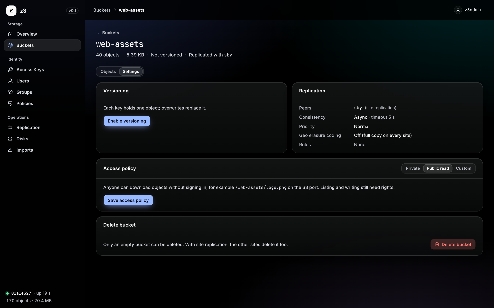

A **bucket policy** is attached to a bucket rather than to a user. Its statements name who they
apply to with a `Principal`, so a bucket policy can grant access to specific users, or to
everyone, including requests **without any credentials**.

```json
{
  "Version": "2012-10-17",
  "Statement": [
    {"Sid": "PublicRead", "Effect": "Allow", "Principal": "*",
     "Action": ["s3:GetObject"], "Resource": ["arn:aws:s3:::web-assets/*"]}
  ]
}
```

| Principal | Means |
| --- | --- |
| `"*"` or `{"AWS": "*"}` | Anyone, including anonymous requests |
| `{"AWS": "arn:aws:iam::z3:user/analyst"}` | The user `analyst` (any account id in the ARN works) |
| `{"AWS": "analyst"}` | The user `analyst`, by name |
| `{"AWS": ["analyst", "reporter"]}` | Several users |

An access key counts as its parent user. A user signed in through
[OIDC or LDAP](/access/openid-connect-ldap) counts under its federated name (`oidc:…`, `ldap:…`).

## Rules

- Every statement needs a `Principal`.
- A bucket policy can name only its own bucket: `arn:aws:s3:::web-assets` and
  `arn:aws:s3:::web-assets/…`.
- It can't grant `admin:` rights.
- [Conditions](/access/conditions) work as in user policies.
- **Deny always wins.** A Deny in the bucket policy refuses a request even if the user's own policy
  allows it, and a Deny in the user's policy can't be overridden by the bucket policy.

## Set the access policy

<Tabs>
  <Tab title="Console">

    Open the bucket, **Settings → Access**, and pick one of three options under **Access policy**:

    | Option | What it does |
    | --- | --- |
    | **Private** | No bucket policy. Only the root account and users whose policies allow it can reach the bucket. |
    | **Public read** | Anyone can download objects without signing in, for example `/web-assets/logo.png` on the S3 port. Listing and writing still need rights. |
    | **Custom** | Your own bucket policy in the JSON editor |

    Click **Save access policy**.

    <Frame>
      
    </Frame>

  </Tab>
  <Tab title="AWS CLI">

    ```bash
    aws --endpoint-url http://localhost:9000 s3api put-bucket-policy --bucket web-assets \
      --policy '{"Version": "2012-10-17", "Statement": [{"Effect": "Allow", "Principal": "*",
                 "Action": ["s3:GetObject"], "Resource": ["arn:aws:s3:::web-assets/*"]}]}'

    aws --endpoint-url http://localhost:9000 s3api get-bucket-policy --bucket web-assets
    aws --endpoint-url http://localhost:9000 s3api delete-bucket-policy --bucket web-assets
    ```

    These need `s3:PutBucketPolicy`, `s3:GetBucketPolicy` and `s3:DeleteBucketPolicy`.

  </Tab>
  <Tab title="Admin API">

    ```bash
    curl -X PUT http://127.0.0.1:9001/api/buckets/web-assets/policy \
      -H "Authorization: Bearer $TOKEN" -H 'content-type: application/json' \
      -d '{"Version": "2012-10-17", "Statement": [{"Effect": "Allow", "Principal": "*",
           "Action": ["s3:GetObject"], "Resource": ["arn:aws:s3:::web-assets/*"]}]}'
    ```

    `GET`, `PUT` and `DELETE /api/buckets/{b}/policy`.

  </Tab>
</Tabs>

## Public read

With **Public read**, any object can be fetched with a plain HTTP GET on the S3 port, using
path-style URLs:

```bash
curl -O http://z3.example.com:9000/web-assets/logo.png
```

Anonymous requests can't list buckets, list the bucket's objects or write, unless you allow those
actions explicitly. To let anyone list the bucket too, add a statement with `s3:ListBucket` on
`arn:aws:s3:::web-assets`.

<Warning>
  Public read means anyone who can reach the S3 port can download every object in the bucket.
  Use it for website assets and public downloads, never for private data.
</Warning>

## Examples

Let another user read and upload into one folder:

```json
{
  "Version": "2012-10-17",
  "Statement": [
    {"Effect": "Allow", "Principal": {"AWS": ["analyst"]},
     "Action": ["s3:GetObject", "s3:PutObject"],
     "Resource": ["arn:aws:s3:::shared/incoming/*"]}
  ]
}
```

Public read, but only through your CDN's addresses:

```json
{
  "Version": "2012-10-17",
  "Statement": [
    {"Effect": "Allow", "Principal": "*", "Action": ["s3:GetObject"],
     "Resource": ["arn:aws:s3:::web-assets/*"],
     "Condition": {"IpAddress": {"aws:SourceIp": ["203.0.113.0/24"]}}}
  ]
}
```

Refuse deletes from everyone except the root account:

```json
{
  "Version": "2012-10-17",
  "Statement": [
    {"Effect": "Deny", "Principal": "*",
     "Action": ["s3:DeleteObject", "s3:DeleteObjectVersion"],
     "Resource": ["arn:aws:s3:::evidence/*"]}
  ]
}
```

The root account isn't bound by policies, so it can still delete. To protect objects from
everyone, use [Object Lock](/storage/object-lock) in compliance mode.

## With replication

Bucket policies are part of IAM: with [site replication](/replication/site-replication) they
reach every site. A deleted bucket takes its policy with it; a new bucket with the same name
starts private.
