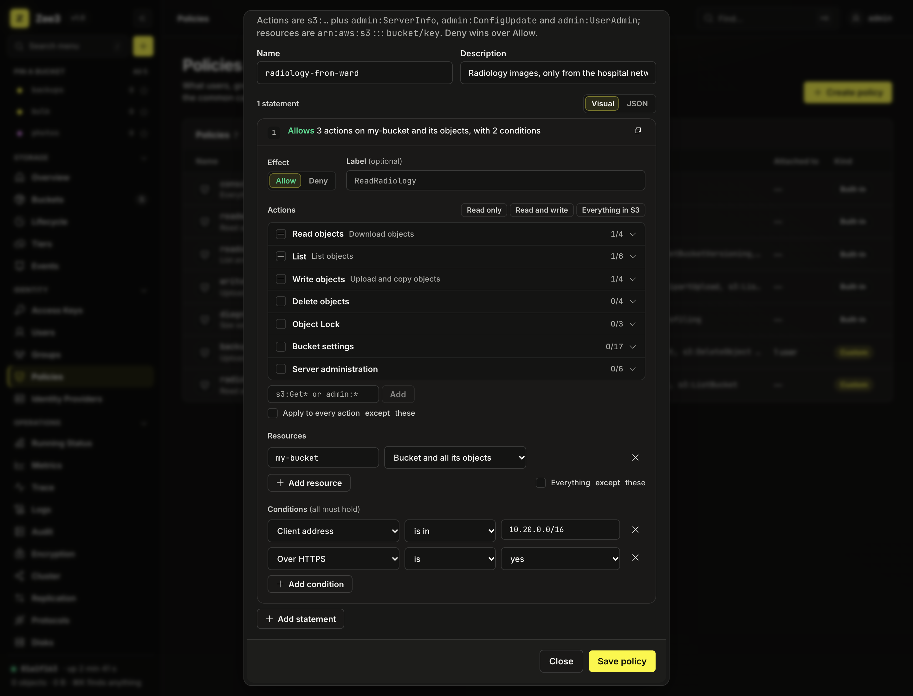

A `Condition` narrows a policy statement: the statement applies only when every condition holds,
for Allow and Deny alike. Conditions work in [user and group policies](/access/policies),
[access key policies](/access/users-groups-keys#access-keys) and
[bucket policies](/access/bucket-policies).

```json
{
  "Effect": "Allow",
  "Action": "s3:ListBucket",
  "Resource": "arn:aws:s3:::home",
  "Condition": {
    "StringLike": {"s3:prefix": ["home/${aws:username}/*"]},
    "IpAddress": {"aws:SourceIp": ["10.0.0.0/8", "192.168.1.0/24"]},
    "Bool": {"aws:SecureTransport": "true"}
  }
}
```

## How conditions are evaluated

- **AND across blocks and keys.** Every operator block must hold, and every key inside it.
- **OR across values.** Within one key, one matching value is enough. For a negated operator
  (`StringNotEquals`, `NotIpAddress` and so on), none of the values may match.
- **Missing keys.** A key the request doesn't carry makes the condition false, except for negated
  operators, the `IfExists` suffix and `ForAllValues:`, which hold. `Null` tests exactly that.
- **Variables.** `${aws:username}`, `${aws:userid}` and any other key in `${…}` are replaced with
  the request's value. `${*}`, `${?}` and `${$}` give a literal `*`, `?` and `$`. Variables are
  replaced in condition values only.

## Operators

| Operator | Compares |
| --- | --- |
| `StringEquals`, `StringNotEquals` | Exact text |
| `StringEqualsIgnoreCase`, `StringNotEqualsIgnoreCase` | Text, ignoring case |
| `StringLike`, `StringNotLike` | Text with `*` and `?` wildcards |
| `NumericEquals`, `NumericNotEquals`, `NumericLessThan`, `NumericLessThanEquals`, `NumericGreaterThan`, `NumericGreaterThanEquals` | Numbers |
| `DateEquals`, `DateNotEquals`, `DateLessThan`, `DateLessThanEquals`, `DateGreaterThan`, `DateGreaterThanEquals` | Times: RFC 3339 (`2026-11-17T08:00:00Z`), a date, or Unix seconds |
| `Bool` | `true` or `false` |
| `IpAddress`, `NotIpAddress` | An IPv4 or IPv6 address against networks (`10.0.0.0/8`) or single addresses |
| `Null` | `true`: the key is absent; `false`: the key is present |

Modifiers:

- **`…IfExists`** suffix (for example `StringEqualsIfExists`): the condition also holds when the
  key is missing. Not for `Null`.
- **`ForAnyValue:`** and **`ForAllValues:`** prefixes, for keys with several values such as
  `s3:RequestObjectTagKeys`: at least one value matches, or every value matches. Not for `Null`.

## Condition keys

| Key | Value |
| --- | --- |
| `aws:SourceIp` | The client address (see [Trusted proxies](#trusted-proxies)) |
| `aws:SecureTransport` | `true` when the request came over HTTPS |
| `aws:CurrentTime`, `aws:EpochTime` | Server time, as RFC 3339 and as Unix seconds |
| `aws:UserAgent`, `aws:Referer` | Headers from the client |
| `aws:username` | The user: the user name, an access key's parent user, or a federated user's name |
| `aws:userid` | The user name, or the access key for an access key |
| `aws:PrincipalType` | `User`, `FederatedUser` or `Anonymous` |
| `s3:prefix`, `s3:delimiter`, `s3:max-keys` | ListObjects parameters |
| `s3:VersionId` | The version asked for |
| `s3:x-amz-server-side-encryption`, `s3:x-amz-server-side-encryption-aws-kms-key-id` | The encryption asked for on PUT |
| `s3:x-amz-storage-class`, `s3:x-amz-copy-source`, `s3:x-amz-metadata-directive` | PUT and copy headers |
| `s3:object-lock-mode`, `s3:object-lock-retain-until-date`, `s3:object-lock-legal-hold` | Object Lock headers |
| `s3:signatureversion` | `AWS4-HMAC-SHA256` for Signature V4, `AWS` for V2 |
| `s3:authType` | `REST-HEADER` or `REST-QUERY-STRING` (presigned URLs) |
| `s3:RequestObjectTagKeys`, `s3:RequestObjectTag/<key>` | Tags from the `x-amz-tagging` header |

Keys are case-insensitive. An unknown key or operator is refused when the policy is saved, and so
is a value that doesn't fit the operator (an address that isn't one, a bad date).

<Note>
  `s3:ExistingObjectTag/<key>`, `s3:x-amz-server-side-encryption-customer-algorithm`,
  `s3:x-amz-acl` and `s3:x-amz-grant-*` aren't supported yet. A policy that uses them is refused
  rather than silently ignored.
</Note>

## Trusted proxies

Zee3 serves plain HTTP. When it sits behind a reverse proxy that handles TLS, the TCP peer is the
proxy, not the client. List the proxy's addresses or networks in the `api.trusted_proxies`
[setting](/operations/settings). Then, **only for requests from those addresses**, Zee3 uses:

- the first address in `X-Forwarded-For` for `aws:SourceIp`, and
- `X-Forwarded-Proto: https` for `aws:SecureTransport`.

Those headers from any other peer are ignored, so clients can't fake their address or HTTPS.
Without a trusted proxy, `aws:SecureTransport` is always `false`.

<Tabs>
  <Tab title="Console">

    Open **Settings → API** and fill in **Trusted proxies**, for example `10.0.0.5` or
    `10.0.0.0/24`.

  </Tab>
  <Tab title="zee3 admin">

    ```bash
    zee3 admin settings set api 'trusted_proxies=["10.0.0.5", "10.0.1.0/24"]'
    ```

  </Tab>
</Tabs>

See [TLS and reverse proxies](/deploy/tls-and-proxies).

## Where conditions apply

- **S3 API**: every key above.
- **Console and admin API**: the connection keys (`aws:SourceIp`, `aws:SecureTransport`,
  `aws:UserAgent`, `aws:Referer`), time and identity. A user whose policy allows access only from
  the office network can't use the console from elsewhere either.
- **File protocols**: `aws:SourceIp` (not for NFS), `aws:SecureTransport` (`true` for FTPS and
  SFTP), and `aws:UserAgent` set to `zee3-webdav`, `zee3-ftp`, `zee3-sftp` or `zee3-nfs`. WebDAV uses the
  client's own user agent when it sends one. See [File protocols](/protocols/overview).

## In the console

In the **Visual** policy editor each statement has a **Conditions** list: pick a key (client
address, HTTPS, time, prefix, user agent, tags, ...), a comparison and the values, separated by
commas. All conditions of a statement must hold. **Add condition** offers ready-made ones (in the
**JSON** view it adds them to the last statement):

| Menu item | Adds |
| --- | --- |
| **Only from a network** | `IpAddress` on `aws:SourceIp` |
| **Only over HTTPS** | `Bool` `aws:SecureTransport` = `true` |
| **Own home folder only** | `StringLike` on `s3:prefix` = `home/${aws:username}/*` |
| **Require encryption** | `StringEquals` on `s3:x-amz-server-side-encryption` = `AES256` or `aws:kms` |
| **Until a date** | `DateLessThan` on `aws:CurrentTime` |
| **Only from one client** | `StringLike` on `aws:UserAgent` |

<Frame>
  
</Frame>

## Examples

Deny everything over plain HTTP:

```json
{"Effect": "Deny", "Action": "s3:*", "Resource": "*",
 "Condition": {"Bool": {"aws:SecureTransport": "false"}}}
```

Only from the office network:

```json
{"Effect": "Allow", "Action": "s3:*", "Resource": ["arn:aws:s3:::reports", "arn:aws:s3:::reports/*"],
 "Condition": {"IpAddress": {"aws:SourceIp": ["10.20.0.0/16"]}}}
```

Refuse uploads without SSE-S3 under one prefix:

```json
{"Effect": "Deny", "Action": "s3:PutObject", "Resource": "arn:aws:s3:::records/secure/*",
 "Condition": {"StringNotEquals": {"s3:x-amz-server-side-encryption": "AES256"}}}
```

Let each user list only their own folder:

```json
{"Effect": "Allow", "Action": "s3:ListBucket", "Resource": "arn:aws:s3:::home",
 "Condition": {"StringLike": {"s3:prefix": ["home/${aws:username}/*"]}}}
```

Access for a contractor that ends on a date:

```json
{"Effect": "Allow", "Action": "s3:GetObject", "Resource": "arn:aws:s3:::handover/*",
 "Condition": {"DateLessThan": {"aws:CurrentTime": "2027-01-01T00:00:00Z"}}}
```

Refuse uploads that carry a `secret` tag:

```json
{"Effect": "Deny", "Action": "s3:PutObject", "Resource": "*",
 "Condition": {"ForAnyValue:StringEquals": {"s3:RequestObjectTagKeys": ["secret"]}}}
```

Only one backup tool may use a key:

```json
{"Effect": "Allow", "Action": "s3:*", "Resource": ["arn:aws:s3:::backups", "arn:aws:s3:::backups/*"],
 "Condition": {"StringLike": {"aws:UserAgent": "*backup-agent*"}}}
```

<Note>
  A user agent is easy to change. Use it to keep honest tools apart, not as a security boundary.
</Note>
