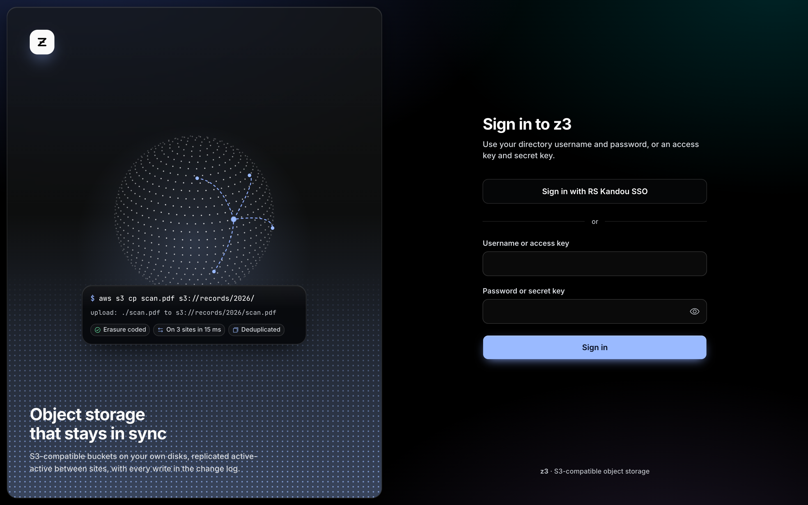
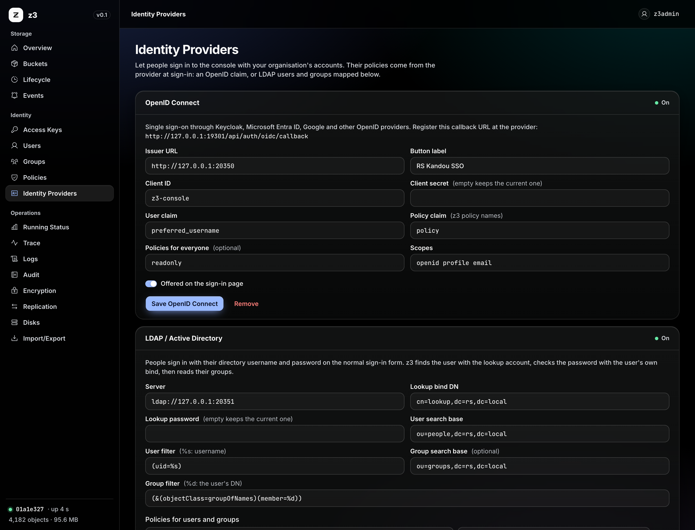

Besides IAM users, people can sign in to the console with their organisation's account:

| Provider | How people sign in | Policies come from |
| --- | --- | --- |
| **OpenID Connect** | A **Sign in with …** button on the sign-in page (Keycloak, Microsoft Entra ID, Google and other OpenID providers) | A claim in the ID token (`policy` by default) plus policies for every OIDC user |
| **LDAP / Active Directory** | The normal sign-in form, with their directory username and password | A mapping of user DNs and group DNs to policies |

<Frame>
  
</Frame>

These are **federated** identities: they aren't stored as IAM users. Their policies are worked out
at sign-in and hold for the session (12 hours, extended while it's in use). They show up as
`oidc:<user>` or `ldap:<user>`. The policies must exist in z3: built-in ones such as `readonly`,
`readwrite` and `consoleAdmin`, or your own. Someone who ends up with no known policy is refused,
with a message that says why.

Setting up providers needs `admin:UserAdmin`. Settings are on the **Identity Providers** page, in
the **OpenID Connect**, **LDAP** and **S3 access (STS)** tabs.

## OpenID Connect

z3 uses the authorization code flow with PKCE:

1. The sign-in button opens `/api/auth/oidc/start`, which redirects to the provider's sign-in page.
2. The provider comes back to `/api/auth/oidc/callback` with a code.
3. z3 exchanges the code at the token endpoint (with the client secret and the PKCE verifier),
   checks the ID token's issuer, audience, expiry and nonce, and opens a console session.

The ID token comes straight from the token endpoint over TLS with client authentication, so the
issuer check over TLS stands in for a signature check here (OIDC Core 3.1.3.7). ID tokens sent to
[STS](/access/sts) are always signature-checked.

<Steps>
  <Step title="Register a client at the provider">
    Create a confidential client (for example `z3-console`) with the authorization code flow, and
    register the callback URL that the **OpenID Connect** tab shows:

    ```text
    https://z3-console.example.com/api/auth/oidc/callback
    ```

    With several sites, register the callback of every site.
  </Step>
  <Step title="Add a policy claim">
    Make the provider put z3 policy names in the ID token, in a claim named `policy` (or any name
    you choose), as an array or a comma-separated string. In Keycloak, for example, add a mapper
    for a user attribute or group membership. You can skip this and give everyone the same
    policies instead.
  </Step>
  <Step title="Fill in z3">
    Open **Identity Providers → OpenID Connect** and fill in the fields below, then click **Save
    OpenID Connect**.
  </Step>
</Steps>

| Field | Meaning |
| --- | --- |
| **Issuer URL** | The provider's base URL; `.well-known/openid-configuration` lives under it |
| **Button label** | The text after "Sign in with" (default "single sign-on") |
| **Client ID** / **Client secret** | The client registered at the provider. The secret is stored sealed and never sent back; leave it empty to keep the current one. |
| **User claim** | The claim with the user name (default `preferred_username`; `email` also works). Falls back to `sub`. |
| **Policy claim** | The claim with z3 policy names (default `policy`) |
| **Policies for everyone** | Policies every OIDC user gets, such as `readonly` |
| **Scopes** | Default `openid profile email` |
| **Redirect URL** | Optional. Empty: z3 builds `<console address>/api/auth/oidc/callback` from the request |

The switch **Offered on the sign-in page** turns the button on or off without deleting the settings.

<Note>
  Behind a reverse proxy, the callback z3 works out may not be the address people use. Set
  **Redirect URL** (or `redirect_url` in `PUT /api/idp/oidc`) to the public callback URL and register
  that one at the provider.
</Note>

## LDAP / Active Directory

<Steps>
  <Step title="Find the user">
    z3 binds with the lookup account and searches for the user with the user filter: `(uid=%s)`
    by default, or `(sAMAccountName=%s)` for Active Directory. The username is escaped (RFC 4515),
    so `*` or parentheses can't inject into the filter.
  </Step>
  <Step title="Check the password">
    z3 binds as the user's own DN with the password they typed.
  </Step>
  <Step title="Read the groups">
    z3 searches for groups with the group filter, where `%d` is the user's DN.
  </Step>
  <Step title="Pick the policies">
    The user's policies are those mapped to their DN plus those mapped to each of their groups.
  </Step>
</Steps>

Open **Identity Providers → LDAP** and fill in:

| Field | Meaning |
| --- | --- |
| **Server** | `ldap://host:389` or `ldaps://host:636` (TLS) |
| **Lookup bind DN** / **Lookup password** | The service account z3 searches with. The password is stored sealed. |
| **User search base** | For example `ou=people,dc=example,dc=com` |
| **User filter** | `%s` is the username. Default `(uid=%s)` |
| **Group search base** | Optional. Where groups live |
| **Group filter** | `%d` is the user's DN. Default `(&(objectClass=groupOfNames)(member=%d))` |
| **Policies for users and groups** | **Add mapping**: a user or group DN, and the policies it gets |

Click **Save LDAP**. Without a mapping, nobody from LDAP can sign in.

**Try a sign-in** at the bottom of the tab: enter a username and password and click **Check**. z3
tries the sign-in without opening a session and shows the DN, the groups and the policies the
person would get.

<Frame>
  
</Frame>

With LDAP on, the sign-in form asks for **Username or access key** and **Password or secret key**.
z3 tries IAM identities first; credentials that don't belong to one are tried against LDAP. A wrong
LDAP password is slowed down, like any failed sign-in.

## Applications and scripts

Federated users can't create access keys. For programs, either create an IAM user with
[access keys](/access/users-groups-keys), or let the program trade an ID token or LDAP password for
[temporary S3 credentials](/access/sts).

## With replication

Provider settings are stored as IAM documents with their secrets sealed. With
[site replication](/replication/site-replication) they reach every site, so OIDC and LDAP sign-in
(and STS sessions) work on every site.

## Admin API

| Endpoint | What it does |
| --- | --- |
| `GET /api/auth/providers` | Public: the providers offered on the sign-in page |
| `GET /api/auth/oidc/start`, `GET /api/auth/oidc/callback` | Public: the OIDC sign-in flow |
| `GET/PUT/DELETE /api/idp/oidc` | OIDC settings. The secret is never returned (`has_secret`). |
| `GET/PUT/DELETE /api/idp/ldap` | LDAP settings |
| `POST /api/idp/ldap/test` | `{"username", "password"}`: DN, groups and policies, without a session |
| `POST /api/auth/login` | Sign-in for IAM identities and LDAP users alike |

```bash
curl -X PUT http://127.0.0.1:9001/api/idp/ldap \
  -H "Authorization: Bearer $TOKEN" -H 'content-type: application/json' \
  -d '{"url": "ldaps://dc01.example.com:636",
       "lookup_bind_dn": "cn=z3,ou=services,dc=example,dc=com", "secret": "lookup-password",
       "user_search_base": "ou=people,dc=example,dc=com", "user_search_filter": "(sAMAccountName=%s)",
       "group_search_base": "ou=groups,dc=example,dc=com",
       "policy_map": {"cn=storage-admins,ou=groups,dc=example,dc=com": ["consoleAdmin"],
                      "cn=radiology,ou=groups,dc=example,dc=com": ["readwrite"]}}'
```

## Not supported yet

- More than one OIDC provider at a time, and sign-out at the provider.
- StartTLS for LDAP. Use `ldaps://`.
- Federated sign-in over the [file protocols](/protocols/overview). Use access keys there.
