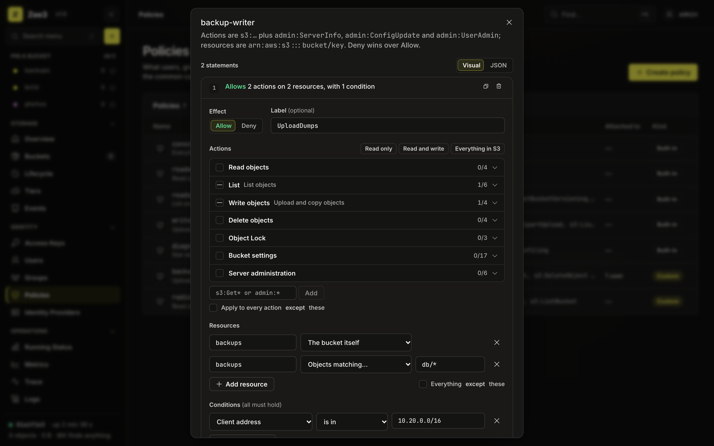
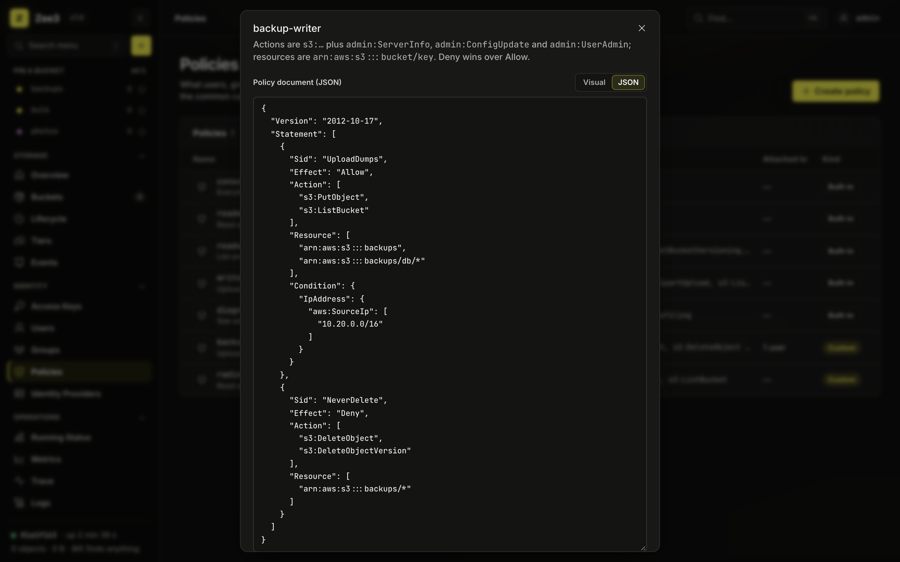

A **policy** is a JSON document that allows or denies actions on buckets and objects. Policies are
attached to [users and groups](/access/users-groups-keys), narrow
[access keys](/access/users-groups-keys#access-keys), and come from the identity provider for
[OIDC and LDAP](/access/openid-connect-ldap) sign-ins. The same policies decide S3 requests, the
console, the admin API and the [file protocols](/protocols/overview).

## Format

Zee3 uses the AWS IAM policy format:

```json
{
  "Version": "2012-10-17",
  "Statement": [
    {
      "Effect": "Allow",
      "Action": ["s3:GetObject", "s3:PutObject", "s3:ListBucket"],
      "Resource": ["arn:aws:s3:::radiology", "arn:aws:s3:::radiology/*"]
    },
    {
      "Effect": "Deny",
      "Action": "s3:DeleteObject",
      "Resource": "arn:aws:s3:::radiology/final/*"
    }
  ]
}
```

| Element | Meaning |
| --- | --- |
| `Version` | `2012-10-17` (the default when left out) |
| `Statement` | One or more statements. A policy needs at least one. |
| `Sid` | An optional name for the statement |
| `Effect` | `Allow` or `Deny` |
| `Action` / `NotAction` | Exactly one of them. `s3:…` and `admin:…` actions, or `*`. Wildcards `*` and `?` work (`s3:Get*`). Actions are case-insensitive. |
| `Resource` / `NotResource` | `arn:aws:s3:::bucket` for a bucket, `arn:aws:s3:::bucket/key` for objects, or `*`. Wildcards `*` and `?` work. A statement with only `admin:` actions needs no resource. |
| `Condition` | Optional limits on address, HTTPS, time, prefix, headers or tags. See [Conditions](/access/conditions). Variables such as `${aws:username}` are replaced in condition values only, not in `Resource`. |

`Principal` belongs only in [bucket policies](/access/bucket-policies). Zee3 checks every policy when
it's saved and refuses unknown actions, malformed resources and unknown condition keys or
operators, with a message naming the statement.

## How a request is decided

1. The root account may do anything.
2. Otherwise, an explicit **Deny** in any policy that applies refuses the request. **Deny always
   wins.**
3. Otherwise, an **Allow** in one of the caller's policies (its own, its enabled groups', or a
   provider's) or in the bucket policy grants it.
4. Otherwise, the request is refused.

An access key with its own policy needs an Allow from **both** its user's policies and its own
policy. Anonymous requests can only be allowed by a [bucket policy](/access/bucket-policies).

[Temporary credentials](/access/sts) with **session policies** (`Policy` or `PolicyArns` on an STS
request) narrow the same way: a request needs an Allow from a session policy **and** from the
identity behind the session (its policies, or a bucket policy), and a Deny in any of them wins.
Session policies never add permissions, and narrow bucket-policy grants too.

## S3 actions

Each S3 operation is checked as an IAM action, mostly with the same name (`PutObject` →
`s3:PutObject`). The ones that differ:

| Operation | Action |
| --- | --- |
| `GetObject`, `HeadObject` | `s3:GetObject`, or `s3:GetObjectVersion` with a `versionId` |
| `DeleteObject` | `s3:DeleteObject`, or `s3:DeleteObjectVersion` with a `versionId` |
| `Get/Put/DeleteObjectTagging` | `s3:GetObjectTagging`, `s3:PutObjectTagging`, `s3:DeleteObjectTagging` (the `…VersionTagging` actions with a `versionId`) |
| `HeadBucket`, `ListObjects`, `ListObjectsV2` | `s3:ListBucket` |
| `ListObjectVersions` | `s3:ListBucketVersions` |
| `ListMultipartUploads` | `s3:ListBucketMultipartUploads` |
| `ListParts` | `s3:ListMultipartUploadParts` |
| `CopyObject`, `CreateMultipartUpload`, `UploadPart`, `CompleteMultipartUpload` | `s3:PutObject` |
| `Get/Put/DeleteBucketLifecycle…` | `s3:GetLifecycleConfiguration`, `s3:PutLifecycleConfiguration` (also for delete) |
| `Get/Put/DeleteBucketEncryption` | `s3:GetEncryptionConfiguration`, `s3:PutEncryptionConfiguration` (also for delete) |
| `Get/PutBucketNotificationConfiguration` | `s3:GetBucketNotification`, `s3:PutBucketNotification` |
| `Get/PutObjectLockConfiguration` | `s3:GetBucketObjectLockConfiguration`, `s3:PutBucketObjectLockConfiguration` |
| `DeleteBucketTagging` | `s3:PutBucketTagging` |

A few operations check more than one thing:

- **CopyObject** also needs read access to the source (`s3:GetObject`, or `s3:GetObjectVersion`
  for a specific version).
- **DeleteObjects** checks every key on its own.
- **ListBuckets** returns only the buckets the caller may use; anonymous callers can't list buckets.
- Shortening or removing governance retention also needs `s3:BypassGovernanceRetention`. See
  [Object Lock](/storage/object-lock#permissions).

The console's bucket and object pages check the same S3 actions, so every user can work in the
console within their own rights.

## Admin rights

The console and the admin API use a few coarse `admin:` rights. Grant them in a statement without a
resource:

| Right | Allows |
| --- | --- |
| `admin:ServerInfo` | Reading server state: overview, running status, metrics, replication, disks and pools, imports, settings, tiers, batch jobs, events and audit targets, bucket quota, trace and logs, health checks |
| `admin:ConfigUpdate` | Changing server state: replication, site replication and peers, healing and GC, imports, settings and protocols, tiers, KMS keys, batch jobs, events and audit targets, bucket quota, pools |
| `admin:UserAdmin` | Managing users, groups, policies, everyone's access keys, and the identity providers (OIDC, LDAP, STS) |
| `admin:Profiling` | Running speed tests and recording CPU profiles ([Support](/operations/support)) |
| `admin:InspectData` | Downloading the raw files of an object through inspect ([Support](/operations/support)) |
| `admin:Prometheus` | Scraping MinIO's metrics paths on the S3 port with a `mc admin prometheus generate` token ([Prometheus metrics](/operations/prometheus#minios-metrics-paths)) |

`admin:*` grants all of them. A route answers `403` with "this needs the `admin:…` permission"
when the caller lacks the right.

```json
{
  "Version": "2012-10-17",
  "Statement": [
    {"Effect": "Allow", "Action": ["admin:ServerInfo"]},
    {"Effect": "Allow", "Action": ["s3:ListAllMyBuckets", "s3:ListBucket", "s3:GetObject"],
     "Resource": ["arn:aws:s3:::*"]}
  ]
}
```

## Built-in policies

These exist on every node and can't be changed or deleted:

| Policy | Grants |
| --- | --- |
| `consoleAdmin` | Everything: `admin:*` and `s3:*` on all buckets |
| `readwrite` | `s3:*` on every bucket and object |
| `readonly` | List and read every bucket and object: `s3:GetBucketLocation`, `s3:GetBucketVersioning`, `s3:GetObject`, `s3:GetObjectVersion`, `s3:GetObjectTagging`, `s3:GetObjectVersionTagging`, `s3:ListAllMyBuckets`, `s3:ListBucket`, `s3:ListBucketVersions` |
| `writeonly` | Upload into every bucket without reading or listing: `s3:PutObject`, `s3:AbortMultipartUpload`, `s3:ListMultipartUploadParts`, `s3:ListAllMyBuckets` |
| `diagnostics` | See server status, run health checks, speed tests and profiles, without data access: `admin:ServerInfo`, `admin:Profiling` |

## Create a policy

<Tabs>
  <Tab title="Console">

    1. Open **Policies** and click **Create policy**.
    2. Enter a **Name** and an optional **Description**.
    3. Build the policy in the **Visual** editor: each statement is a card with **Allow** or
       **Deny**, the actions grouped by what they do (with **Read only**, **Read and write** and
       **Everything in S3** shortcuts), the buckets and prefixes it covers, and optional
       [conditions](/access/conditions). Switch to **JSON** to see or edit the raw document; both
       views edit the same policy. A document the visual editor can't show opens in **JSON**.
    4. Save, then attach the policy to users or groups.

    <Frame>
      
    </Frame>

    <Frame>
      
    </Frame>

  </Tab>
  <Tab title="Admin API">

    ```bash
    curl -X PUT http://127.0.0.1:9001/api/iam/policies/radiology-rw \
      -H "Authorization: Bearer $TOKEN" -H 'content-type: application/json' \
      -d '{"description": "Read and write the radiology bucket",
           "doc": {"Version": "2012-10-17", "Statement": [
             {"Effect": "Allow", "Action": ["s3:GetObject", "s3:PutObject", "s3:ListBucket"],
              "Resource": ["arn:aws:s3:::radiology", "arn:aws:s3:::radiology/*"]}]}}'
    ```

    `GET /api/iam/policies` lists built-in and custom policies, with where each is attached.

  </Tab>
</Tabs>

Policy names follow the same rules as user names (3 to 64 characters). A policy that is still
attached to a user or group can't be deleted; the error names them.

## Examples

One bucket, read and write, and nothing else:

```json
{
  "Version": "2012-10-17",
  "Statement": [
    {"Effect": "Allow", "Action": ["s3:ListBucket", "s3:ListBucketVersions"],
     "Resource": "arn:aws:s3:::invoices"},
    {"Effect": "Allow", "Action": ["s3:GetObject", "s3:PutObject", "s3:DeleteObject"],
     "Resource": "arn:aws:s3:::invoices/*"}
  ]
}
```

Everything except deleting:

```json
{
  "Version": "2012-10-17",
  "Statement": [
    {"Effect": "Allow", "NotAction": "s3:Delete*", "Resource": ["arn:aws:s3:::logs", "arn:aws:s3:::logs/*"]}
  ]
}
```

More examples with conditions are on the [Conditions](/access/conditions#examples) page.
