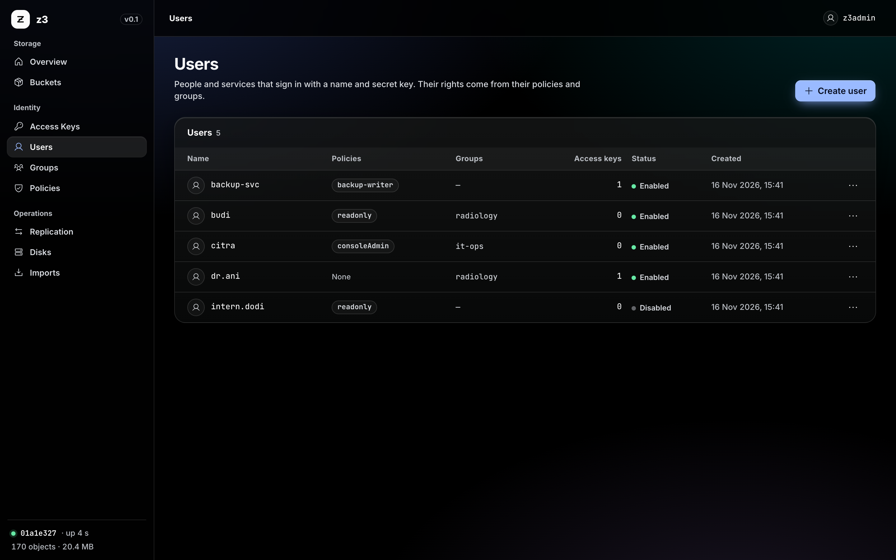
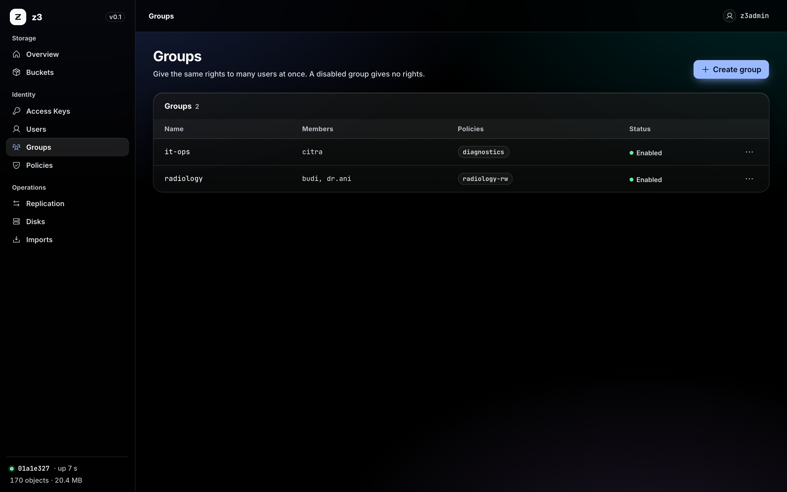
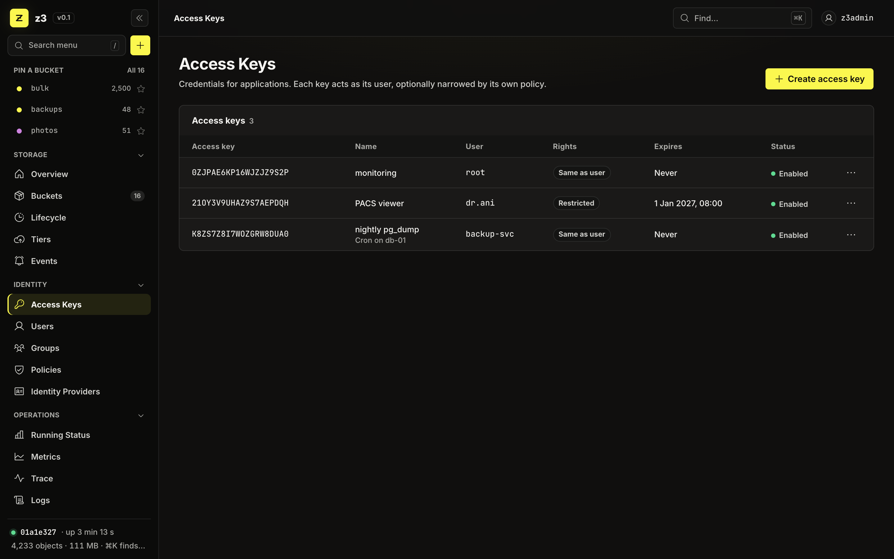
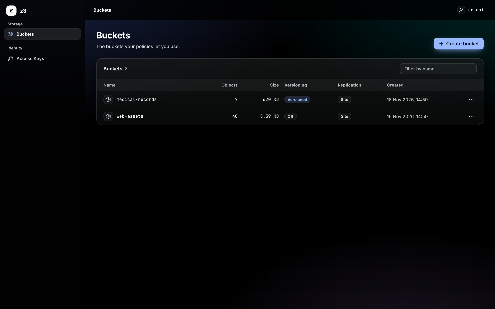

Zee3 has its own identities, so every person and application gets only the rights it needs. The same
identities sign S3 requests and sign in to the console. What each one may do comes from
[policies](/access/policies).

| Identity | Signs in with | Rights |
| --- | --- | --- |
| **Root** | The keys chosen on the setup page, or `ZEE3_ACCESS_KEY` / `ZEE3_SECRET_KEY` | Everything. Can't be limited or deleted. |
| **User** | Its name as the access key, plus its secret key | Its own policies plus those of its enabled groups |
| **Access key** | An access key (20 characters) and secret key (40 characters) | The same as its parent user, or less when it has its own policy |
| **Temporary credentials** | A `ZSTS…` access key, secret key and session token from [STS](/access/sts) | The identity behind them (a user, an access key, or an OIDC or LDAP user), narrowed by session policies if any. S3 API only |

People can also sign in through [OpenID Connect or LDAP](/access/openid-connect-ldap) without a
Zee3 user; their policies come from the identity provider.

The root credentials come from the environment (`ZEE3_ACCESS_KEY` and `ZEE3_SECRET_KEY`) when set,
otherwise from the console's setup page on a node's first start: chosen there, or taken over from the
node it joined, so the same root account signs in on every site that joined this way. Their secret
also seals the secrets Zee3 stores, so the console can't change it later. See
[Root credentials](/deploy/configuration#root-credentials).

<Warning>
  Use root only to administer Zee3. Give people and applications users and access keys for everyday
  work. A data directory from an older version that never had root credentials set keeps the
  built-in `zee3admin` / `zee3admin-secret`: set your own with the variables before Zee3 is reachable
  on a network, and before it stores user secrets or KMS keys.
</Warning>

<Frame>
  
</Frame>

## Users

A user's name is also its access key. Names are 3 to 64 characters: letters, digits and
`+ = , . @ - _` (and not `root`). Secret keys are 8 to 128 characters without spaces.

<Tabs>
  <Tab title="Console">

    1. Open **Users** and click **Create user**.
    2. Enter the **Name (access key)** and a **Secret key**.
    3. Pick one or more **Policies**, such as `readwrite` or a policy of your own.
    4. Save.

    Click a user to edit its policies, change its secret key, or turn it off.

  </Tab>
  <Tab title="Admin API">

    ```bash
    curl -X POST http://127.0.0.1:9001/api/iam/users \
      -H "Authorization: Bearer $TOKEN" -H 'content-type: application/json' \
      -d '{"name": "radiology-app", "secret_key": "a-long-secret-key", "policies": ["readwrite"]}'

    # turn off, change policies or secret
    curl -X PUT http://127.0.0.1:9001/api/iam/users/radiology-app \
      -H "Authorization: Bearer $TOKEN" -H 'content-type: application/json' \
      -d '{"enabled": false}'
    ```

    See [Admin API: IAM](/api/admin-iam).

  </Tab>
</Tabs>

- **Turning a user off** stops its S3 requests, its console sessions and all its access keys at
  once, because the identity is looked up again on every request.
- **Deleting a user** also deletes its access keys and removes it from every group.

## Groups

A group gives its policies to all its members. A user gets the policies of every **enabled** group
it belongs to, on top of its own.

<Tabs>
  <Tab title="Console">

    Open **Groups** and click **Create group**. Enter a **Name**, pick **Members** and
    **Policies**, and save. Turning a group off takes its policies away from its members without
    deleting it.

    <Frame>
      
    </Frame>

  </Tab>
  <Tab title="Admin API">

    ```bash
    curl -X POST http://127.0.0.1:9001/api/iam/groups \
      -H "Authorization: Bearer $TOKEN" -H 'content-type: application/json' \
      -d '{"name": "radiology", "members": ["analyst", "reporter"], "policies": ["readonly"]}'
    ```

  </Tab>
</Tabs>

Group names follow the same rules as user names. Members must be existing users.

## Access keys

An **access key** is a separate set of credentials for an application or script that acts as its
parent user. Use one per application, so you can turn off or delete one without touching the
others.

- An access key can do what its user can do. With its **own policy** it can do only what both its
  user **and** that policy allow: the policy narrows, never widens.
- It can have an **expiry**. After that moment it stops working.
- The secret key is shown **once**, when the key is created.
- Turning off or deleting the parent user stops its access keys too.
- A user or access key can trade its credentials for short-lived ones with STS
  [`AssumeRole`](/access/sts#with-an-iam-user-or-access-key), optionally narrowed by a session
  policy. The root account and its access keys can't.

<Tabs>
  <Tab title="Console">

    1. Open **Access Keys** and click **Create access key**.
    2. Give it a **Name** and an optional **Description**.
    3. IAM admins can pick **For user**; everyone else creates keys for themselves.
    4. Set **Expires**, or leave it at **Never**.
    5. To narrow it, turn on **Restrict with a policy** and edit the policy. The key can then do
       only what both its user and this policy allow.
    6. Create it, and copy the secret key from **Access key created**. It isn't shown again.

    The list shows each key's user, expiry (soon-to-expire keys are highlighted) and whether it is
    **Restricted** or **Same as user**.

    <Frame>
      
    </Frame>

  </Tab>
  <Tab title="Admin API">

    ```bash
    curl -X POST http://127.0.0.1:9001/api/iam/access-keys \
      -H "Authorization: Bearer $TOKEN" -H 'content-type: application/json' \
      -d '{"parent": "radiology-app", "name": "backup job",
           "expires_ms": 1798761600000,
           "policy": {"Version": "2012-10-17", "Statement": [
             {"Effect": "Allow", "Action": ["s3:PutObject"], "Resource": ["arn:aws:s3:::backups/*"]}]}}'
    # {"access_key": "Q3Z8...", "secret_key": "..."}
    ```

    Leave out `parent` to create a key for yourself. `PUT /api/iam/access-keys/{key}` changes
    `enabled`, `name`, `description`, `expires_ms` and `policy`; `clear_expiry` and
    `clear_policy` remove them.

  </Tab>
</Tabs>

Who may manage access keys:

- **Every user** can create, change and delete their own access keys, from the **Access Keys**
  page, even without admin rights.
- **IAM admins** (`admin:UserAdmin`) can manage everyone's keys, including keys for the root
  account.
- An access key can't create more access keys (unless it has `admin:UserAdmin`): sign in as the
  user instead.
- People signed in through OIDC or LDAP can't create access keys. Give them an IAM user, or let
  applications use [temporary credentials](/access/sts) (`AssumeRoleWithWebIdentity`,
  `AssumeRoleWithLDAPIdentity`).

## Who sees what in the console

The console signs in with any identity: root, a user, or an access key. Menus and pages follow
the caller's rights. A user without admin rights sees only **Buckets** and **Access Keys**, and
only the buckets their policies let them use.

<Frame>
  
</Frame>

Managing users, groups and policies needs `admin:UserAdmin`. See [Policies](/access/policies) for
the admin rights.

## How secrets are stored

- Secret keys of users and access keys are stored encrypted (AES-256-GCM) with a key derived from
  the root secret key.

  <Warning>
    If you change `ZEE3_SECRET_KEY`, stored secrets can no longer be opened. Users and access keys
    then need new secrets.
  </Warning>

- With [site replication](/replication/site-replication), users, groups, policies, access keys
  and bucket policies reach every site. In the site log, secrets are sealed with a key derived
  from the tokens of every site in the group, so each site can open them even when the sites have
  different root secrets. Conflicting changes are settled by timestamp, and deletes leave
  tombstones.
