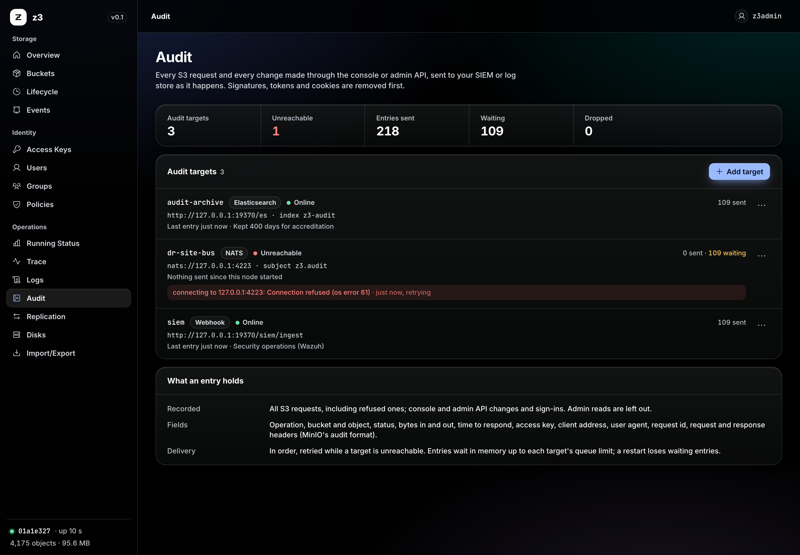

Zee3 can send an **audit entry** for every S3 request and every change made through the console or
the admin API to one or more **audit targets**: a SIEM, a log store, a stream. Entries use MinIO's
audit log format, so tools that already read MinIO audit logs work unchanged.

<Frame>
  
</Frame>

## What is recorded

- **Every S3 request**, including refused ones (bad signature, access denied). A request refused
  before Zee3 knows its operation is recorded as `Unauthenticated`, with the access key it claimed
  and the bucket and object from its path.
- **Every change through the console and the admin API**: every call that is not a `GET`,
  including failed sign-ins. Reads of the admin API are not sent to audit targets; they still show
  in the [live trace](/audit/trace-and-logs).

Each node sends entries for the requests it serves. S3 requests never wait for audit delivery.

## Audit targets

Audit targets use the same settings as [event destinations](/events/destinations), but only these
types:

| Type | What each entry becomes |
| --- | --- |
| `webhook` | A `POST` of the entry as JSON |
| `redis` | `RPUSH` to a list |
| `nats` | `PUB` to a subject |
| `elasticsearch` | A new document in the index |
| `kafka` | A record on an existing topic, with SASL and TLS as for Kafka event destinations |

Audit entries are a stream, so `format` is always `access`. AMQP, MQTT, NSQ, PostgreSQL and MySQL
are for bucket events only.

<Tabs>
  <Tab title="Console">

Go to **Audit → Add target**. **Send test entry** sends one test entry to the target as entered and
shows the error if it fails.

  </Tab>
  <Tab title="Admin API">

```bash
curl -X PUT http://127.0.0.1:9001/api/audit/targets/siem \
  -H "Authorization: Bearer $TOKEN" -H "Content-Type: application/json" \
  -d '{"kind": "kafka", "endpoint": "k1:9092,k2:9092", "key": "zee3-audit",
       "user": "zee3", "secret": "kafka-password", "sasl": "scram-sha-512", "tls": true}'
```

See [Events and audit API](/api/admin-events-audit#audit-targets).

  </Tab>
</Tabs>

Changing audit targets needs `admin:ConfigUpdate`; seeing them needs `admin:ServerInfo`. Like
event destinations, secrets are stored sealed and never shown again.

## Entry format

```json
{
  "version": "1",
  "deploymentid": "01a1e9a0-be79-7462-83e2-8685ea015598",
  "time": "2026-11-17T09:08:44.787Z",
  "trigger": "incoming",
  "api": {
    "name": "PutObject",
    "bucket": "medical-records",
    "object": "reports/2026-11/p-0353.pdf",
    "status": "OK",
    "statusCode": 200,
    "rx": 5490,
    "tx": 0,
    "timeToResponse": "108000000ns"
  },
  "remotehost": "10.0.0.9",
  "requestID": "1A1E70C991C0000CB",
  "userAgent": "aws-cli/2.17",
  "requestPath": "/medical-records/reports/2026-11/p-0353.pdf",
  "requestHost": "s3.example.internal:9000",
  "requestQuery": {},
  "requestHeader": { "authorization": "AWS4-HMAC-SHA256 Credential=AKIA.../20261117/us-east-1/s3/aws4_request, SignedHeaders=..., Signature=REDACTED" },
  "responseHeader": { "etag": "\"5d41402abc4b2a76b9719d911017c592\"", "x-amz-request-id": "1A1E70C991C0000CB" },
  "accessKey": "zee3admin",
  "tags": { "kind": "s3" }
}
```

| Field | Meaning |
| --- | --- |
| `deploymentid` | The node that served the request |
| `api.name` | The S3 operation (`PutObject`), or for the admin API the route, like `PUT /api/buckets/{bucket}/policy` |
| `api.status`, `api.statusCode` | The HTTP status |
| `api.rx`, `api.tx` | Request and response body sizes, from `Content-Length` |
| `api.timeToResponse` | Time until the response headers were sent |
| `remotehost` | The client address (the first `X-Forwarded-For` or `X-Real-IP` address when present) |
| `requestID` | The same value as the `x-amz-request-id` header the client got, so a user's complaint can be matched to its entry |
| `accessKey` | The access key of the request (for the admin API, the signed-in user) |
| `tags.kind` | `s3` or `admin` |

### Redaction

Secrets never leave the node. Before an entry is recorded:

- the signature in `Authorization` becomes `REDACTED` (SigV4 `Signature=REDACTED`, SigV2
  `AWS <key>:REDACTED`, console `Bearer REDACTED`);
- `Cookie`, `Set-Cookie`, `X-Amz-Security-Token` and the SSE-C key headers are replaced by
  `REDACTED`;
- in the query, `X-Amz-Signature`, `X-Amz-Security-Token`, `Signature` and `token` are redacted.

The same redaction applies to the trace.

## Delivery and the on-disk queue

- Entries go to each target in order, and are retried while the target cannot be reached, with a
  pause from 1 to 60 seconds.
- Each target has its own queue of at most `queue_limit` entries (10,000 by default, at most
  1,000,000). When it is full, the **oldest** entry is dropped and counted as *dropped*, so what
  gets sent later is always the newest.
- The queue survives restarts. As soon as a target cannot be reached, or more than 256 entries
  wait, every waiting entry is saved on disk as a local document `auq/<target>/<seq>`, and new
  ones follow in batches. After a restart they are loaded and sent in their original order. A
  clean shutdown (`SIGTERM`) also saves what still waits.
- While a target is healthy, entries are sent straight from memory without touching the disk. A
  node that dies suddenly while its targets are healthy can lose the few entries being sent.
- Delivery is *at least once*: an entry sent just before a crash can be sent twice. Use
  `requestID` to drop duplicates.
- A disabled target receives no new entries; its queue stays and is sent when it is enabled
  again. Deleting a target throws its queue away.

The Audit page and `GET /api/audit` show for each target: `queued`, `sent`, `failed`, `dropped`,
`online`, `last_error`, and `queue.on_disk` (entries saved on disk) and `queue.limit`. The `sent`,
`failed` and `dropped` counters start from zero when the node starts; the queue itself survives.

## With site replication

Audit targets and their secrets reach every site, like event destinations. Each site sends the
entries of the requests it serves; `deploymentid` says which node sent an entry. Audit targets are
also part of [config export and import](/operations/config-export).
