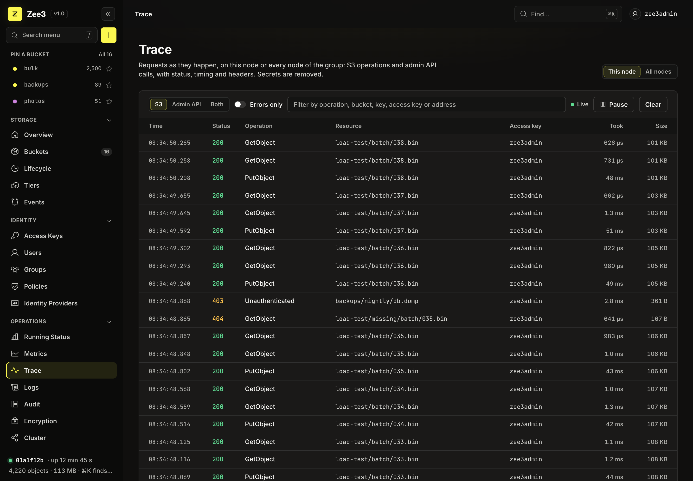
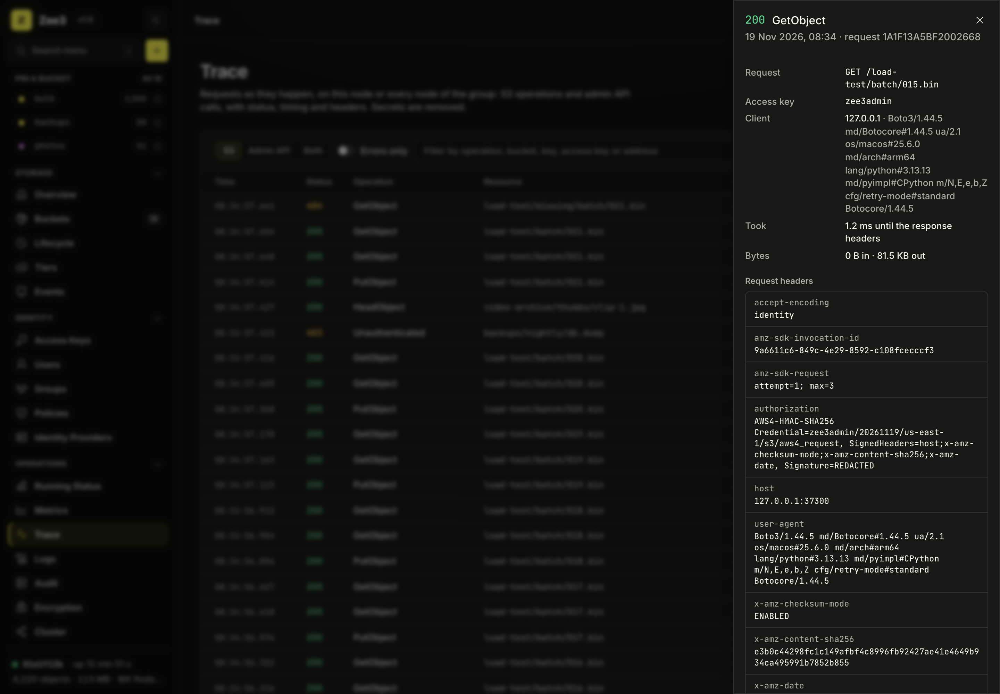
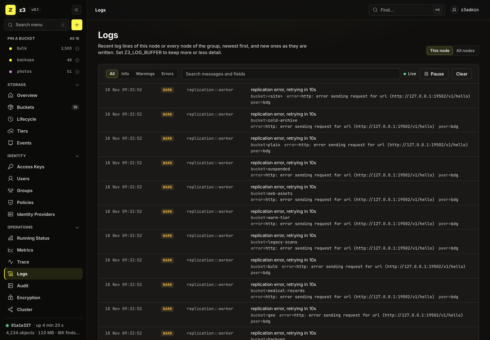

Two views show what a node is doing:

- **Trace**: S3 and admin API requests as they happen, with status, timing and headers.
- **Logs**: the server's log lines, live as they are written, or from the
  [history on disk](#log-history-on-disk), also from before the last restart.

Both show the node you are signed in to, or every node of the group at once
([All nodes](#all-nodes)), in the console or with [`z3 admin logs` and `z3 admin trace`](/cli/logs).
Reading them needs `admin:ServerInfo`. Secrets are [redacted](/audit/audit-log#redaction) as in
the audit log.

## Trace

<Frame>
  
</Frame>

The Trace page lists the latest requests (the node keeps the last 500), then new ones live. Filter
by **S3**, **admin API** or both, show **errors only** (status 400 and up), and search by
operation, path, bucket, key, access key or client address. **Pause** stops the stream without
leaving the page. Click a row for the details and the request and response headers.

<Frame>
  
</Frame>

- **Took** is the time until the response headers were sent.
- Sizes come from `Content-Length` of the request and the response (`HEAD` sends no body).

## Logs

<Frame>
  
</Frame>

The Logs page has two modes, with the same level filter (a level shows itself and everything
more severe) and search in messages and fields:

- **Live**: the latest log lines (the last 2,000 are kept in memory), then new lines as they are
  written. **Pause** stops the stream.
- **History**: lines from the [history on disk](#log-history-on-disk), also from before the node
  last restarted. Pick a time range (presets from the last 15 minutes to the last 7 days,
  everything kept, or your own **From** and **To**). The page shows the newest 500 lines of the
  range, and **Load older** fetches the 500 before them. Above the list, the page shows how much
  history the node keeps, since when, its limits, and any lines that could not be written.

What the console keeps is set separately from what the server prints:

| Setting | Startup default | Controls |
| --- | --- | --- |
| `logger.console_level` | `Z3_LOG_BUFFER` (`info`) | What the Logs page keeps, in memory and on disk |
| `logger.level` | `RUST_LOG` (`info`) | What the server writes to standard output |

Both are tracing filters (`info`, or `warn,z3_server=debug`) and can be changed at runtime in
[Settings](/operations/settings#logging). With `RUST_LOG=warn`, for example, the Logs page still
shows info lines.

### Log history on disk

Every line the Logs page keeps is also written to `<data dir>/logs/` on that node, as rotating
JSON Lines files (`.jsonl`) with one line per log line, in the same format as the API. Log
history survives restarts.

| Setting | Default | Meaning |
| --- | --- | --- |
| `logger.history_max_mb` | `64` | The most the history may take, in MiB. The oldest files are deleted first. `0` turns the history off and deletes its files |
| `logger.history_days` | `7` | Files last written longer ago than this are deleted. `0`: only the size limit applies |

Change them in **Settings → Logging** or with
[`z3 admin settings`](/cli/settings); they apply without a restart.

- Lines are written in the background, so requests and logging never wait for the disk.
- If the disk is full or can't be written, the server keeps running: lines are dropped and
  counted, and the **Log history** [health check](/operations/support#health) turns to warn.
- A crash can lose the last few lines still buffered; a clean shutdown writes them all.
- The history belongs to its node: it is not replicated.
- Time ranges use each node's clock and assume it moves forward. A node whose clock is off shows up
  in the wrong place when nodes are merged, as in live mode.

<Note>
  Trace history is kept in memory only: the last 500 requests since the node started.
</Note>

## All nodes

On the Trace and Logs pages (live and history), **This node / All nodes** at the top right merges
the requests or lines of every node into one list, ordered by time. The **Node** column shows where
each row comes from (the site or peer name), and the node picker in the toolbar narrows it to one
node.

A node that cannot be reached shows in a line under the toolbar with the reason; the other nodes
keep showing and z3 keeps retrying it. In history mode, a node on an older z3 that has no log
history is named there too; only its recent lines in memory are shown.

"All nodes" means this node plus the members of [site replication](/replication/site-replication)
and the replication peers, each once (recognised by endpoint). In a hub-and-spoke topology, a
spoke still sees every site, because the site configuration holds every site's endpoint and token.

### How it works

Every node serves its own trace and logs on the peer API (port 9002, `Z3_PEER_ADDR`), with the same
token as replication (`Z3_PEER_TOKEN`):

| Peer endpoint | Returns |
| --- | --- |
| `GET /v1/trace?kind=&errors=&q=&limit=` | Recent requests, as a JSON array |
| `GET /v1/trace/stream?kind=&errors=&q=` | New requests, as newline-delimited JSON |
| `GET /v1/logs?level=&q=&limit=&since=&until=&history=` | Recent log lines, or lines from the history on disk |
| `GET /v1/logs/stream?level=&q=&since=` | New log lines (with `since`: first the lines since then) |

- Filters run on the node that has the data, so only matching rows cross the network.
- Streams send an empty line every 10 seconds; a stream silent for 35 seconds counts as broken and
  is reconnected, with a pause from 1 to 30 seconds.
- Answers carry the serving node's id in `x-z3-node-id`. History queries also carry
  `x-z3-history: disk`, or `memory` when the history is off on that node.
- Streams end when a node shuts down, so nodes still stop quickly.

The node you opened in the console forwards your filters to every node, merges the answers, and
tags each entry with `node` (the node id) and `node_name` (the site or peer name; for itself, its
site name or the start of its node id).

## API

| Endpoint | Returns |
| --- | --- |
| `GET /api/trace?kind=&errors=&q=&limit=&scope=` | Recent requests, newest first (`limit` 200 by default, at most 500) |
| `GET /api/trace/stream?kind=&errors=&q=&scope=` | New requests, as server-sent events |
| `GET /api/logs?level=&q=&limit=&scope=&since=&until=&history=` | Recent log lines, or lines from the history on disk, oldest first |
| `GET /api/logs/stream?level=&q=&scope=&since=` | New log lines, as server-sent events |
| `GET /api/logs/history` | The state of this node's log history on disk |

- Without `since`, `until` or `history=true`, `GET /api/logs` reads memory (`limit` 500 by default,
  at most 2,000).
- With any of them, it reads the history on disk: the newest `limit` lines (500 by default, at most
  5,000) with `since <= time_ms <= until`, oldest first. `since` and `until` are Unix milliseconds
  or RFC 3339 times.
- On the stream, `since` first sends the newest lines since then, then new lines.

With `scope=all` the lists become `{"entries": [...], "nodes": [...]}`, and the streams send a
`nodes` event once at the start and again whenever a node's state changes. See
[Events and audit API](/api/admin-events-audit#logs) for every field.

```bash
curl -N -H "Authorization: Bearer $TOKEN" \
  "http://127.0.0.1:9001/api/trace/stream?kind=s3&errors=true&scope=all"
```

## Command line

`z3 admin logs` and `z3 admin trace` read the same from a shell, for one node or with
`--all-nodes` for every node of the group:

```bash
z3 admin logs --all-nodes --since 24h --until 2h     # history on disk, every node
z3 admin trace --all-nodes --kind s3 --errors        # recent failed requests, every node
z3 admin logs --all-nodes --follow                   # new lines from every node
```

See [`z3 admin logs` and `trace`](/cli/logs).
