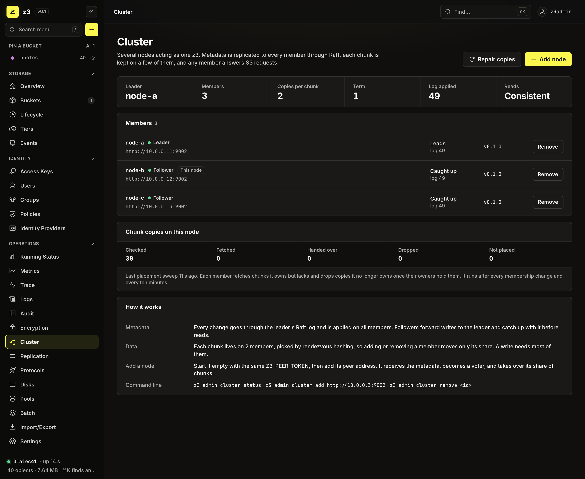

In cluster mode several nodes act as one z3. Metadata is replicated to every member through Raft,
each chunk is kept on a few members, and any member answers S3 requests, so clients can reach all
of them through a load balancer. Members join and leave without downtime, chunk copies move on
their own, and members can be upgraded one at a time.

<Frame>
  
</Frame>

A cluster is for nodes in one location on a fast network. To connect locations, use
[bucket replication](/replication/bucket-replication) or
[site replication](/replication/site-replication). A cluster takes part in them like one node: see
[Replication with other z3 nodes](#replication-with-other-z3-nodes).

## Start the nodes

Cluster mode rides on the peer API (the same port and token as replication). Start every node with
the same token:

```bash
Z3_PEER_TOKEN=cluster-secret \
Z3_CLUSTER_ADDR=http://10.0.0.11:9002 \
Z3_NODE_NAME=z3-1 \
z3
```

| Variable | Default | Meaning |
| --- | --- | --- |
| `Z3_PEER_TOKEN` | (required) | Peer API token, the same on every member |
| `Z3_CLUSTER_ADDR` | `http://127.0.0.1:<peer port>` (`https://` with [mutual TLS](#mutual-tls)) | This node's peer API as the other members reach it |
| `Z3_NODE_NAME` | host name | The node's name in the console and the CLI |
| `Z3_CLUSTER_COPIES` | `3` | Copies of each chunk, capped at the number of members |
| `Z3_CLUSTER_READS` | `consistent` | `consistent`: followers catch up with the leader before reads; `local`: read at once |
| `Z3_CLUSTER_SWEEP_INTERVAL` | `600` | Seconds between placement sweeps |

## Form the cluster

Start a cluster on one node, then add the others by their peer address:

```bash
z3 admin cluster init                       # on the first node
z3 admin cluster add http://10.0.0.12:9002
z3 admin cluster add http://10.0.0.13:9002
z3 admin cluster status
```

The **Cluster** page in the console does the same.

<Frame>
  
</Frame>

- A node that joins must be **empty** (no buckets). It receives the cluster's metadata from a
  snapshot, including the cluster's node id, so the whole cluster shows up as one z3 node.
- A node that already has replication peers or site replication can start a cluster. Its peers,
  replication settings, cursors and node id become the cluster's, so its peers see no difference.
- Run **three or five** members. Three members keep taking writes with one member down, five with
  two. With two members, losing one stops writes.

## Metadata

- Every metadata change (buckets, objects, versions, IAM, settings, lifecycle and so on) is a
  command in the Raft log. The leader stamps it with its clock, time and randomness, so every member
  produces the same version ids, timestamps and change log.
- Followers forward writes to the leader, and answer once they have applied the write themselves:
  a write through a node can be read on that node right away.
- With `Z3_CLUSTER_READS=consistent`, a follower asks the leader for its commit point before a GET,
  HEAD or List and waits until it has applied that point. Concurrent reads share one round trip. A
  write acknowledged on any member is visible on every member.
- The Raft log is in `raft.redb` under `Z3_DATA_DIR`, with a snapshot every 5,000 entries. A member
  that falls far behind receives the snapshot.
- Background work that changes metadata runs on the leader only: garbage collection, lifecycle
  (including tier transitions), the tier delete queue, replication links, and geo erasure coding
  reduction and repair.

## Data

- Each chunk's owners are picked by **rendezvous hashing** over the voting members. A chunk is
  written to `Z3_CLUSTER_COPIES` owners in parallel, and the write succeeds once most of them have it.
- When an owner is down, its copy goes to the next member in line, and the placement sweep hands it
  to the owner once it is back.
- A read fetches a chunk this node lacks from its owners, then from any member, and verifies it
  with BLAKE3.
- Adding or removing a member moves only that member's share: a fourth member takes over about a
  quarter of the copies.

### Placement sweep

Every member runs a sweep after each membership change and every `Z3_CLUSTER_SWEEP_INTERVAL`
seconds:

1. It fetches chunks it owns but lacks.
2. It drops copies it no longer owns, but only once every owner holds one, handing the copy over
   first when an owner lacks it.

The console shows the last sweep's counts. `z3 admin cluster sweep`, or **Repair copies** in the
console, runs a sweep on every member now.

The [orphan sweep](/durability/healing#orphaned-chunks), which deletes chunk files a crash left
unreferenced, is separate: every member runs it on its own disks only. Copies a member holds for an
owner that is down are still referenced, so they are kept. Because other members may place chunks
before the commit that references them arrives, its minimum age in a cluster is the larger of
`Z3_GC_GRACE` and `Z3_UPLOAD_TTL`.

## Remove a member

```bash
z3 admin cluster remove <member id>
```

The member stops owning chunks at once and stays as a learner (**Leaving**), still serving chunk
reads. The leader runs a sweep on every voter, and once every copy is on its new owners, the member
leaves the cluster. Wipe its `Z3_DATA_DIR` before using it again.

A removed member still holds the cluster's node id and its old metadata. Within a few seconds it
learns from the leader that it was removed: it stops replicating and answers the peer API with
**503** until its data directory is wiped. Peers that list several cluster URLs move on to the next
one. Remove the member's URL from their endpoints.

## Replication with other z3 nodes

A cluster can replicate buckets with other z3 nodes or clusters, join a
[site replication](/replication/site-replication) group, and be one site in
[geo erasure coding](/replication/geo-erasure-coding). It takes part as **one node**: one node id,
one change log, and peers don't need to know there are several members behind it.

Peers, bucket replication, site replication, cursors and peer acknowledgements are stored in the
replicated metadata. Configure them through **any member** (console or admin API), and they
apply on every member.

### Who pulls

- Only the **leader** pulls from peers: bucket logs, the site log and anti-entropy. Fetched chunks
  go straight to their owners, and the changes are applied through the Raft log, so every member
  applies the same thing.
- When the leader changes, the new leader continues where the old one stopped. Each applied batch
  carries the cursor it was pulled after, and a batch whose cursor has already moved is refused. No
  change is applied twice, and none is skipped.
- The totals of each link (changes applied, bytes, errors and so on) carry over to the new leader.

### How peers reach the cluster

**Any member** serves peers: the log, Merkle trees and leaves, chunks (a member that lacks one
fetches it from its owner), geo shards, and joining a site group. There is no redirect or proxy.

On the peer, write the cluster's endpoint in one of these ways:

| Endpoint on the peer | When |
| --- | --- |
| `http://10.0.0.11:9002,http://10.0.0.12:9002,http://10.0.0.13:9002` | Every member, separated by commas. Recommended without a load balancer. The peer must run a version that understands comma lists |
| `https://z3-peer.example.com:9002` | A VIP or load balancer in front of every member's peer port. Also for older peers |
| `http://10.0.0.11:9002` | One member. Works, but peers can't pull from the cluster while that member is down |

With several URLs, the peer uses the URL that last answered, and moves to the next one on a
connection error or a **503**. The same goes for site members (`sites.<name>.endpoint`) and every
call between sites: geo shards, geo repair, the replication map and health checks.

Older single-node peers can still replicate with a cluster, but they don't understand comma lists:
give them one URL or a VIP. With [mutual TLS](#mutual-tls), each member's certificate must include
the host name or IP address peers use; behind a VIP, the VIP's name.

The cluster's peer token is the `Z3_PEER_TOKEN` shared by every member.

```bash
# on the cluster (any member): add node x as a peer and replicate the bucket data to it
curl -X PUT http://127.0.0.1:9001/api/peers/x \
  -H "Authorization: Bearer $TOKEN" -H 'content-type: application/json' \
  -d '{"endpoint": "http://10.0.1.5:9002", "token": "token-of-x"}'
curl -X PUT http://127.0.0.1:9001/api/buckets/data/replication \
  -H "Authorization: Bearer $TOKEN" -H 'content-type: application/json' \
  -d '{"peers": ["x"]}'

# on node x: the cluster as one peer, with its three members
curl -X PUT http://127.0.0.1:9001/api/peers/office \
  -H "Authorization: Bearer $TOKEN" -H 'content-type: application/json' \
  -d '{"endpoint": "http://10.0.0.11:9002,http://10.0.0.12:9002,http://10.0.0.13:9002", "token": "cluster-secret"}'
curl -X PUT http://127.0.0.1:9001/api/buckets/data/replication \
  -H "Authorization: Bearer $TOKEN" -H 'content-type: application/json' \
  -d '{"peers": ["office"]}'
```

### Geo erasure coding

A cluster is one site in the geo layout. Its shards are ordinary chunks, placed on
`Z3_CLUSTER_COPIES` members and moved by the placement sweep like any other chunk.

- Cutting full chunks down to shards runs on the leader. Every member drops its full copy when it
  applies that step.
- Reads put each chunk together from shards on any member plus shards from other sites.
- Repair from other sites runs on the leader: at start, after a full heal, and on
  `POST /api/heal/geo`. A shard counts as missing only when **no member** holds it. A member that
  lost its copy gets it back from another member through the sweep.
- Call `POST /api/heal/geo` on the leader. On a follower it checks nothing (`checked: 0`).

### Consistency, sessions and offline peers

- `quorum` and `all` modes work through any member.
- `x-z3-session` [read-your-writes](/replication/bucket-replication#read-your-writes-with-session-tokens)
  tokens work through any member, in both directions.
- The leader decides which peers are offline, and the other members follow it every second, so
  [`on_offline: local`](/replication/edge#on_offline) also applies to writes through a follower.
- Give every member the same `Z3_SITE_NAME`, or none and use site replication instead.

### Monitoring

`GET /api/replication` (also `?view=peers`), `/metrics`, the health check and the
[replication map](/replication/map) show the cluster's links **once**, on every member. Each link
carries `worker`, the member running it. `GET /api/cluster` returns `replication_worker`. In the
console, the **Links** tab and the map details name the member running the links.

`POST /api/buckets/{bucket}/replication/resync` on a follower runs on the leader.

## Mutual TLS

Raft, forwarded writes and chunk copies all run on the peer API, so a cluster uses the same
[mutual TLS](/deploy/peer-tls) as replication: set `Z3_PEER_TLS_CERT`, `Z3_PEER_TLS_KEY` and
`Z3_PEER_TLS_CA` on every member.

```bash
Z3_PEER_TOKEN=cluster-secret \
Z3_PEER_TLS_CERT=/etc/z3/peer/z3-1.pem \
Z3_PEER_TLS_KEY=/etc/z3/peer/z3-1.key \
Z3_PEER_TLS_CA=/etc/z3/peer/ca.pem \
Z3_CLUSTER_ADDR=https://10.0.0.11:9002 \
Z3_NODE_NAME=z3-1 \
z3
```

- Each member's certificate must include the host name or IP address in its `Z3_CLUSTER_ADDR`.
- In `mtls` and `tls` mode, `Z3_CLUSTER_ADDR` defaults to `https://127.0.0.1:<peer port>`, and an
  `http://` address is refused at startup.
- Add new members with `https://` addresses: `z3 admin cluster add https://10.0.0.14:9002`.
- Member addresses are stored in the Raft membership as they were added, so the console may still
  show `http://` for older members. The scheme used to reach them follows each node's own
  `Z3_CLUSTER_ADDR`: a member with an `https://` address calls every member over TLS.

To turn it on in a running cluster, restart members one at a time as in a
[rolling upgrade](#rolling-upgrade), and wait until each one is caught up:

<Steps>
  <Step title="Certificates and mixed mode">
    Set the certificate variables and `Z3_PEER_TLS_MODE=mixed` on every member. Addresses stay
    `http://`.
  </Step>
  <Step title="https:// addresses">
    Set `Z3_CLUSTER_ADDR=https://...` on every member. Members you have changed call the others over
    TLS, the rest still in plain HTTP; `mixed` mode accepts both.
  </Step>
  <Step title="TLS only">
    Remove `Z3_PEER_TLS_MODE` (the default is `mtls`).
  </Step>
</Steps>

## Rolling upgrade

Restart members one at a time, and wait until `z3 admin cluster status` shows the member caught up
before moving on. Reads and writes continue on the other members meanwhile. Each member's version is
in the status. Don't use features of the new version until every member runs it.

Replication on a cluster adds new commands to the Raft log, which members on an older version can't
read. Upgrade every member first, then configure peers, bucket replication, site replication or geo
erasure coding on the cluster. A member still on the old version stops following the log when the
first new command arrives, and catches up once it is upgraded.

## Limitations

- [Lean Replica](/replication/lean-replica) isn't available on cluster members.
- The change log, tombstones and internal delete markers aren't
  [pruned](/replication/overview#change-log-pruning) in a cluster.
- Geo repair from other sites doesn't re-read shards held by other members to check them. A shard
  damaged on every member is repaired by local healing and the placement sweep, not from other sites.
- A client write forwarded by a follower is at-least-once: if the leader dies after committing it
  and before answering, a retry can create a second version. Changes applied from peers are applied
  exactly once.
- Every member holds all the metadata, so its size is bounded by one node.
- Writes are slower than on a single node, since each change waits for Raft and for chunk copies on
  several members.
- Copies fetched by the sweep are stored uncompressed.
- Data is protected with full copies; erasure coding across members isn't available yet.
