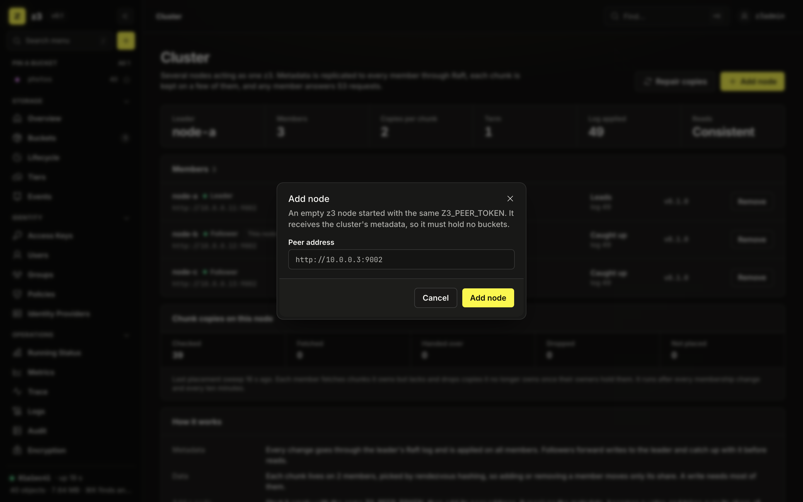

In cluster mode several nodes act as one z3. Metadata is replicated to every member through Raft,
each chunk is kept on a few members, and any member answers S3 requests, so clients can reach all
of them through a load balancer. Members join and leave without downtime, chunk copies move on
their own, and members can be upgraded one at a time.

<Frame>
  
</Frame>

A cluster is for nodes in one location on a fast network. To connect locations, use
[site replication](/replication/site-replication) between standalone nodes.

## Start the nodes

Cluster mode rides on the peer API (the same port and token as replication). Start every node with
the same token:

```bash
Z3_PEER_TOKEN=cluster-secret \
Z3_CLUSTER_ADDR=http://10.0.0.11:9002 \
Z3_NODE_NAME=z3-1 \
z3
```

| Variable | Default | Meaning |
| --- | --- | --- |
| `Z3_PEER_TOKEN` | (required) | Peer API token, the same on every member |
| `Z3_CLUSTER_ADDR` | `http://127.0.0.1:<peer port>` | This node's peer API as the other members reach it |
| `Z3_NODE_NAME` | host name | The node's name in the console and the CLI |
| `Z3_CLUSTER_COPIES` | `3` | Copies of each chunk, capped at the number of members |
| `Z3_CLUSTER_READS` | `consistent` | `consistent`: followers catch up with the leader before reads; `local`: read at once |
| `Z3_CLUSTER_SWEEP_INTERVAL` | `600` | Seconds between placement sweeps |

## Form the cluster

Start a cluster on one node, then add the others by their peer address:

```bash
z3 admin cluster init                       # on the first node
z3 admin cluster add http://10.0.0.12:9002
z3 admin cluster add http://10.0.0.13:9002
z3 admin cluster status
```

The **Cluster** page in the console does the same.

<Frame>
  
</Frame>

- A node that joins must be **empty** (no buckets). It receives the cluster's metadata from a
  snapshot, including the cluster's node id, so the whole cluster shows up as one z3 node.
- A node with replication peers or site replication can't start a cluster.
- Run **three or five** members. Three members keep taking writes with one member down, five with
  two. With two members, losing one stops writes.

## Metadata

- Every metadata change (buckets, objects, versions, IAM, settings, lifecycle and so on) is a
  command in the Raft log. The leader stamps it with its clock, time and randomness, so every member
  produces the same version ids, timestamps and change log.
- Followers forward writes to the leader, and answer once they have applied the write themselves:
  a write through a node can be read on that node right away.
- With `Z3_CLUSTER_READS=consistent`, a follower asks the leader for its commit point before a GET,
  HEAD or List and waits until it has applied that point. Concurrent reads share one round trip. A
  write acknowledged on any member is visible on every member.
- The Raft log is in `raft.redb` under `Z3_DATA_DIR`, with a snapshot every 5,000 entries. A member
  that falls far behind receives the snapshot.
- Background work that changes metadata runs on the leader only: garbage collection, lifecycle
  (including tier transitions) and the tier delete queue.

## Data

- Each chunk's owners are picked by **rendezvous hashing** over the voting members. A chunk is
  written to `Z3_CLUSTER_COPIES` owners in parallel, and the write succeeds once most of them have it.
- When an owner is down, its copy goes to the next member in line, and the placement sweep hands it
  to the owner once it is back.
- A read fetches a chunk this node lacks from its owners, then from any member, and verifies it
  with BLAKE3.
- Adding or removing a member moves only that member's share: a fourth member takes over about a
  quarter of the copies.

### Placement sweep

Every member runs a sweep after each membership change and every `Z3_CLUSTER_SWEEP_INTERVAL`
seconds:

1. It fetches chunks it owns but lacks.
2. It drops copies it no longer owns, but only once every owner holds one, handing the copy over
   first when an owner lacks it.

The console shows the last sweep's counts. `z3 admin cluster sweep`, or **Repair copies** in the
console, runs a sweep on every member now.

The [orphan sweep](/durability/healing#orphaned-chunks), which deletes chunk files a crash left
unreferenced, is separate: every member runs it on its own disks only. Copies a member holds for an
owner that is down are still referenced, so they are kept. Because other members may place chunks
before the commit that references them arrives, its minimum age in a cluster is the larger of
`Z3_GC_GRACE` and `Z3_UPLOAD_TTL`.

## Remove a member

```bash
z3 admin cluster remove <member id>
```

The member stops owning chunks at once and stays as a learner (**Leaving**), still serving chunk
reads. The leader runs a sweep on every voter, and once every copy is on its new owners, the member
leaves the cluster. Wipe its `Z3_DATA_DIR` before using it again.

## Rolling upgrade

Restart members one at a time, and wait until `z3 admin cluster status` shows the member caught up
before moving on. Reads and writes continue on the other members meanwhile. Each member's version is
in the status. Don't use features of the new version until every member runs it.

## Limitations

- Bucket replication, site replication and geo erasure coding aren't available on cluster members
  yet. Replicate to another z3 from standalone nodes.
- Every member holds all the metadata, so its size is bounded by one node.
- Writes are slower than on a single node, since each change waits for Raft and for chunk copies on
  several members.
- Copies fetched by the sweep are stored uncompressed.
- Data is protected with full copies; erasure coding across members isn't available yet.
