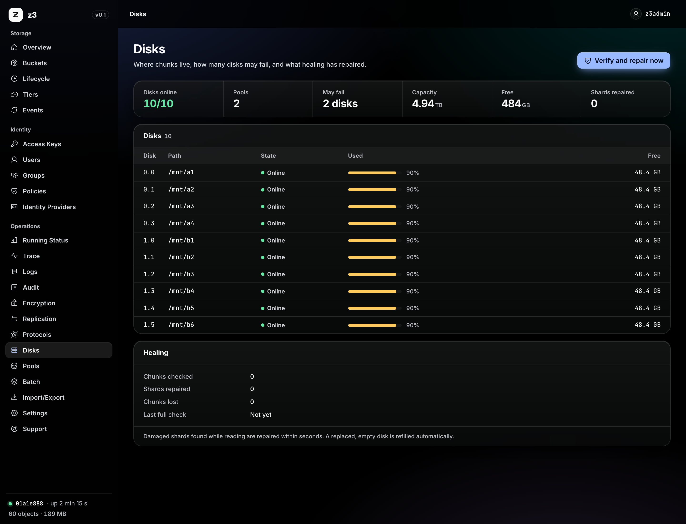

Zee3 keeps two kinds of data: **metadata** (buckets, versions, IAM, the change log) in
`ZEE3_DATA_DIR`, and **chunks** (the object data). Where chunks go depends on three variables.

| Setup | Variables | Chunks go to |
| --- | --- | --- |
| One directory | `ZEE3_DATA_DIR` only | `ZEE3_DATA_DIR/chunks` |
| One disk set | `ZEE3_DISKS` (and optionally `ZEE3_PARITY`) | Erasure-coded over the listed disks |
| Several pools | `ZEE3_POOLS` | Spread over pools, each a disk set or a directory |

## One directory

The default. Chunks live next to the metadata, and durability is whatever the underlying disk
provides (a RAID array, a cloud volume). Good for trying Zee3, small installs, and nodes whose
durability comes from [replication](/replication/overview) to other sites.

```bash
ZEE3_DATA_DIR=/var/lib/zee3 zee3
```

## Several disks with erasure coding

List one directory per physical disk in `ZEE3_DISKS`, separated by commas:

```bash
ZEE3_DATA_DIR=/var/lib/zee3 \
ZEE3_DISKS=/mnt/d1,/mnt/d2,/mnt/d3,/mnt/d4,/mnt/d5,/mnt/d6 \
ZEE3_PARITY=2 \
zee3
```

Each chunk is split into data shards and parity shards, one per disk. With six disks and parity 2
the layout is 4 data + 2 parity: **any two disks can fail** and every object stays readable and
writable, for 1.5 times the raw size.

| Disks | Default parity | Layout | Readable with this many disks lost | Disks needed to write | Raw size per byte |
| --- | --- | --- | --- | --- | --- |
| 2 | 1 | 1+1 | 1 | 2 | 2× |
| 3 | 1 | 2+1 | 1 | 2 | 1.5× |
| 4 | 2 | 2+2 | 2 | 3 | 2× |
| 6 | 2 | 4+2 | 2 | 4 | 1.5× |
| 8 | 2 | 6+2 | 2 | 6 | 1.33× |
| 12 | 2 (or set 4) | 10+2 (or 8+4) | 2 (or 4) | 10 (or 8) | 1.2× (or 1.5×) |

A write needs as many disks as there are data shards, or one more when parity is at least half the
set (as in 1+1 and 2+2), so a set with that much parity keeps reading through more failures than it
keeps writing through. Shards that couldn't be written are queued for healing.

`ZEE3_PARITY` can be anything from 1 to one less than the number of disks; more parity survives more
failures and costs more space. See [Erasure coding](/durability/erasure-coding) for how reads,
writes and small chunks work.

<Warning>
  The first start **formats** the disks: each gets a `zee3-disk.json` with the set's id, its position,
  the number of disks and the parity. After that:

  - the **number of disks** and the **parity** can't change. Zee3 refuses to start with
    `the number of disks cannot change` or `parity cannot change`,
  - the **order** of `ZEE3_DISKS` matters. A disk listed in another position is marked `foreign` and
    never written to.

  To add capacity, add a pool (below).
</Warning>

### Guidelines

- Use one directory per **physical disk**. Two directories on the same disk give no protection.
- Use a dedicated directory on each disk (such as `/mnt/d1/zee3`) rather than the mount point
  itself, and mount disks by UUID or label in `/etc/fstab` so a reboot doesn't swap them.
- Keep `ZEE3_DATA_DIR` on a reliable disk (a RAID 1 mirror or similar). The metadata database lives
  there, not on the erasure-coded disks.
- Disks of similar size work best: chunks are spread evenly over the disks of a set.

## What happens when a disk fails

| Event | What Zee3 does |
| --- | --- |
| A disk disappears or returns I/O errors | Marked `offline`. Reads rebuild from parity; writes continue while enough disks are online (see the table above) |
| The disk comes back | Checked every 5 seconds. If its format matches, it's `online` again and a full heal runs |
| An **empty** disk is mounted at the same path | Formatted into the same position, then a full heal fills it |
| A disk from another set, or the order of `ZEE3_DISKS` changed | Marked `foreign` and never written to |
| The directory holds other files | Marked `foreign`; its contents are left alone |

To replace a failed disk, mount a new empty disk at the same path, create the same directory on it
(owned by the user Zee3 runs as) and wait: within seconds Zee3 formats it and heals every chunk back.
No restart is needed. See [Healing](/durability/healing).

The console's **Disks** page shows each disk's state, capacity and free space, the layout, the
healing totals, and the **Orphaned chunks** panel with a **Sweep now** button (see
[Orphaned chunks](/durability/healing#orphaned-chunks)).

<Frame>
  
</Frame>

## Growing with pools

`ZEE3_POOLS` lists several pools separated by `;`. Each pool is a comma-separated disk set or one
plain directory, with its own layout and parity. It replaces `ZEE3_DISKS`, so list the existing disk
set as the **first** pool:

```bash
# Before: one set of four disks
ZEE3_DISKS=/mnt/a1,/mnt/a2,/mnt/a3,/mnt/a4 zee3

# After: the old set plus a new set of six disks
ZEE3_POOLS="/mnt/a1,/mnt/a2,/mnt/a3,/mnt/a4;/mnt/b1,/mnt/b2,/mnt/b3,/mnt/b4,/mnt/b5,/mnt/b6" zee3
```

A node that kept chunks in `ZEE3_DATA_DIR` lists that directory as its first pool:

```bash
ZEE3_DATA_DIR=/var/lib/zee3 \
ZEE3_POOLS="/var/lib/zee3;/mnt/b1,/mnt/b2,/mnt/b3,/mnt/b4" zee3
```

- Setting both `ZEE3_DISKS` and `ZEE3_POOLS` is an error.
- A path may appear only once.
- `ZEE3_PARITY` applies to every disk-set pool. Existing pools keep the parity they were formatted
  with, and a configured parity that differs is refused, so leave `ZEE3_PARITY` unset when pools have
  different parity; a new set then gets the default for its number of disks.

New chunks go to the pool with the most free space. Rebalance moves existing data, and decommission
empties a pool before you remove it from `ZEE3_POOLS`. See [Pools](/durability/pools).

## In Docker

Mount each disk into the container and list the container paths. See
[Docker: several disks](/deploy/docker#several-disks).
