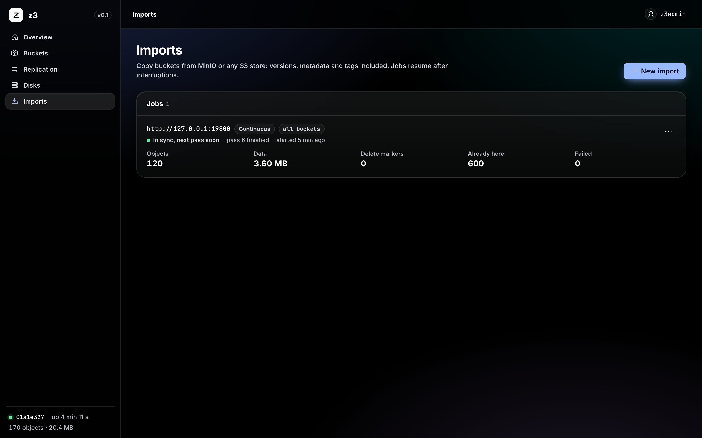

z3 can pull everything from MinIO, or any service that speaks the S3 API with Signature V4 (AWS S3,
Ceph RGW, Garage, SeaweedFS, another z3). Give it an endpoint and credentials: it creates every
bucket with its versioning state and copies every version and delete marker, keeping version ids,
timestamps and ETags.

## What is copied

| From the source | In z3 |
| --- | --- |
| Buckets | Created with the same names |
| Versioning state (`Enabled`, `Suspended`) | The same |
| Every object version and delete marker | Copied |
| Version ids | Kept. MinIO's UUIDs are used as they are; AWS-style ids are turned into stable z3 ids |
| Last-Modified | Kept, to the millisecond |
| ETag | Kept, including multipart ETags (`...-N`) |
| Content-Type, `x-amz-meta-*` metadata, tags | Kept |
| Cache-Control, Content-Disposition, Content-Encoding, Content-Language, Expires | Kept. Bodies are copied as they are, never decompressed |

Old version ids keep working in `GET ?versionId=` on any version. z3 shows UUIDs without dashes but
accepts them with dashes too.

Nothing else comes along: bucket policies, lifecycle rules, event notifications, quotas, Object Lock
settings, users and policies stay on the source. Set them up again in z3 (see
[Users, groups and keys](/access/users-groups-keys), [Bucket policies](/access/bucket-policies) and
[Lifecycle](/storage/lifecycle)).

**Verification.** A body is checked against the source's ETag when that ETag is a plain MD5, and its
size is always checked against the listing. Objects that fail are counted in `failed` and listed in
`recent_errors`; the import carries on with the rest.

## Start an import

<Tabs>
  <Tab title="Console">
    Open **Import/Export**, fill in the source endpoint, access key and secret key, optionally
    choose buckets, a region and continuous mode, and start. The job's progress shows per bucket.

    <Frame>
      
    </Frame>
  </Tab>
  <Tab title="Admin API">
    Sign in to get a token, then create the job:

    ```bash
    TOKEN=$(curl -s -X POST http://127.0.0.1:9001/api/auth/login \
      -H 'content-type: application/json' \
      -d '{"access_key": "admin", "secret_key": "change-me-please"}' | jq -r .token)

    curl -X POST http://127.0.0.1:9001/api/imports \
      -H "Authorization: Bearer $TOKEN" -H 'content-type: application/json' \
      -d '{
        "endpoint": "http://minio.internal:9000",
        "access_key": "minioadmin",
        "secret_key": "minioadmin"
      }'
    ```

    Wrong credentials are refused right away with `400`.
  </Tab>
</Tabs>

Starting and managing imports needs the `admin:ConfigUpdate` right (root has it).

### Options

| Field | Default | Meaning |
| --- | --- | --- |
| `endpoint` | required | The source's S3 endpoint |
| `access_key`, `secret_key` | required | Credentials on the source that can list and read every bucket |
| `buckets` | all | Only these buckets, such as `["photos", "logs"]` |
| `region` | `us-east-1` | Region used to sign requests to the source (AWS needs the right one) |
| `concurrency` | `8` | Objects copied in parallel (1 to 64) |
| `continuous` | `false` | Repeat the import every `interval_secs`, so changes on the source keep arriving until you cut over |
| `interval_secs` | `300` | Pause between rounds in continuous mode |

## Manage jobs

| Endpoint | What |
| --- | --- |
| `GET /api/imports` | Every job and its progress (secrets hidden) |
| `GET /api/imports/{id}` | State (`running`, `waiting`, `paused`, `done`, `failed`), current bucket and position, counts of objects, delete markers, bytes, skipped and failed |
| `POST /api/imports/{id}/pause` | Stop the job and keep its position |
| `POST /api/imports/{id}/resume` | Continue, or run another round of a finished job |
| `DELETE /api/imports/{id}` | Stop and forget the job; imported data stays |

- **Resumable.** The position (bucket and listing marker) is saved after every page. After a z3
  restart or a network failure the job continues from there.
- **Idempotent.** Versions that already exist are skipped without downloading them again. A version
  you have permanently deleted in z3 isn't brought back, and a null version from the source doesn't
  overwrite a newer write in z3.

## Cut over from MinIO

<Steps>
  <Step title="Start a continuous import">
    Create the job with `"continuous": true`.
  </Step>
  <Step title="Wait for the first round">
    The state turns to `waiting` once every bucket has been copied.
  </Step>
  <Step title="Move clients to z3">
    Change the endpoint and credentials in your applications (see [Clients](/get-started/clients)).
  </Step>
  <Step title="Wait one more round">
    So the last writes that landed on MinIO are copied too.
  </Step>
  <Step title="Pause the job">
    `POST /api/imports/{id}/pause`, or **Pause** in the console. Then retire MinIO.
  </Step>
</Steps>

<Note>
  Objects deleted on the source after they were imported are not deleted in z3.
</Note>

## From MinIO to z3, side by side

| MinIO | z3 |
| --- | --- |
| `MINIO_ROOT_USER` / `MINIO_ROOT_PASSWORD` | `Z3_ACCESS_KEY` / `Z3_SECRET_KEY` |
| S3 API on 9000, console on 9001 | The same ports; the replication API is on 9002 |
| `mc admin ...` | The console, the [admin API](/api/overview) and [`z3 admin`](/cli/overview) |
| Bucket quota error `XMinioAdminBucketQuotaExceeded` | The same error code (see [Tags and quota](/storage/tags-and-quota)) |
| Site replication | [Site replication](/replication/site-replication), with HLC conflict resolution and delta chunks |

S3 clients keep working with a new endpoint and credentials. Use path-style addressing.

## Copy z3 configuration between nodes

Once you run z3, the **configuration export** copies a node's setup to another z3 node or keeps it as
a backup: buckets with their versioning, replication, bucket policy, lifecycle, event rules, Object
Lock, tags, quota and default encryption; IAM policies, users, groups and access keys; peers, event
and audit targets, tiers, KMS keys and cluster settings. It holds no object data.

```bash
# On the old node: with secrets (users' secret keys, peer tokens, KMS keys)
curl -H "Authorization: Bearer $TOKEN" \
  "http://old-node:9001/api/config/export?secrets=true" -o z3-config.json

# On the new node
curl -X POST -H "Authorization: Bearer $TOKEN" -H 'content-type: application/json' \
  --data-binary @z3-config.json http://new-node:9001/api/config/import
```

Without `secrets=true`, users come back without secret keys and aren't created, peers without a token
are skipped, and KMS keys are left out, so objects encrypted with them can't be read on the other
node. Whatever couldn't be applied is listed under `skipped` in the import's answer. The site
replication configuration is listed in the export but not imported; set it up again.

Keep an export with secrets as safely as the secrets themselves. In the console, use **Export
configuration** and **Import configuration** on the **Import/Export** page. See
[Config export](/operations/config-export).
