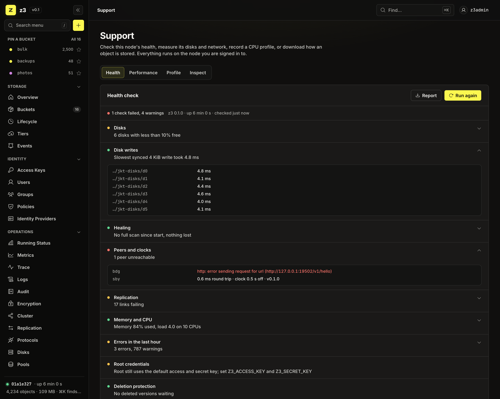

Start with the **health check**: the console's **Support** page, or `z3 admin support health`. It
checks disks, healing, peers and clocks, peer TLS, replication, memory, recent errors, the log
history and the root credentials, and tells you which one is wrong. See [Support](/operations/support).

## Startup errors

z3 exits with one of these when it can't start. Read them in `journalctl -u z3` or
`docker compose logs z3`.

| Error | Cause and fix |
| --- | --- |
| `binding 0.0.0.0:9000` … `Address already in use` | Another program (often MinIO) holds the port. Stop it, or move z3 with `Z3_S3_ADDR`, `Z3_ADMIN_ADDR` or `Z3_PEER_ADDR` |
| `opening data dir ...` … `Permission denied` | The user z3 runs as can't write `Z3_DATA_DIR`. With systemd, `sudo chown -R z3:z3 /var/lib/z3`. In Docker with a bind mount, the container runs as uid 65532: `sudo chown -R 65532:65532 <dir>` |
| `set either Z3_DISKS or Z3_POOLS, not both` | `Z3_POOLS` replaces `Z3_DISKS`. Remove `Z3_DISKS` and list its disks as the first pool. See [Disks](/deploy/disks#growing-with-pools) |
| `erasure coding needs at least two disks` | `Z3_DISKS` lists one path. Use at least two, or none |
| `parity must be between 1 and ... for ... disks` | `Z3_PARITY` is 0, or not smaller than the number of disks |
| `disk set was formatted with N disks, M configured; the number of disks cannot change` | A disk set can't grow or shrink. Restore the original list; add capacity with a [pool](/durability/pools) |
| `disk set was formatted with parity X, Y configured; parity cannot change` | Set `Z3_PARITY` back to `X`, or remove it. With pools of different parity, leave it unset |
| `... is listed twice` | The same path appears twice in `Z3_DISKS` or `Z3_POOLS` |
| `Z3_PEER_TLS_CA is required with Z3_PEER_TLS_CERT`, `... is set but ... is not`, or `Z3_PEER_TLS_MODE needs ...` | Peer TLS needs the certificate, the key and the CA together. See [Mutual TLS between nodes](/deploy/peer-tls#settings) |
| `Z3_CLUSTER_ADDR must start with https://` | The peer API is TLS only (`mtls` or `tls` mode). Use an `https://` cluster address. See [Cluster](/deploy/cluster#mutual-tls) |
| `unusable private key` | The peer TLS key can't be used, often a P-256 key written by LibreSSL on macOS. Create the key again, or use RSA |
| `data directory uses format N, newer than this z3 supports` | A newer z3 already upgraded this data directory. Install that version again, or restore the backup from before the upgrade. See [Upgrading](/deploy/upgrading) |

## Running, but something is wrong

| Symptom | Cause and fix |
| --- | --- |
| The console doesn't open from another machine | Outside Docker, the console listens on `127.0.0.1:9001`. Use an SSH tunnel (`ssh -L 9001:127.0.0.1:9001 you@server`), a [reverse proxy](/deploy/tls-and-proxies), or `Z3_ADMIN_ADDR=0.0.0.0:9001` on a trusted network |
| `using default credentials` warning at startup | `Z3_ACCESS_KEY` or `Z3_SECRET_KEY` is still the default. Set both. See [Root credentials](/deploy/configuration#root-credentials) |
| Users can't sign in and KMS keys show `cannot be opened with this node's root secret` | `Z3_SECRET_KEY` changed after the node stored secrets. Put the old secret back. Otherwise give users new secret keys; internal KMS keys can't be recovered without the old secret |
| `NoSuchBucket` for a bucket that exists, or requests going to the wrong bucket | The client uses virtual-hosted addressing (`bucket.host`). Turn on path-style; see [Clients](/get-started/clients) |
| `SignatureDoesNotMatch` behind a proxy | The proxy changes the `Host` header or the path. Pass `Host` through unchanged and don't add a path to `proxy_pass`. See [TLS and reverse proxies](/deploy/tls-and-proxies) |
| `SignatureDoesNotMatch` everywhere | Wrong secret key, or a clock far off on the client. Check the key and run NTP on clients and servers |
| `AuthorizationHeaderMalformed` | The cluster setting `region.name` is set and the client signs for another region. Use that region in the client, or clear the setting |
| Presigned URLs from boto3 are refused | They are signed with Signature V2. Use `Config(signature_version="s3v4")` |
| `413` from the proxy on large uploads | The proxy's body limit. Set `client_max_body_size 0` in nginx |
| `EntityTooLarge` | The PUT or part is larger than the `api.max_object_size_mb` setting (5120 MiB by default). Use multipart uploads or raise the setting |
| `503 SlowDown` | More concurrent S3 requests than `api.requests_max` allows, and none got a slot within `api.requests_deadline_secs`. Raise the limit or slow the client down. See [Settings](/operations/settings) |
| `503` on writes to a replicated bucket | The bucket's mode is `quorum` or `all` and not enough peers applied the write within `timeout_ms`. The write is stored locally and replicates later. Check the peers on the **Replication** page |
| `XMinioAdminBucketQuotaExceeded` | The bucket reached its quota. See [Tags and quota](/storage/tags-and-quota) |
| `403 AccessDenied` on a write that the policy allows | A residency rule doesn't allow this site to store that key. See [Data residency](/replication/bucket-replication#data-residency) |
| A disk shows `foreign` | It belongs to another set, sits at another position in `Z3_DISKS`, or holds other files (`not empty and not a z3 disk`). Restore the original order, or give z3 an empty directory |
| A disk shows `offline` with `directory does not exist` | A replaced disk isn't mounted, or its directory wasn't created. Mount it and create the directory, owned by z3's user |
| `write quorum not met for chunk ...` | Too many disks of the set are offline to write. Bring disks back; reads keep working down to the parity limit. See [Disks](/deploy/disks) |
| Peers can't pull: `401 invalid peer token`, or connection refused on 9002 | The replication API runs only with `Z3_PEER_TOKEN`; the log says `replication API disabled` otherwise. The token in the peer's configuration must be **this** node's token |
| A link fails with a certificate error, or `426` from the peer | See the TLS messages in [Mutual TLS between nodes](/deploy/peer-tls#check-it). `426` means the peer requires TLS: use an `https://` endpoint |
| Replication lag keeps growing | See the link's last error on the **Replication** page. Check bandwidth limits and time windows on the peer; see [Replication overview](/replication/overview#monitoring) |
| `docker ps` shows `unhealthy` | `z3 healthcheck` can't reach the admin API. Check the container's logs for one of the startup errors above |

## Health check

Three levels, from quickest to most thorough:

| Check | What it tells you |
| --- | --- |
| `GET /api/health` on the admin port | `{"status": "ok"}` when the node answers. Needs no sign-in; for load balancers and monitoring |
| `z3 healthcheck` | Exits with 0 when `GET /api/health` answers on `Z3_ADMIN_ADDR` of this machine. The Docker image's `HEALTHCHECK` uses it |
| **Support** page, `z3 admin support health` | Disks, disk writes, healing, peers and clocks, peer TLS, replication, memory and CPU, errors in the last hour, root credentials. Each is `ok`, `warn` or `fail`; the CLI exits with 1 if any check fails |

```bash
curl -s http://127.0.0.1:9001/api/health
z3 healthcheck && echo healthy
z3 admin support health
z3 admin support health --json
```

On the Support page, **Report** downloads the whole report as JSON to attach when you ask for help.

<Frame>
  
</Frame>

## Logs

z3 logs to standard output.

```bash
journalctl -u z3 -f              # systemd
docker compose logs -f z3        # Docker
```

`RUST_LOG` chooses the level at startup (`info` by default). For more detail on one part, use a
filter such as `RUST_LOG=info,z3_server=debug`. The `logger.level` setting changes it at runtime
without a restart.

The console's **Logs** page shows recent and live log lines, filtered by level and text, without
access to the server. Its **History** mode reads the log history each node keeps in
`<data dir>/logs/` (64 MiB or 7 days by default), also from before a restart. What it keeps is set
by `Z3_LOG_BUFFER` or the `logger.console_level` setting. From a shell, `z3 admin logs` reads the
same, for one node or all of them. See [Trace and logs](/audit/trace-and-logs), which also covers
the live request trace.

## Useful commands

```bash
z3 --version                          # the installed version
z3 --help                             # every startup option and its variable
z3 admin support health               # the health check
z3 admin logs --since 1h --level warn # warnings and errors of the last hour, from disk
z3 admin settings get                 # cluster settings, values and defaults
z3 admin pools                        # pools and the running rebalance or decommission
curl -s http://127.0.0.1:9001/metrics # Prometheus metrics, no sign-in
```
