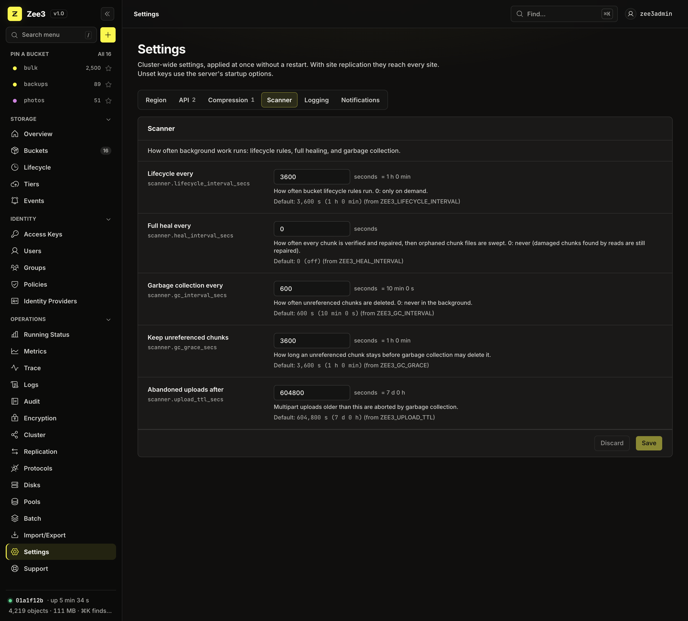

Healing rebuilds shards that are missing or damaged on an erasure-coded disk set, from the shards
that remain. It runs by itself; you rarely need to start it.

## When it runs

| Trigger | What happens |
| --- | --- |
| **A read finds a bad shard** | The read is still served (rebuilt from parity) and the chunk is queued. The healer, which wakes every 5 seconds, repairs it |
| **A write misses a disk** | Shards that couldn't be written are queued the same way |
| **A disk comes back, or an empty replacement appears** | Disks are checked every 5 seconds. When one comes online, a full heal runs at once |
| **On a schedule** | Every `Z3_HEAL_INTERVAL` seconds (7 days by default), every referenced chunk is verified and repaired |
| **On demand** | **Verify and repair now** on the console's **Disks** page, or `POST /api/heal` |

A full pass reads every chunk, so on large nodes it takes a while and adds disk load. The read path
and the queue keep damage found in normal use from waiting for the next full pass.

## Change the schedule

A full pass pauses after every batch of 256 chunks for a time proportional to the batch, so it uses
only `Z3_HEAL_DUTY` percent of the time (25 by default): on a machine shared with a database or
other services, the weekly verification does not take over the disk or the CPU.

`Z3_HEAL_INTERVAL` sets the default at startup. The `scanner.heal_interval_secs` setting changes it
at runtime, for every site with site replication:

<Tabs>
  <Tab title="Console">
    **Settings → Scanner → Full heal every**.

    <Frame>
      
    </Frame>
  </Tab>
  <Tab title="CLI">
    ```bash
    z3 admin settings set scanner heal_interval_secs=1209600   # every 14 days
    ```
  </Tab>
</Tabs>

`0` turns the scheduled pass off. Chunks found damaged by reads and disks that come back are still
healed.

## Replace a failed disk

<Steps>
  <Step title="See which disk failed">
    The **Disks** page marks it `offline` with the reason (for example a read or write error). The
    health check reports it too.
  </Step>
  <Step title="Swap the disk">
    Mount a new, empty disk at the **same path**. Create the directory z3 uses on it and give it to
    the user z3 runs as.
  </Step>
  <Step title="Wait">
    Within seconds z3 formats the empty disk into the same position (the log says
    `new empty disk formatted; healing will refill it`) and a full heal rebuilds its shards. No
    restart is needed.
  </Step>
</Steps>

Objects stay readable and writable during all of this, as long as no more disks than the parity are
missing at once.

<Note>
  A disk that holds other files, belongs to another set or sits at a different position in
  `Z3_DISKS` is marked `foreign` and left alone. z3 never overwrites it.
</Note>

## Lost chunks

A chunk is **lost** when fewer shards than its data shard count are readable, for example when more
disks than the parity failed at once. The heal result lists such chunks under `lost_chunks`, the
health check fails, and `z3_heal_chunks_lost_total` counts them.

If the bucket is replicated, [anti-entropy](/replication/overview#anti-entropy) compares Merkle trees
with the other sites and pulls back what is missing.

## Watch it

| Where | What |
| --- | --- |
| **Disks** page | Disk states, layout and healing totals |
| `GET /api/disks` | The same as JSON |
| **Support** page, `z3 admin support health` | The **Healing** check: chunks checked, shards repaired, chunks lost |
| `z3_heal_shards_repaired_total` | Shards rebuilt (Prometheus) |
| `z3_heal_chunks_lost_total` | Chunks that couldn't be rebuilt (Prometheus) |
| `z3_disk_online{disk,path}` | 1 per online disk (Prometheus) |

## Geo erasure coding

The same background loop also finishes [geo erasure coding](/replication/geo-erasure-coding): once
every site has acknowledged a new version, it cuts the writing site's full chunks down to that site's
shards.
