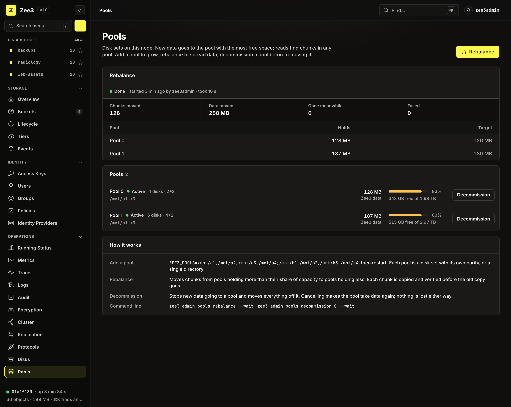
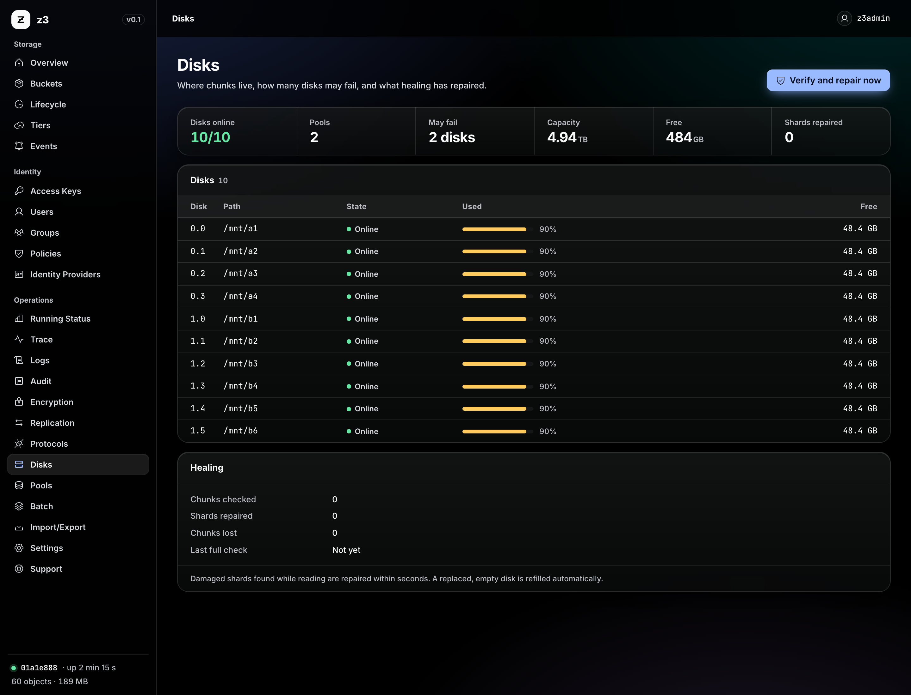

A disk set can't grow, so Zee3 adds capacity in **pools**. A node can have several pools, each either
an erasure-coded disk set (two or more paths) or a plain directory (one path), with its own layout
and parity. Objects stay readable while data moves between them, and operations continue after a
restart.

<Frame>
  
</Frame>

## Add a pool

`ZEE3_POOLS` lists the pools separated by `;`, and the disks of each pool separated by `,`. It
replaces `ZEE3_DISKS`, so the existing set becomes the first pool:

```bash
# Before: one set of four disks
ZEE3_DISKS=/mnt/a1,/mnt/a2,/mnt/a3,/mnt/a4 zee3

# After: the old set and a new set of six disks
ZEE3_POOLS="/mnt/a1,/mnt/a2,/mnt/a3,/mnt/a4;/mnt/b1,/mnt/b2,/mnt/b3,/mnt/b4,/mnt/b5,/mnt/b6" zee3
```

A node without `ZEE3_DISKS` keeps its chunks in `ZEE3_DATA_DIR`; list that directory as the first pool.
Leave `ZEE3_PARITY` unset when the pools have different parity (see [Disks](/deploy/disks#growing-with-pools)).

After a restart with the new list:

- **New chunks** go to the pool with the most free space, as a share of its capacity. A chunk that
  already exists in a writable pool isn't written again (deduplication still works across pools).
- **Reads** look for a chunk in every pool. No index has to change when chunks move, and the
  metadata format stays the same.
- **Healing, garbage collection, the [orphan sweep](/durability/healing#orphaned-chunks), inspect and
  replication** work across all pools.

The **Disks** page labels each disk with its pool number (`pool.disk`).

<Frame>
  
</Frame>

## Rebalance

After you add a pool, existing data stays where it was. **Rebalance** moves chunks from the fullest
pool to the emptiest one until every pool is filled to within 5% of the others (bytes stored divided
by capacity). Bytes are measured from the files on disk, so pools with different layouts (2+2 and
4+2, say) are compared fairly. A pool that has received chunks never gives any back during the same
run.

<Tabs>
  <Tab title="Console">
    **Pools → Rebalance**.
  </Tab>
  <Tab title="CLI">
    ```bash
    zee3 admin pools rebalance --wait
    ```
  </Tab>
  <Tab title="Admin API">
    ```bash
    curl -X POST -H "Authorization: Bearer $TOKEN" http://127.0.0.1:9001/api/pools/rebalance
    ```
  </Tab>
</Tabs>

## Decommission

**Decommission** stops new data going to a pool and moves everything in it to the other pools. It
goes over the pool again until no chunk is left, including chunks deduplicated into it while it ran.
When it finishes, the pool's state is `decommissioned`.

<Steps>
  <Step title="Start the decommission">
    Pools are numbered from 0 in `ZEE3_POOLS` order.

    ```bash
    zee3 admin pools decommission 0 --wait
    ```

    Or **Pools → Decommission** on that pool in the console, or
    `POST /api/pools/{index}/decommission`.
  </Step>
  <Step title="Wait for decommissioned">
    `zee3 admin pools` shows the progress and, at the end, the state `decommissioned`.
  </Step>
  <Step title="Remove the pool">
    Delete it from `ZEE3_POOLS` and restart Zee3. You can then take the disks out.
  </Step>
</Steps>

If a decommission is cancelled or fails, the pool takes new data again. No data is lost either way.

## Safety while data moves

- Each chunk is **copied and verified** (BLAKE3) on the target pool before the old copy is removed,
  so objects are readable at every moment.
- Removing the old copy happens in the same metadata transaction as garbage collection. A chunk that
  garbage collection deletes between the copy and the removal doesn't come back to life.
- Uploads during the move are safe. A chunk that only exists on the pool being emptied is written to
  another pool instead of being deduplicated into the old one.
- Only one operation (rebalance or decommission) runs per node at a time. Its progress is saved, so
  an operation interrupted by a restart or crash continues from the last directory it reached.
- Pool states are stored by pool id, not by position, so you may reorder `ZEE3_POOLS`.

## Commands and API

```bash
zee3 admin pools                        # pools, state, usage and the current operation
zee3 admin pools rebalance --wait
zee3 admin pools decommission 0 --wait
zee3 admin pools cancel                 # stop the running operation
```

| Endpoint | What |
| --- | --- |
| `GET /api/pools` | Pools (layout, disks, capacity, state, bytes measured every minute) and the last operation |
| `POST /api/pools/rebalance` | Start a rebalance (`409` while another operation runs) |
| `POST /api/pools/{index}/decommission` | Start emptying a pool |
| `POST /api/pools/cancel` | Stop the running operation |

Viewing needs `admin:ServerInfo`; starting or stopping needs `admin:ConfigUpdate`. See also
[`zee3 admin pools`](/cli/pools).
