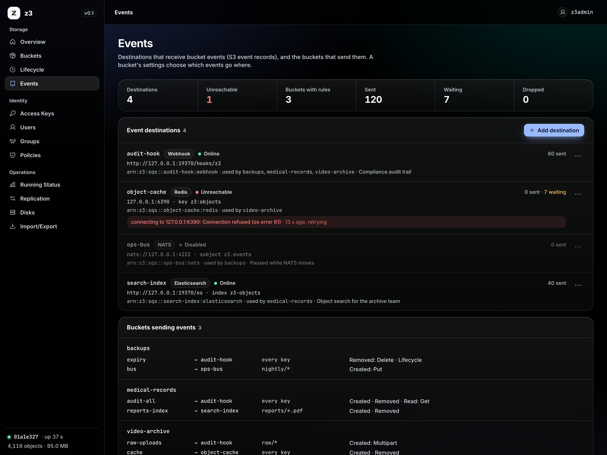
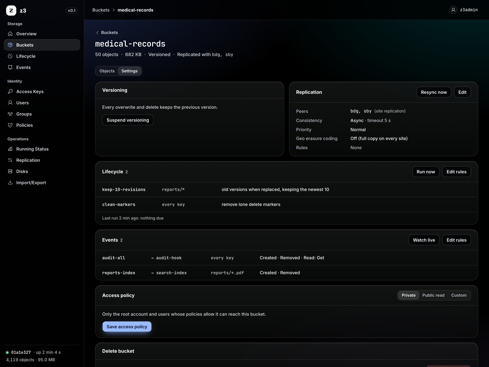

z3 can tell other systems when something happens to an object: it was written, read, tagged,
moved to a tier or deleted. Two things work together:

- **Event destinations** receive the events: a webhook, Redis, NATS, Elasticsearch, Kafka, RabbitMQ
  (AMQP), MQTT, PostgreSQL, MySQL or NSQ. See [Event destinations](/events/destinations).
- **Rules** on each bucket say which events, for which keys, go to which destination.

Events use the S3 / MinIO event format, so consumers written for AWS S3 notifications or MinIO
webhooks work unchanged.

<Frame>
  
</Frame>

## Event types

| Event | When |
| --- | --- |
| `s3:ObjectCreated:Put` | `PutObject`, an upload from the console, a file written over a [file protocol](/protocols/overview) |
| `s3:ObjectCreated:Copy` | `CopyObject` |
| `s3:ObjectCreated:CompleteMultipartUpload` | A multipart upload is completed |
| `s3:ObjectRemoved:Delete` | An object, or a specific version, is deleted |
| `s3:ObjectRemoved:DeleteMarkerCreated` | A delete in a versioned bucket creates a delete marker |
| `s3:ObjectAccessed:Get` | `GetObject` |
| `s3:ObjectAccessed:Head` | `HeadObject` |
| `s3:ObjectTagging:Put` | Object tags are set |
| `s3:ObjectTagging:Delete` | Object tags are removed |
| `s3:LifecycleExpiration:Delete` | A [lifecycle](/storage/lifecycle) rule removes a version |
| `s3:LifecycleExpiration:DeleteMarkerCreated` | A lifecycle rule expires a current version and leaves a delete marker |
| `s3:ObjectTransition:Complete` | Lifecycle moved a version to a [tier](/storage/tiers) |
| `s3:ObjectTransition:Failed` | Moving a version to a tier failed |

Every group can be chosen as a whole with a wildcard: `s3:ObjectCreated:*`, `s3:ObjectRemoved:*`,
`s3:ObjectAccessed:*`, `s3:ObjectTagging:*`, `s3:LifecycleExpiration:*` and
`s3:ObjectTransition:*`.

A rule picks keys with a **prefix** and a **suffix** (each at most 1024 bytes). A bucket has at most
100 rules. When several rules match the same destination, that destination still gets the event
once.

<Note>
  Downloads from the console do not send `s3:ObjectAccessed:Get`. Bucket-level events
  (`s3:BucketCreated`, `s3:BucketRemoved`) and MinIO's replication events are not sent.
</Note>

## What a destination receives

The body is MinIO's webhook body: the event name, `bucket/key`, and one S3 event record.

```json
{
  "EventName": "s3:ObjectCreated:Put",
  "Key": "media/photos/cat.jpg",
  "Records": [
    {
      "eventVersion": "2.0",
      "eventSource": "z3:s3",
      "awsRegion": "",
      "eventTime": "2026-11-17T08:30:00.123Z",
      "eventName": "s3:ObjectCreated:Put",
      "userIdentity": { "principalId": "uploader" },
      "requestParameters": { "principalId": "uploader", "region": "", "sourceIPAddress": "10.0.0.9" },
      "responseElements": { "x-z3-origin-node": "01a1e327-..." },
      "s3": {
        "s3SchemaVersion": "1.0",
        "configurationId": "jpegs",
        "bucket": { "name": "media", "ownerIdentity": { "principalId": "uploader" }, "arn": "arn:aws:s3:::media" },
        "object": {
          "key": "photos/cat.jpg",
          "size": 48213,
          "eTag": "9b2cf535f27731c974343645a3985328",
          "contentType": "image/jpeg",
          "userMetadata": { "camera": "x100" },
          "versionId": "01a1e3276f0a7c119d1e3c5b8a2f4e10",
          "sequencer": "019A9131D1F30000"
        }
      },
      "source": { "host": "10.0.0.9", "port": "", "userAgent": "aws-cli/2.17" }
    }
  ]
}
```

- `principalId` is the access key that sent the request, `anonymous` for a public request, and
  `z3:lifecycle` for lifecycle actions.
- `configurationId` is the id of the rule that matched.
- `awsRegion` is the `region.name` [setting](/operations/settings#region), empty when it is not set.
- `x-z3-origin-node` is the node that sent the event.
- The object key in the record is URL-encoded, as in S3. `size`, `eTag`, `contentType` and
  `userMetadata` are left out for removals.

## Set up rules

Create the destination first, then add rules to the bucket.

<Tabs>
  <Tab title="Console">

Open the bucket, then **Settings → Events**. Add a rule: pick the destination, the events, and an
optional prefix and suffix. **Watch live** shows every event of the bucket as it happens, whether
or not a rule matches it (see [Watch events live](/events/listen)).

<Frame>
  
</Frame>

The **Events** page lists every destination with its delivery status, and the rules of every
bucket.

  </Tab>
  <Tab title="S3 API">

Use `PutBucketNotificationConfiguration` with a `QueueConfiguration`. The queue ARN names the
destination: `arn:z3:sqs::<name>:<kind>`, for example `arn:z3:sqs::audit-hook:webhook`. MinIO's form
`arn:minio:sqs::<name>:<kind>` is accepted too.

```bash
aws --endpoint-url http://127.0.0.1:9000 s3api put-bucket-notification-configuration \
  --bucket media --notification-configuration '{
    "QueueConfigurations": [
      {"Id": "jpegs", "QueueArn": "arn:z3:sqs::audit-hook:webhook",
       "Events": ["s3:ObjectCreated:*"],
       "Filter": {"Key": {"FilterRules": [{"Name": "prefix", "Value": "photos/"},
                                          {"Name": "suffix", "Value": ".jpg"}]}}}]}'
```

An empty configuration removes the bucket's rules. `GetBucketNotificationConfiguration` returns
them.

`TopicConfiguration` and `LambdaFunctionConfiguration` are refused; use `QueueConfiguration`.

  </Tab>
  <Tab title="Admin API">

```bash
curl -X PUT http://127.0.0.1:9001/api/buckets/media/notifications \
  -H "Authorization: Bearer $TOKEN" -H "Content-Type: application/json" \
  -d '{"rules": [{"id": "jpegs", "target": "audit-hook",
                  "events": ["s3:ObjectCreated:*"], "prefix": "photos/", "suffix": ".jpg"}]}'
```

A rule without an `id` gets `rule-1`, `rule-2` and so on. See
[Events and audit API](/api/admin-events-audit#bucket-rules).

  </Tab>
</Tabs>

### Permissions

| What | Right |
| --- | --- |
| Read a bucket's rules | `s3:GetBucketNotification` |
| Change or remove a bucket's rules | `s3:PutBucketNotification` |
| Watch a bucket's events live | `s3:ListenBucketNotification` |
| Watch every bucket's events (S3 port) | `s3:ListenNotification` |
| Add, change, test or remove destinations | `admin:ConfigUpdate` |
| See destinations and their status | `admin:ServerInfo` |

## Delivery

- An event is saved in the node's metadata **before the S3 request finishes**, then sent to each
  destination in order. It leaves the queue once the destination has accepted it, so delivery is
  *at least once*: a consumer can see an event twice after a crash.
- When a destination cannot be reached, its events wait and are retried with a growing pause,
  from 1 second up to 60 seconds. The queue survives restarts (local documents under `evq/`).
- Each destination keeps at most `queue_limit` events (10,000 by default, at most 1,000,000). When
  the queue is full, **new** events for that destination are dropped and counted as *dropped*.
- A disabled destination neither receives nor queues events.
- A destination that a bucket rule still uses cannot be deleted; remove the rules first.

The Events page shows each destination's state (**Online**, **Catching up**, **Unreachable**,
**Disabled**), how many events were sent, how many wait, how many were dropped, and the last
error.

## With replication

Rules and destinations are stored as cluster documents, like bucket policies. With
[site replication](/replication/site-replication) they reach every site, destination secrets
included (sealed again with the site group's key).

Each node sends events only for the requests it served itself, and for its own lifecycle actions.
Writes that arrive through replication do not send events again. So one change produces exactly
one event, even when every site has the same rule. Every site must be able to reach the
destination. `x-z3-origin-node` in the record says which node sent it.

With bucket replication only (no site replication), set up the destinations and rules on each
node.
