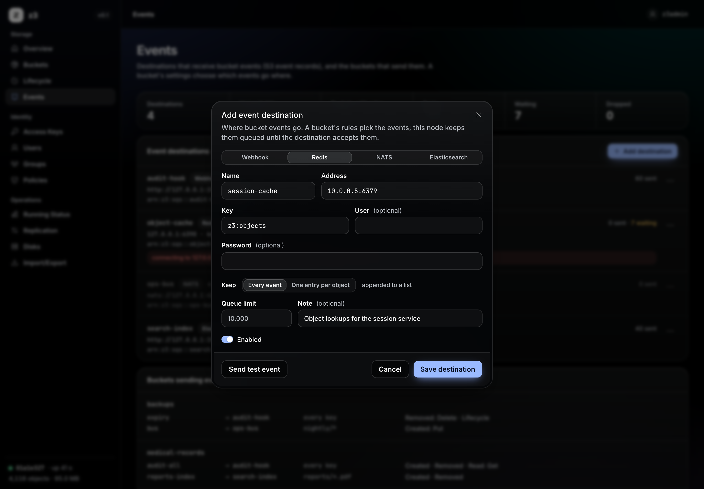

An event destination is where [bucket events](/events/bucket-events) go. Each has a name, a type,
an endpoint and the few fields its type needs. Bucket rules point at destinations by name.

| Type (`kind`) | How events are sent |
| --- | --- |
| `webhook` | `POST` of the JSON body to a URL, optionally with an `Authorization` header |
| `redis` | `RPUSH` to a list (every event), or `HSET` / `HDEL` on a hash (one entry per object) |
| `nats` | `PUB` to a subject, confirmed with `PING` / `PONG` |
| `elasticsearch` | A new document per event, or one document per object |
| `kafka` | A record on a topic, keyed by `bucket/key` |
| `amqp` | `basic.publish` to an exchange with a routing key, with publisher confirms (RabbitMQ) |
| `mqtt` | `PUBLISH` to a topic with QoS 0 or 1 (MQTT 3.1.1) |
| `postgresql` | One row per object (upsert and delete), or a new row per event |
| `mysql` | Same as PostgreSQL |
| `nsq` | `PUB` over nsqd's TCP protocol, or `POST /pub` to nsqd's HTTP API |

## Add a destination

<Tabs>
  <Tab title="Console">

Go to **Events → Add destination**. The dialog has three tabs: **Connection**, **Sign-in & TLS** and
**Delivery**; the fields shown follow the type. **Send test event** sends an `s3:TestEvent` to the
destination as entered and shows the error if it fails.

<Frame>
  
</Frame>

  </Tab>
  <Tab title="Admin API">

```bash
curl -X PUT http://127.0.0.1:9001/api/events/targets/objects-redis \
  -H "Authorization: Bearer $TOKEN" -H "Content-Type: application/json" \
  -d '{"kind": "redis", "endpoint": "10.0.0.5:6379", "secret": "redis-password",
       "key": "z3:objects", "format": "namespace", "queue_limit": 10000}'
```

`POST /api/events/test` with the same body tests it without saving. See
[Events and audit API](/api/admin-events-audit#event-destinations).

  </Tab>
</Tabs>

Changing destinations needs `admin:ConfigUpdate`.

## Fields

Fields that do not apply to a type can be left out.

| Field | Meaning |
| --- | --- |
| `name` | 1 to 64 letters, digits, `-` or `_` (the path in the API) |
| `kind` | One of the types above |
| `enabled` | `true` by default. A disabled destination receives and queues nothing |
| `endpoint` | Where to connect; the form depends on the type (see below) |
| `user` | User name: Redis ACL, NATS, Elasticsearch basic auth, Kafka SASL, AMQP, MQTT, PostgreSQL, MySQL |
| `secret` | Webhook: the `Authorization` value. Others: the password (NATS: a token when there is no user) |
| `key` | Redis key, NATS subject, Elasticsearch index, Kafka / MQTT / NSQ topic, AMQP routing key, PostgreSQL / MySQL table |
| `format` | `access` (default) or `namespace`, for Redis, Elasticsearch, PostgreSQL and MySQL |
| `queue_limit` | Most events kept while the destination is unreachable. `0` means the default, 10,000; at most 1,000,000 |
| `comment` | Free text |
| `tls`, `tls_ca`, `tls_skip_verify` | TLS options (see [TLS](#tls)) |
| `sasl` | Kafka only |
| `exchange`, `exchange_type`, `durable` | AMQP only |
| `qos` | MQTT only |

Secrets are stored sealed and never shown again; the API answers `has_secret` instead. When you
update a destination, leave `secret` out to keep the current one, or send `""` to remove it.

<Warning>
  Never put a password in an endpoint URL: z3 refuses it. Put it in `secret`, where it is stored
  sealed.
</Warning>

### `format`: a stream or one entry per object

- `access` keeps every event: a list item, a new document, a new row.
- `namespace` keeps one entry per object, keyed by `bucket/key`: written again on every write and
  removed when the object is removed. It mirrors what the bucket holds.

## Per type

### Webhook

| Field | Value |
| --- | --- |
| `endpoint` | An `http://` or `https://` URL |
| `secret` | Optional. Sent as the `Authorization` header; a value without a space gets `Bearer ` in front |

Each event is a `POST` with `Content-Type: application/json`. Any `2xx` answer counts as delivered;
anything else is retried.

### Redis

| Field | Value |
| --- | --- |
| `endpoint` | `host:port` (port 6379 when left out), `redis://host:port`, or `rediss://host:port` for TLS |
| `key` | Required: the list or hash |
| `user`, `secret` | Optional ACL user and password |
| `format` | `access`: `RPUSH key <event>`. `namespace`: `HSET key bucket/key <event>`, and `HDEL` when the object is removed |

### NATS

| Field | Value |
| --- | --- |
| `endpoint` | `host:port` (port 4222 when left out), `nats://host:port`, or `tls://host:port` for TLS |
| `key` | Required: the subject, without spaces |
| `user`, `secret` | User and password, or only `secret` for a token |

Each event is published with `PUB` and confirmed with a `PING` / `PONG`. NATS starts TLS after its
`INFO` line, also when the server requires it (`tls_required`).

### Elasticsearch

| Field | Value |
| --- | --- |
| `endpoint` | The cluster's `http://` or `https://` URL |
| `key` | Required: the index, in lower case |
| `user`, `secret` | Optional basic auth |
| `format` | `access`: `POST /<index>/_doc`, a new document per event. `namespace`: `PUT /<index>/_doc/<bucket/key>`, and `DELETE` when the object is removed |

### Kafka

| Field | Value |
| --- | --- |
| `endpoint` | Brokers, separated by commas: `k1:9092,k2:9092` |
| `key` | Required: the topic, which must already exist (letters, digits, `.`, `_`, `-`, at most 249) |
| `sasl` | `plain`, `scram-sha-256` or `scram-sha-512`. Empty: no SASL, unless `user` is set, which means `plain` |
| `user`, `secret` | SASL user and password |

The record key is `bucket/key`, so the events of one object land in the same partition, in order.
OAUTHBEARER, compression and creating topics are not supported.

### RabbitMQ (AMQP 0-9-1)

| Field | Value |
| --- | --- |
| `endpoint` | `amqp://host:5672/vhost`, or `amqps://` for TLS |
| `key` | The routing key (at most 255 bytes). With the default exchange it is the queue name and is required |
| `exchange` | Empty for the default exchange, or a name (letters, digits, `-`, `_`, `.`, `:`, at most 127) |
| `exchange_type` | `direct` (default), `topic`, `fanout` or `headers` |
| `durable` | A durable exchange and persistent messages |
| `user`, `secret` | Defaults to `guest` / `guest` when both are empty |

z3 uses publisher confirms: an event leaves the queue only once the broker has taken it.

### MQTT 3.1.1

| Field | Value |
| --- | --- |
| `endpoint` | `host:port`, `mqtt://` or `tcp://`, or `mqtts://` / `ssl://` for TLS |
| `key` | Required: the topic to publish to, without `+` or `#` wildcards |
| `qos` | `0` (counts as sent once written) or `1` (waits for `PUBACK`) |
| `user`, `secret` | Optional |

### PostgreSQL

| Field | Value |
| --- | --- |
| `endpoint` | `postgres://user@host:5432/db`, or the key-value form `host=... user=... dbname=...`. Add `sslmode=require` for TLS |
| `key` | Required: `table` or `schema.table` (letters, digits and `_`) |
| `user` | When the endpoint names no user |
| `secret` | The password |

### MySQL

| Field | Value |
| --- | --- |
| `endpoint` | `mysql://user@host:3306/db` |
| `key` | Required: `table` or `database.table`. Without a database in the URL, write `database.table` |
| `user`, `secret` | User and password |

#### Table layout

z3 creates the table when it is missing, with MinIO's layout:

| `format` | PostgreSQL | MySQL |
| --- | --- | --- |
| `namespace` | `key VARCHAR PRIMARY KEY, value JSONB` | `key_name VARBINARY(2048) PRIMARY KEY, value JSON` |
| `access` | `event_time TIMESTAMP WITH TIME ZONE, event_data JSONB` | `event_time DATETIME(3), event_data JSON` |

`key` / `key_name` is `bucket/key`, `value` / `event_data` the whole event, and `event_time` the
record's `eventTime`. With `namespace`, a write upserts the row (`ON CONFLICT` /
`ON DUPLICATE KEY`) and a removal deletes it.

### NSQ

| Field | Value |
| --- | --- |
| `endpoint` | nsqd's TCP address `host:4150`, or its HTTP API `http://host:4151` |
| `key` | Required: the topic (letters, digits, `.`, `_`, `-`, at most 64) |

TLS and `AUTH` over NSQ's TCP protocol are not supported; use nsqd's HTTP API behind HTTPS
instead.

## TLS

Redis, NATS, Kafka, AMQP, MQTT, PostgreSQL and MySQL take these options:

| Field | Meaning |
| --- | --- |
| `tls` | Connect with TLS. A TLS scheme in the endpoint turns it on as well: `rediss://`, `tls://`, `amqps://`, `mqtts://`, `ssl://`, or `sslmode=require` for PostgreSQL |
| `tls_ca` | PEM certificates of the CAs to trust instead of the public ones (one or more, at most 64 KiB) |
| `tls_skip_verify` | Accept any certificate. Only for tests |

Webhooks, Elasticsearch and NSQ over HTTPS check certificates against the public CAs; they have no
own-CA or skip-verify option.

## Test a destination

**Send test event** in the console, or `POST /api/events/test`, sends one `s3:TestEvent` record (bucket
`z3-test`, key `z3-test-event`) straight to the destination as entered, without queueing:

```json
{ "ok": false, "ms": 0, "error": "error sending request for url (http://10.0.0.7/hook): client error (Connect)" }
```

When you test a saved destination without entering its secret again, the saved secret is used.
