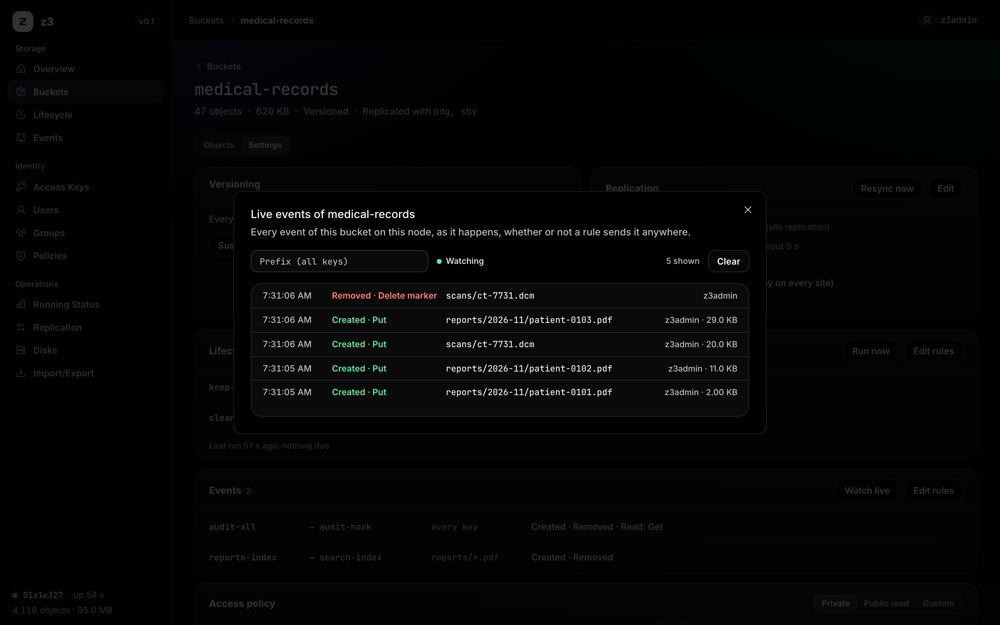

Besides sending events to [destinations](/events/destinations), Zee3 can stream them to whoever is
watching. Watching needs **no bucket rule**: you see every event of the bucket while the connection
lasts. Events that happen while nobody watches are not kept for later.

There are three ways to watch:

| Where | How | Right |
| --- | --- | --- |
| S3 port (9000) | `ListenBucketNotification`, as in MinIO: `mc event listen`, `mc watch`, minio-go and other MinIO SDKs | `s3:ListenBucketNotification` (`s3:ListenNotification` for every bucket) |
| Console | **Watch live** in a bucket's Events settings | `s3:ListenBucketNotification` |
| Admin API (9001) | `GET /api/buckets/{bucket}/events/listen`, server-sent events | `s3:ListenBucketNotification` |

## On the S3 port

Zee3 answers MinIO's `ListenBucketNotification` request:

```
GET /{bucket}?events=s3:ObjectCreated:*&events=s3:ObjectRemoved:*&prefix=photos/&suffix=.jpg&ping=10
```

- The request is signed like any other S3 request (SigV4) and needs `s3:ListenBucketNotification`
  on the bucket. A bucket that does not exist answers `NoSuchBucket`.
- `GET /?events=...`, without a bucket, follows **every** bucket and needs `s3:ListenNotification`
  (MinIO's `ListenNotification`).
- `events` may be repeated or comma-separated. Without it, or with `s3:*`, every event is sent. An
  unknown event name is refused with `InvalidArgument`.
- `prefix` and `suffix` filter keys.
- The answer keeps streaming: one JSON line `{"Records":[...]}` per event, with the same record as
  [destinations receive](/events/bucket-events#what-a-destination-receives), and a single space
  every `ping` seconds (default 10, from 1 to 60) so proxies keep the connection open.

<Note>
  Only path-style addresses work (`/bucket?events=`). Virtual-hosted addresses (`bucket.host`) are
  not supported for listening.
</Note>

### With mc

```bash
mc alias set zee3 http://127.0.0.1:9000 zee3admin zee3admin-secret
mc event listen zee3/photos --event put,delete --prefix 2026/ --suffix .jpg
```

`mc watch zee3/photos` works too.

### With minio-go

```go
for info := range client.ListenBucketNotification(ctx, "photos", "2026/", ".jpg",
    []string{"s3:ObjectCreated:*", "s3:ObjectRemoved:*"}) {
    if info.Err != nil {
        log.Fatal(info.Err)
    }
    for _, r := range info.Records {
        fmt.Println(r.EventName, r.S3.Object.Key)
    }
}
```

## In the console

Open the bucket, then **Settings → Events → Watch live**. Every event of the bucket shows as it
happens, with the event name, key, size and who caused it.

<Frame>
  
</Frame>

## Through the admin API

`GET /api/buckets/{bucket}/events/listen` streams the bucket's events as server-sent events.

| Query | Meaning |
| --- | --- |
| `prefix` | Only keys starting with this |
| `suffix` | Only keys ending with this |
| `events` | Comma-separated event names or wildcards; empty for every event |

Each message is one event:

```json
{"bucket": "photos", "key": "2026/cat.jpg", "event": "s3:ObjectCreated:Put", "record": { "eventName": "s3:ObjectCreated:Put", "...": "..." }}
```

A `lagged` message, whose data is a number, says that many events were skipped because the reader
fell behind. A keep-alive comment is sent every 15 seconds.

```bash
curl -N -H "Authorization: Bearer $TOKEN" \
  "http://127.0.0.1:9001/api/buckets/photos/events/listen?events=s3:ObjectCreated:*"
```

Browsers cannot set headers on an `EventSource`; pass the token as `?token=` instead.

## With site replication

Each node streams the events of the requests it serves, like it sends them to destinations. To
watch a bucket across every site, watch it on each site.
