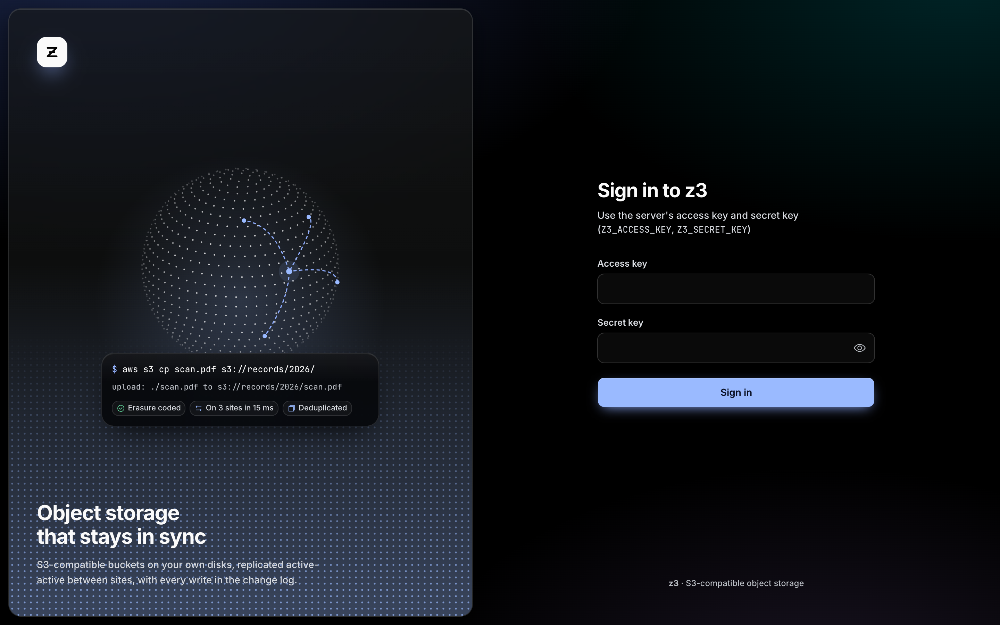
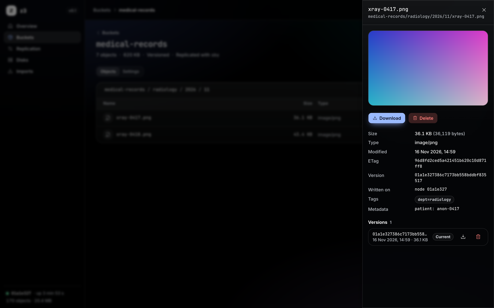

This gets Zee3 running on your machine with Docker, the quickest way to try it. For a server install,
see [Install](/deploy/install).

<Steps>
  <Step title="Start Zee3">
    ```bash
    docker run -d --name zee3 --restart unless-stopped \
      -p 9000:9000 -p 9001:9001 \
      -v zee3-data:/data \
      terrificci/zee3:latest
    ```

    The S3 API listens on port **9000** and the console on **9001**. Data is kept in the `zee3-data`
    volume. For a Compose file and every setting, see [Docker](/deploy/docker).
  </Step>
  <Step title="Choose the root credentials">
    Open `http://localhost:9001`. A new node has no root account yet, so the console shows the
    **setup page** and nothing else runs (the S3 API starts once setup is done). Choose **New node**
    and pick the root access key and secret key, for example `admin` and `change-me-please`.

    <Warning>
      Choose the secret with care: user secrets and internal KMS keys are sealed with a key derived
      from it, so it can't be changed later. The access key needs 3 to 128 letters, digits or
      `. _ - @`; the secret key 8 to 128 characters.
    </Warning>

    <Tip>
      For an unattended install, set `ZEE3_ACCESS_KEY` and `ZEE3_SECRET_KEY` instead (add
      `-e ZEE3_ACCESS_KEY=admin -e ZEE3_SECRET_KEY=change-me-please` to `docker run`): with them set,
      the setup page never shows. To add this node to Zee3 nodes you already run, choose
      **Join a Zee3** instead; see [Join from the setup page](/replication/site-replication#join-from-the-setup-page).
    </Tip>
  </Step>
  <Step title="Sign in to the console">
    Sign in with the access key and secret key you chose (`admin` and `change-me-please` above).

    <Frame>
      
    </Frame>
  </Step>
  <Step title="Create a bucket">
    <Tabs>
      <Tab title="Console">
        Go to **Buckets**, choose **Create bucket** and name it `photos`.
      </Tab>
      <Tab title="AWS CLI">
        ```bash
        export AWS_ACCESS_KEY_ID=admin
        export AWS_SECRET_ACCESS_KEY=change-me-please
        export AWS_DEFAULT_REGION=us-east-1
        aws --endpoint-url http://localhost:9000 s3 mb s3://photos
        ```
      </Tab>
    </Tabs>
  </Step>
  <Step title="Upload and list with the AWS CLI">
    With the variables from the previous step:

    ```bash
    aws --endpoint-url http://localhost:9000 s3 cp ./photo.jpg s3://photos/
    aws --endpoint-url http://localhost:9000 s3 ls s3://photos/
    ```

    Open the bucket in the console to see the object, preview it and download it.

    <Frame>
      
    </Frame>
  </Step>
</Steps>

<Note>
  Zee3 uses **path-style** addressing (`http://host:9000/bucket/key`). Most clients do that
  automatically for a custom endpoint; see [Clients](/get-started/clients) for the settings of each
  one.
</Note>

## Next steps

<CardGroup cols={2}>
  <Card title="Concepts" icon="sitemap" href="/get-started/concepts">
    Buckets, versions, chunks, disks, pools, peers and sites.
  </Card>
  <Card title="Clients" icon="terminal" href="/get-started/clients">
    AWS CLI, boto3, mc, rclone and s3cmd.
  </Card>
  <Card title="Deploy for real" icon="server" href="/deploy/install">
    systemd, several disks, TLS and upgrades.
  </Card>
  <Card title="Users and keys" icon="users" href="/access/users-groups-keys">
    Give applications their own credentials instead of the root account.
  </Card>
</CardGroup>
