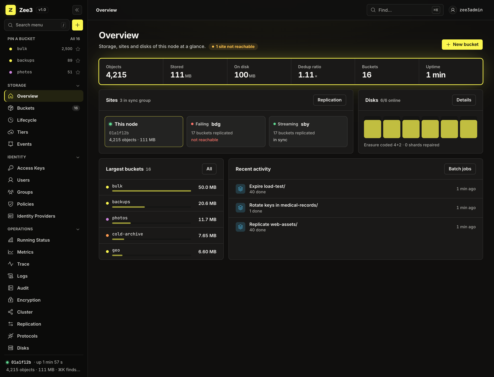

Zee3 is **one binary**, `zee3`, that serves the S3 API, a web console and an admin API. Point any S3
client at it (the AWS CLI, boto3, rclone, `mc`, s3cmd) and store objects on one disk, on a set of
disks with erasure coding, or across several sites that all accept writes.

It is written in Rust and built around replication: every node keeps an ordered change log,
peers pull only the chunks they don't have yet, and concurrent writes are resolved the same way on
every node without losing either version.

<Frame>
  
</Frame>

<CardGroup cols={2}>
  <Card title="Quickstart" icon="rocket" href="/get-started/quickstart">
    Run Zee3 with Docker, sign in to the console and upload a file in a few minutes.
  </Card>
  <Card title="Install" icon="download" href="/deploy/install">
    Docker image, Linux binaries, or a systemd service in one command.
  </Card>
  <Card title="Replication" icon="clone" href="/replication/overview">
    Active-active buckets, whole-site replication and geo erasure coding.
  </Card>
  <Card title="Migrate from MinIO" icon="right-left" href="/deploy/migrate-from-minio">
    Copy every bucket, version and delete marker from MinIO or any S3 store.
  </Card>
</CardGroup>

## What Zee3 does

<AccordionGroup>
  <Accordion title="S3 API" icon="bucket">
    Buckets, versioning, objects with ranges, metadata, tags and conditional requests, ListObjects
    V1 and V2, ListObjectVersions, CopyObject, DeleteObjects, multipart uploads and presigned URLs,
    signed with Signature V4 (V2 can be turned on). See [S3 compatibility](/api/s3-compatibility).
  </Accordion>
  <Accordion title="Deduplicated chunks" icon="cubes">
    Objects are cut into content-defined chunks (about 1 MiB on average) stored by their BLAKE3
    hash, so the same data is stored once. Copies and completed multipart uploads only reference
    existing chunks. Every chunk is verified when it is read. See [Concepts](/get-started/concepts).
  </Accordion>
  <Accordion title="Erasure coding and healing" icon="hard-drive">
    Spread chunks over several disks, or over the members of a cluster, with Reed-Solomon parity,
    keep serving when disks or members fail, and repair damaged or missing shards automatically.
    Add capacity with new disk pools, then rebalance or decommission. See
    [Erasure coding](/durability/erasure-coding), [Healing](/durability/healing),
    [Pools](/durability/pools) and [Cluster](/deploy/cluster#erasure-coding-across-members).
  </Accordion>
  <Accordion title="Active-active replication" icon="arrows-rotate">
    Every node accepts writes. Changes arrive in milliseconds over long-polling, only missing chunks
    travel, and Merkle trees repair any drift. Choose async, quorum or all-peer consistency, filter
    by prefix or tag, and pin data to allowed sites. See [Replication](/replication/overview).
  </Accordion>
  <Accordion title="Site replication and geo erasure coding" icon="earth-asia">
    One call joins several sites: every bucket, bucket setting and IAM change follows. Instead of a
    full copy per site, a bucket can be split into shards across sites. See
    [Site replication](/replication/site-replication) and
    [Geo erasure coding](/replication/geo-erasure-coding).
  </Accordion>
  <Accordion title="Identity and access" icon="users">
    Users, groups, AWS-style policies with conditions, access keys with their own limits and expiry,
    bucket policies, OpenID Connect and LDAP sign-in, and temporary credentials through STS. See
    [Users, groups and keys](/access/users-groups-keys).
  </Accordion>
  <Accordion title="Encryption" icon="lock">
    SSE-S3, SSE-KMS and SSE-C with a per-object data key, default encryption per bucket, and an
    internal KMS or an external one (HashiCorp Vault, MinIO KES, AWS KMS, Azure Key Vault, Google
    Cloud KMS). See [Encryption](/security/encryption).
  </Accordion>
  <Accordion title="Data management" icon="clock-rotate-left">
    Lifecycle rules, transitions to remote tiers (S3, MinIO or another Zee3, Google Cloud Storage,
    Azure Blob), Object Lock, bucket tags and quotas, compression and batch jobs. See
    [Lifecycle](/storage/lifecycle) and [Tiers](/storage/tiers).
  </Accordion>
  <Accordion title="Events, audit and metrics" icon="bell">
    Bucket events to webhooks, Redis, NATS, Elasticsearch, Kafka, RabbitMQ, MQTT, PostgreSQL, MySQL
    and NSQ; an audit log of every request; live trace and logs; historical metrics and Prometheus.
    See [Bucket events](/events/bucket-events) and [Audit log](/audit/audit-log).
  </Accordion>
  <Accordion title="File protocols" icon="folder-open">
    Open buckets over WebDAV, FTP/FTPS, SFTP and NFSv3, with the same IAM checks as S3. See
    [File protocols](/protocols/overview).
  </Accordion>
</AccordionGroup>

## How fast

On one machine with the same limits for each server (2 CPUs, 2 GiB of memory, one drive), measured
with warp:

| Workload | Zee3 1.0.0 | MinIO | RustFS |
|---|---|---|---|
| PUT 1 MiB | **150.7 MiB/s** | 124.4 MiB/s | 102.2 MiB/s |
| GET 1 MiB | **1,486 MiB/s** | 1,265 MiB/s | 609 MiB/s |
| PUT 16 KiB | 796 objects/s | 732 objects/s | **886 objects/s** |
| GET 16 KiB | **5,759 objects/s** | 3,357 objects/s | 5,439 objects/s |
| HEAD 16 KiB | **10,068 objects/s** | 3,663 objects/s | 7,839 objects/s |
| Peak memory | **174 MiB** | 997 MiB | 284 MiB |

The setup, every workload and how to run it yourself are on [Benchmarks](/deploy/benchmarks).

## One program

The console is built into the binary, and so are the database, the replication protocol and the
`zee3 admin` command line. Run it without arguments to start a node; `zee3 admin ...` manages a running
node through its admin API (see the [CLI](/cli/overview)).

A node listens on three ports:

| Port | Default address | What |
| --- | --- | --- |
| 9000 | `0.0.0.0:9000` | S3 API |
| 9001 | `127.0.0.1:9001` | Console and admin API |
| 9002 | `0.0.0.0:9002` | Replication API that peers pull from (only once the node has a peer token) |

Zee3 runs on Linux (amd64 and arm64) as a [Docker image](/deploy/docker), a
[systemd service](/deploy/systemd) or the [release binaries](/deploy/install), and on macOS in Docker.

## Source and releases

Zee3 is on GitHub at [terrific-ci/z3](https://github.com/terrific-ci/z3). Every release is published
there with binaries for Linux, and as the Docker image
[`terrificci/zee3`](https://hub.docker.com/r/terrificci/zee3).

<CardGroup cols={2}>
  <Card title="GitHub" icon="github" href="https://github.com/terrific-ci/z3">
    Source, issues and the install script.
  </Card>
  <Card title="Releases" icon="tag" href="https://github.com/terrific-ci/z3/releases">
    Every version with its binaries and checksums.
  </Card>
</CardGroup>

## Support Zee3

Zee3 is free to use. If it is useful to you, you can support its development with a
contribution through [PayPal](https://www.paypal.com/paypalme/alfianlensun).

<Card title="Support Zee3" icon="heart" href="https://www.paypal.com/paypalme/alfianlensun">
  A one-time contribution through PayPal helps keep Zee3 going.
</Card>
