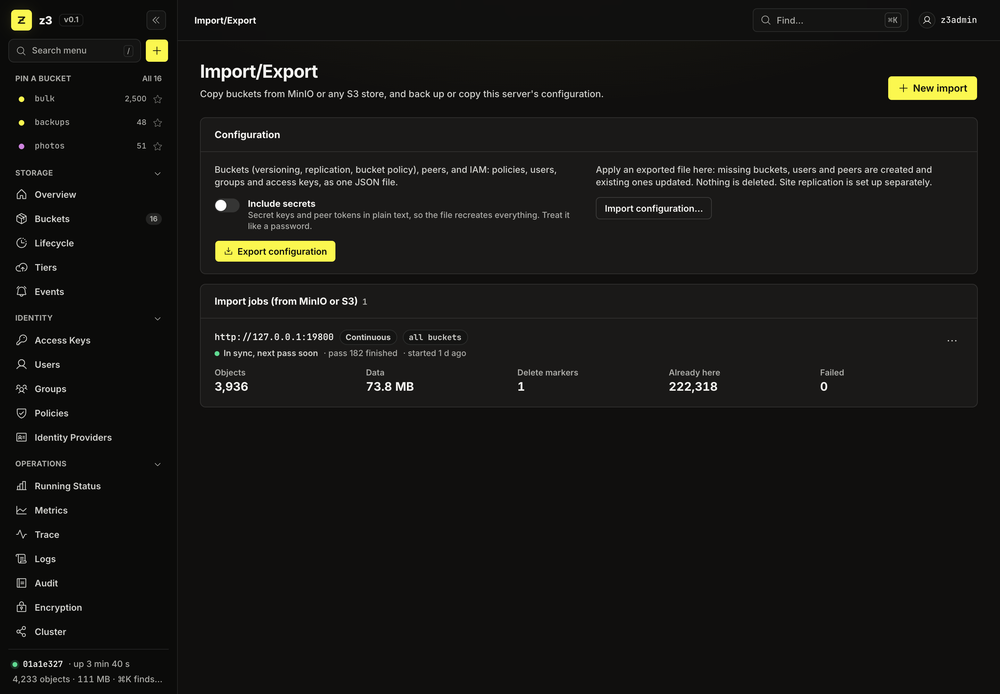

Zee3 can save its whole configuration as one JSON document: buckets and their settings, IAM, event
destinations, audit targets, peers, KMS keys, tiers and cluster settings. Import applies such a
file to a node. Use it to back a configuration up, or to set up a second node like the first.

Objects are not part of it. To copy data, use [replication](/replication/overview),
[batch replicate](/storage/batch) or an [import from S3](/deploy/migrate-from-minio).

<Frame>
  
</Frame>

## What the file holds

| Part | Contents |
| --- | --- |
| `buckets` | Each bucket's name, versioning, replication, bucket policy, lifecycle rules, event rules, Object Lock, tags, quota and default encryption |
| `iam` | Policies, users, groups and access keys. Only when the exporter has `admin:UserAdmin` |
| `event_targets` | [Event destinations](/events/destinations) |
| `audit_targets` | [Audit targets](/audit/audit-log) |
| `peers` | Replication peers |
| `site` | The site replication configuration (listed, never imported) |
| `kms_keys` | Internal KMS master keys. Only in an export with secrets |
| `kms_external` | The [external KMS](/security/external-kms) settings (Vault, KES, AWS KMS, Azure Key Vault or Google Cloud KMS). Its credentials (Vault token or AppRole secret id, KES client key, AWS secret access key and session token, Azure client secret, Google Cloud service account key) only in an export with secrets |
| `kms_external_retired` | [Retired key stores](/security/external-kms#retired-key-stores), the same way. Left out when there are none, like `kms_external` |
| `tiers` | [Tiers](/storage/tiers) |
| `settings` | The [cluster settings](/operations/settings) that are set |

The top of the file says what it is:

```json
{
  "zee3_config": 1,
  "exported_ms": 1794921056000,
  "node_id": "01a1e9a0-be79-7462-83e2-8685ea015598",
  "includes_secrets": false,
  "buckets": [
    { "name": "logs", "versioning": "Enabled", "replication": null, "policy": null,
      "lifecycle": null, "notifications": { "rules": [ { "id": "rule-1", "target": "hook",
      "events": ["s3:ObjectCreated:*"], "prefix": "app/", "suffix": "" } ] },
      "object_lock": null, "tags": null, "quota": null, "encryption": null }
  ],
  "peers": [], "site": null,
  "iam": { "policies": [], "users": [], "groups": [], "access_keys": [] },
  "event_targets": [], "audit_targets": [], "kms_keys": [], "tiers": [], "settings": {}
}
```

## Secrets

By default the export has **no secrets**: no user or access key secret keys, peer and site tokens,
destination and target secrets, tier secret keys, KMS keys, or external KMS credentials.

An export **with secrets** has all of them. It needs both `admin:UserAdmin` and
`admin:ConfigUpdate`. Without the KMS keys, encrypted objects cannot be read on another node, so
moving encrypted data needs an export with secrets.

<Warning>
  An export with secrets holds every credential of the node in plain text. Store it like a
  password vault, and delete copies you no longer need.
</Warning>

## Export

<Tabs>
  <Tab title="Console">

**Import/Export → Export configuration**, optionally with **Include secrets** turned on. The browser
downloads the JSON file.

  </Tab>
  <Tab title="API">

```bash
curl -fsS -H "Authorization: Bearer $TOKEN" \
  "http://127.0.0.1:9001/api/config/export?secrets=false" -o zee3-config.json
```

The answer suggests the file name `zee3-config-<unix time>.json` and is sent with
`Cache-Control: no-store`.

  </Tab>
</Tabs>

Exporting needs `admin:ServerInfo`.

## Import

<Tabs>
  <Tab title="Console">

**Import/Export → Import configuration**, then pick the file. The result lists what was applied and
what was skipped, and why.

External KMS settings and retired key stores imported without credentials keep the credentials
the node already has for the same kind of KMS; a node with none skips them and says so.

  </Tab>
  <Tab title="API">

```bash
curl -fsS -X POST -H "Authorization: Bearer $TOKEN" -H "Content-Type: application/json" \
  --data-binary @zee3-config.json http://127.0.0.1:9001/api/config/import
```

```json
{
  "applied": ["policy app-rw", "user analyst created", "event destination hook", "bucket logs created",
              "bucket logs versioning Enabled", "bucket logs events", "settings: api"],
  "skipped": ["access key AKIA1EXAMPLE: no secret key in the export",
              "peer dc2: no token in the export",
              "site replication: set it up on the Replication page (it configures every site)"]
}
```

  </Tab>
</Tabs>

Importing needs `admin:ConfigUpdate`, and `admin:UserAdmin` for the IAM part (without it, IAM is
skipped with a note).

How things are applied:

- IAM comes first. Existing users are updated. A new user, or a new access key, is created only
  when the file has its secret key; otherwise it is skipped.
- Peers without a token are skipped.
- Buckets that do not exist are created, then their settings are applied. A bucket whose
  replication is managed by site replication keeps it.
- Tiers already on the node are left as they are; a new tier without its secret key is not
  imported.
- The site replication configuration is never imported: set it up on the Replication page, which
  configures every site at once ([Site replication](/replication/site-replication)).
- A file whose `zee3_config` is not `1` is refused.

Anything that cannot be applied is listed in `skipped`, and the rest still applies.
