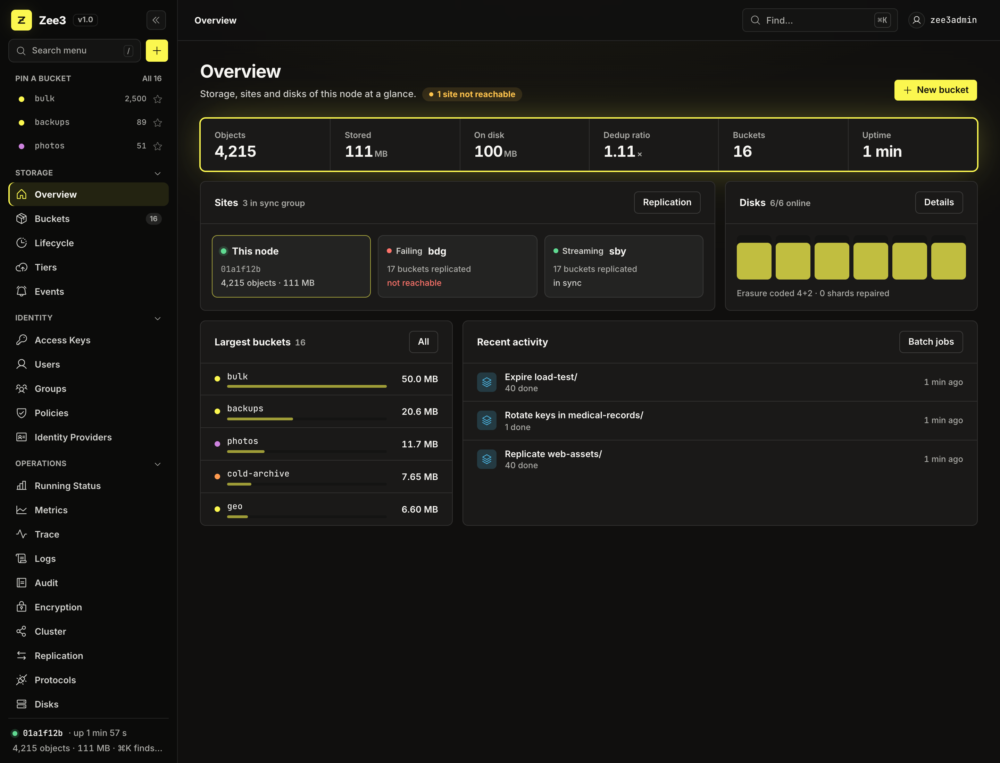
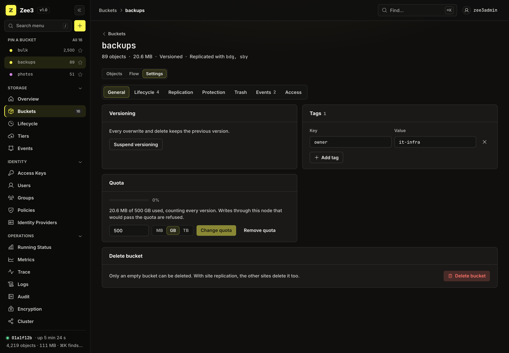
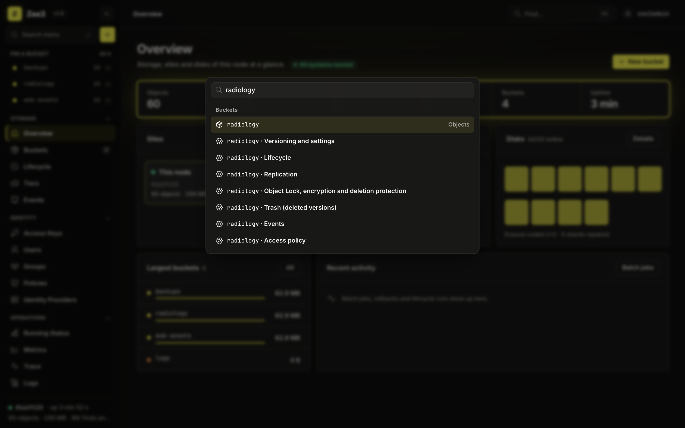
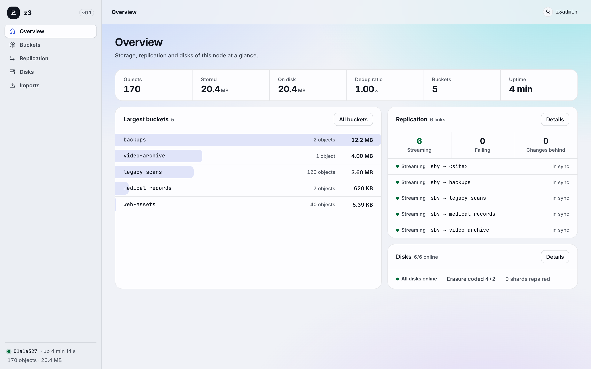

The console is z3's web interface. The same `z3` binary serves it on the admin port
(`Z3_ADMIN_ADDR`, `http://127.0.0.1:9001` by default), next to the [admin API](/api/overview) it
uses. There is nothing else to install.

<Frame>
  
</Frame>

## Signing in

Sign in with any identity z3 knows:

- the root account (`Z3_ACCESS_KEY` and `Z3_SECRET_KEY`),
- an IAM user (user name and secret key),
- an access key and its secret,
- an LDAP account, or **single sign-on** through OpenID Connect, when an
  [identity provider](/access/openid-connect-ldap) is set up.

The sign-in page has a mascot, Zee: it follows the pointer, reads along while you type the access
key, covers its eyes while you type the secret (and peeks when you pause), shakes its head when a
sign-in fails and hops when it works.

A session lasts 12 hours and is extended each time it is used. Sessions live in memory, so a
restart signs everyone out. Disabling a user or a key ends its sessions at once.

<Note>
  The admin port listens on `127.0.0.1` by default. To open the console to the network, set
  `Z3_ADMIN_ADDR=0.0.0.0:9001` and put an HTTPS reverse proxy in front of it
  ([TLS and proxies](/deploy/tls-and-proxies)).
</Note>

## The menu follows your rights

Each page needs a right. A user without admin rights sees only **Buckets** and **Access Keys**, and
only the buckets their policies let them use. See [Admin rights](/api/overview#rights).

| Section | Page | What it shows | Needs |
| --- | --- | --- | --- |
| Storage | Overview | A status pill, objects, data stored and on disk, dedup ratio, uptime; a card per site (this node and each peer, with its lag), each disk's fill, the largest buckets, and recent activity (batch jobs, rollbacks, lifecycle runs) | `admin:ServerInfo` |
| | Buckets | Every bucket with size and quota, tags, Object Lock, versioning, replication; create and delete buckets | – |
| | Lifecycle | Buckets with lifecycle rules, a summary of the rules and the last run | `admin:ServerInfo` |
| | Tiers | Remote tiers with health, contents and the buckets using them; add, check, change credentials, remove | `admin:ServerInfo` |
| | Events | [Event destinations](/events/destinations) with delivery status, and every bucket's rules | `admin:ServerInfo` |
| Identity | Access Keys | Your own access keys (everyone's, for IAM admins); a new secret is shown once | – |
| | Users, Groups, Policies | [IAM](/access/users-groups-keys), with a JSON policy editor | `admin:UserAdmin` |
| | Identity Providers | OpenID Connect, LDAP / Active Directory and STS settings, DN-to-policy mapping, a test sign-in | `admin:UserAdmin` |
| Operations | Running Status | Live throughput, CPU and memory ([Running status](/operations/running-status)) | `admin:ServerInfo` |
| | Metrics | Traffic and storage over time, per bucket too ([Metrics](/operations/metrics)) | `admin:ServerInfo` |
| | Trace | Live S3 and admin requests ([Trace and logs](/audit/trace-and-logs)) | `admin:ServerInfo` |
| | Logs | Live server logs | `admin:ServerInfo` |
| | Audit | [Audit targets](/audit/audit-log) with delivery status | `admin:ServerInfo` |
| | Encryption | KMS keys, the default SSE-S3 key, an external KMS, buckets encrypted by default | `admin:ServerInfo` |
| | Replication | Live state of each link; peers; site replication | `admin:ServerInfo` |
| | Protocols | S3 and the file protocols: on or off, settings, state, sessions, connect commands | `admin:ServerInfo` |
| | Disks | Disk state and capacity, erasure layout, healing, **Verify and repair** | `admin:ServerInfo` |
| | Pools | Pools, rebalance and decommission ([Pools](/durability/pools)) | `admin:ServerInfo` |
| | Batch | [Batch jobs](/storage/batch): replicate, expire, rotate keys, [roll back](/storage/point-in-time) | `admin:ServerInfo` |
| | Import/Export | Import jobs from MinIO or S3, and [config export and import](/operations/config-export) | `admin:ServerInfo` |
| | Settings | [Cluster settings](/operations/settings) by subsystem | `admin:ServerInfo` |
| | Support | Health check, speed tests, CPU profile, inspect ([Support](/operations/support)) | `admin:ServerInfo` |

Changing things on these pages needs `admin:ConfigUpdate` on top (or `admin:UserAdmin` for IAM).
Speed tests and profiles need `admin:Profiling`, inspecting an object `admin:InspectData`.

### The sidebar

- **Search menu** (press <kbd>/</kbd>) filters the menu as you type.
- Each section folds; the menu remembers which ones you folded.
- Badges show the number of buckets and the batch jobs running.
- **Pinned buckets** sit at the top: star a bucket to pin it. With nothing pinned, the largest
  buckets are offered.
- **+** creates a bucket, starts a rollback or a batch job, or adds a user, as your rights allow.
- The button next to the logo folds the sidebar into a rail of icons.

Folded sections, the rail and pins are kept in your browser.

## A bucket

Opening a bucket shows its objects and folders. You can:

- search the open folder by a word in the name (subfolders too, any case) or by the start of a name;
- browse folders, upload files (button or drag and drop, with progress), download, and preview
  images, video and text;
- see an object's version history, tags, metadata, encryption, lock and tier;
- open **Flow**: the bucket as a diagram of what writes into it and where its data goes (other
  sites, tiers from lifecycle rules, event destinations, expiry), with its versions below. Drag
  nodes, zoom, and click one for its details and a link to it; the versions node offers
  **Roll back…**;
- open **Roll back…** (versioned buckets) to bring the bucket or the open folder back to a point
  in time; see [Point-in-time rollback](/storage/point-in-time);
- open **Settings**, split into tabs: **General** (versioning, tags, quota, delete the bucket),
  **Lifecycle**, **Replication**, **Protection** (Object Lock, default encryption), **Events** and
  **Access** (bucket policy).

A link can open a tab directly: `?tab=settings&section=lifecycle`.

<Frame>
  
</Frame>

Previews are served with `Content-Security-Policy: sandbox` and `nosniff`, and HTML, SVG and
JavaScript are shown as text, so a bucket's contents can never run as part of the console.

## Find

**Find** opens with <kbd>⌘</kbd> <kbd>K</kbd> on macOS, <kbd>Ctrl</kbd> <kbd>K</kbd> on Windows and
Linux, or the **Find…** button in the top bar. It searches:

- pages;
- settings inside pages, by the words people use: "cors", "sftp", "rebalance", "flame graph",
  "default credentials";
- buckets, and each bucket's settings tabs ("photos lifecycle");
- quick actions: create a bucket, run a health check, switch the theme, sign out.

Every word must match, in any order. Results follow your rights, and picking a setting opens its
page and highlights that part.

<Frame>
  
</Frame>

## Themes and phones

Dark, light, or follow the system: pick it from the account menu. On a phone the menu moves to a
dock at the bottom.

<Frame>
  
</Frame>
