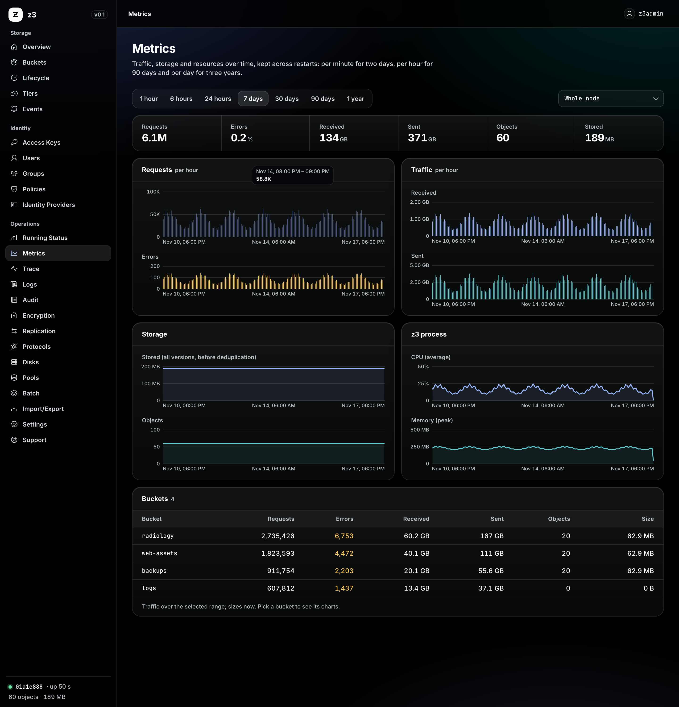
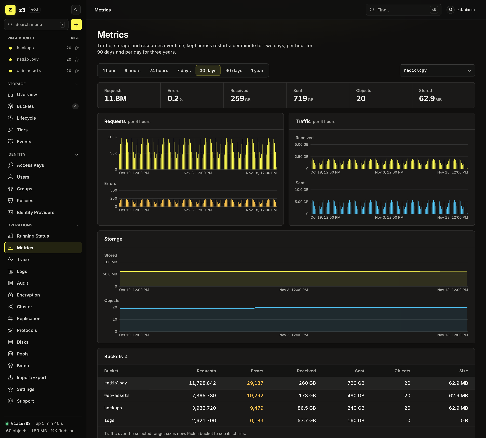

Zee3 records traffic, resources and storage over time, node-wide and per bucket. The history
survives restarts, so last night's spike or a month of growth stays visible.

<Frame>
  
</Frame>

For live figures over the last hour, see [Running status](/operations/running-status). For
Prometheus, see [Prometheus metrics](/operations/prometheus).

## What is recorded

At the end of every minute, Zee3 writes one point to `metrics.redb` in the data directory
(`ZEE3_DATA_DIR`):

| Node | Per bucket |
| --- | --- |
| S3 requests, reads and writes, 4xx and 5xx errors | Requests and errors |
| Bytes received and sent | Bytes received and sent |
| Average CPU and peak memory of the Zee3 process, host memory used | Objects and size (all versions) |
| Buckets, objects, logical and physical bytes | |

- Requests count on the S3 port only. A request counts for a bucket by its path (path-style
  addressing); a path that does not name an existing bucket is not counted per bucket.
- Each minute is folded into the current hour and day, which are saved every minute too, so a
  restart in the middle of an hour loses nothing.

## Tiers and retention

| Tier | One point | Kept for |
| --- | --- | --- |
| Minute | 1 minute | 2 days |
| Hour | 1 hour | 90 days |
| Day | 1 day | 3 years |

Older points are deleted automatically. A range uses the finest tier that covers it: the last 24
hours come from minutes, the last 30 days from hours, the last year from days.

A series has at most 180 points. Longer ranges merge neighbouring points; for 24 hours, for
example, each bar is 8 minutes. Traffic is summed over the merged points, CPU is averaged, memory
is the peak, and objects and sizes are the latest value.

## The Metrics page

**Metrics** in the menu (`/history`) shows a range from 1 hour to 1 year (1 hour, 6 hours, 24 hours,
7 days, 30 days, 90 days, 1 year):

- a summary: requests, error rate, bytes received and sent, objects, and size stored;
- charts of requests, errors, traffic, storage, and the CPU and memory of the Zee3 process;
- a table of buckets with their traffic over the range and their size now.

Pick a bucket, from the dropdown or by clicking its row, to see its own charts.

<Frame>
  
</Frame>

Periods when the node was down show as gaps.

## From the CLI

```bash
zee3 admin metrics --range 7d
zee3 admin metrics --range 30d --bucket radiology
```

See [`zee3 admin metrics`](/cli/metrics).

## From the API

| Endpoint | Returns |
| --- | --- |
| `GET /api/metrics?range=24h` | A series for the node |
| `GET /api/metrics?range=24h&bucket=radiology` | A series for one bucket |
| `GET /api/metrics/buckets?range=24h` | Each bucket's traffic over the range, and its size now |

`range` is a number and a unit: `90m`, `24h`, `7d`, `2w`, `1y`, from 1 minute to 3 years. Both need
`admin:ServerInfo`, which the built-in `diagnostics` policy includes. See
[Operations API](/api/admin-operations#metrics) for the fields.

## Per bucket in Prometheus

`/metrics` carries per-bucket gauges and counters too (`zee3_bucket_objects`,
`zee3_bucket_size_bytes`, `zee3_bucket_requests_total`, and more). Prometheus counters count since the
node started, as usual. See [Prometheus metrics](/operations/prometheus#per-bucket).
