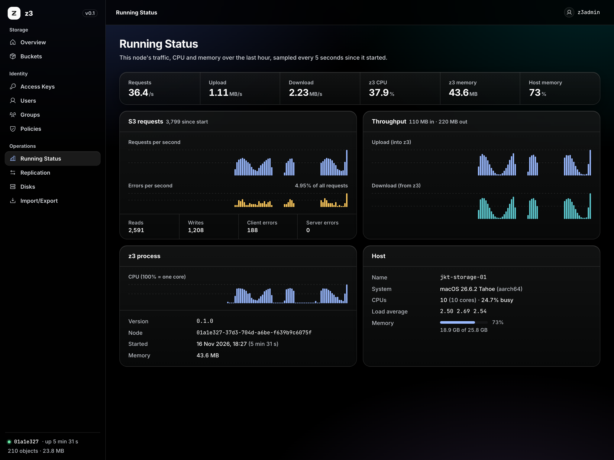

**Running Status** shows what a node is doing right now: S3 requests per second, upload and
download throughput, and the CPU and memory of the z3 process and its host. It covers the last
hour, sampled every 5 seconds.

<Frame>
  
</Frame>

## What it shows

| Card | Contents |
| --- | --- |
| Readouts | Requests per second, upload, download, z3 CPU, z3 memory, host memory |
| S3 requests | Requests and errors over the last hour |
| Throughput | Bytes received and sent over the last hour |
| z3 process | CPU and memory of the z3 process over the last hour |
| Host | Host name, operating system, architecture, CPUs and cores, load average, memory in use |

The page refreshes every 5 seconds.

- Requests and bytes are counted on the S3 port, from `Content-Length` of each request and
  response. Errors are answers with a 4xx or 5xx status.
- The history is kept in memory: 720 samples, one hour. It starts empty when the node starts.

For history beyond the last hour, per bucket too, use [Metrics](/operations/metrics), which keeps
points for up to three years.

## API

`GET /api/status` returns the same data and needs `admin:ServerInfo`.

```bash
curl -H "Authorization: Bearer $TOKEN" http://127.0.0.1:9001/api/status
```

```json
{
  "version": "0.1.0",
  "node_id": "01a1e9a0-be79-7462-83e2-8685ea015598",
  "uptime_secs": 86400,
  "started_ms": 1794834588308,
  "sample_secs": 5,
  "host": {
    "hostname": "z3-jkt-1",
    "os": "Linux 6.8 Ubuntu 24.04",
    "arch": "x86_64",
    "cpus": 16,
    "physical_cores": 8,
    "cpu_percent": 17.1,
    "load_average": [3.23, 2.55, 2.36],
    "memory_total": 68719476736,
    "memory_used": 19275776000,
    "process_memory": 335724544,
    "process_cpu_percent": 42.5,
    "process_threads": 38
  },
  "totals": {
    "requests": 1842211, "reads": 1500321, "writes": 341890,
    "client_errors": 1204, "server_errors": 3,
    "bytes_in": 98312009331, "bytes_out": 412093003311
  },
  "history": [
    { "t_ms": 1794920988291, "requests": 412, "errors": 1, "bytes_in": 20480133, "bytes_out": 90122340,
      "cpu_percent": 38.2, "process_memory": 331522816 }
  ]
}
```

- `totals` count since the node started.
- Each `history` sample holds the requests, errors and bytes **during** its 5 seconds, plus the
  process CPU and memory at that moment.

The same totals feed the `z3_s3_*` counters of [Prometheus](/operations/prometheus#s3-traffic).
