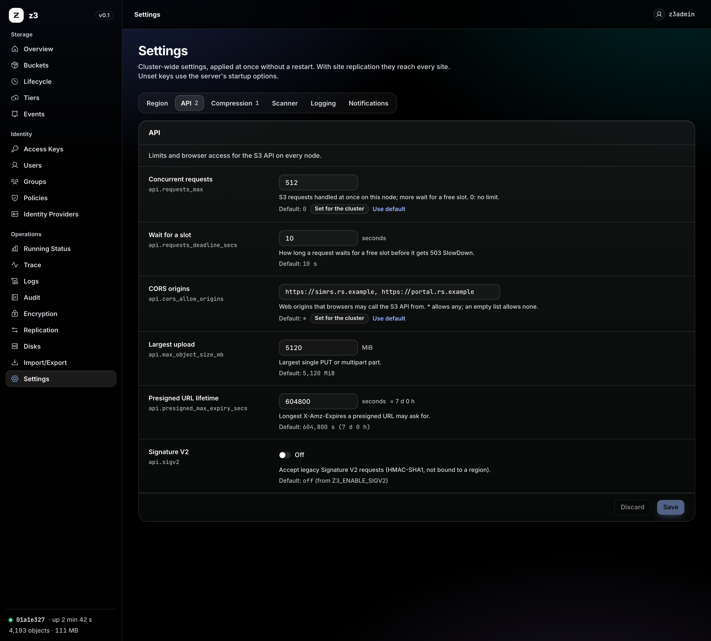
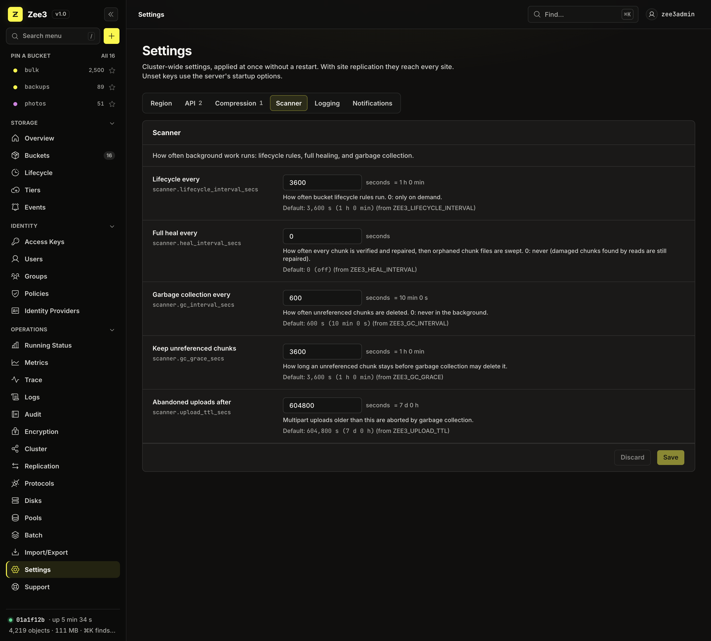

Cluster settings change how z3 behaves while it runs: region, S3 limits and CORS, compression,
background scanners, logging and the file protocols. A change takes effect at once, without a
restart, and with [site replication](/replication/site-replication) it reaches every site.

A key that is not set uses its **default**: for some keys a startup option or environment variable
(such as `Z3_HEAL_INTERVAL`), for the rest a built-in value.

<Frame>
  
</Frame>

## Changing settings

<Tabs>
  <Tab title="Console">

**Settings** has one tab per subsystem: **Region**, **API**, **Compression**, **Scanner**,
**Logging** and **Notifications**. Each key shows its current value, its default (and the variable
it comes from), a **Set for the cluster** mark when it is set, and **Use default** to put it back.
The file protocol subsystems are set on the **Protocols** page.

  </Tab>
  <Tab title="CLI">

```bash
z3 admin settings get api
z3 admin settings set api requests_max=500 cors_allow_origins=https://app.example.com
z3 admin settings reset api
```

See [`z3 admin settings`](/cli/settings).

  </Tab>
  <Tab title="API">

```bash
curl -X PUT http://127.0.0.1:9001/api/settings/compression \
  -H "Authorization: Bearer $TOKEN" -H "Content-Type: application/json" \
  -d '{"enabled": true}'
```

`null` puts a key back to its default. See [Operations API](/api/admin-operations#settings).

  </Tab>
</Tabs>

Seeing settings needs `admin:ServerInfo`; changing them needs `admin:ConfigUpdate`. Values are
checked (number ranges, region format, addresses, networks, log filters) and refused with a clear
message.

## Region

| Key | Default | Meaning |
| --- | --- | --- |
| `region.name` | empty | The region `GetBucketLocation` returns and event records carry. When set, requests signed for another region are refused (`AuthorizationHeaderMalformed`); empty accepts any region. Lowercase letters, digits and dashes, at most 32 |

## API

| Key | Default | Range | Meaning |
| --- | --- | --- | --- |
| `api.requests_max` | `0` (no limit) | 0 to 100,000 | S3 requests handled at once on **each node**; more wait for a free slot |
| `api.requests_deadline_secs` | `10` | 1 to 600 | How long a request waits for a slot before it gets `503 SlowDown` with `Retry-After` |
| `api.cors_allow_origins` | `*` | at most 100 | Web origins browsers may call the S3 API from. `*` allows any; an empty list allows none |
| `api.max_object_size_mb` | `5120` | 1 to 5,242,880 | Largest single PUT or multipart part, in MiB (`EntityTooLarge`) |
| `api.presigned_max_expiry_secs` | `604800` | 1 to 604,800 | Longest `X-Amz-Expires` a presigned URL may ask for |
| `api.trusted_proxies` | empty | at most 100 | Reverse proxies (addresses or networks) whose `X-Forwarded-For` and `X-Forwarded-Proto` z3 believes, for `aws:SourceIp` and `aws:SecureTransport` in [policy conditions](/access/conditions) |
| `api.sigv2` | `Z3_ENABLE_SIGV2` (`false`) | | Accept legacy Signature V2 requests (HMAC-SHA1, not bound to a region) |

**CORS.** A preflight `OPTIONS` from an allowed origin is answered with the methods `GET`, `PUT`,
`POST`, `DELETE`, `HEAD` and the headers it asked for. Normal answers carry
`Access-Control-Allow-Origin` and `Access-Control-Expose-Headers` (`ETag`, `Content-Length`,
`Content-Range`, `Content-Type`, `Last-Modified`, `x-amz-version-id`, `x-amz-delete-marker`,
`x-amz-request-id`, `x-amz-storage-class`, `x-amz-server-side-encryption`). Preflights from other
origins are refused with `403`. Per-bucket CORS (`PutBucketCors`) is not supported.

## Compression

| Key | Default | Meaning |
| --- | --- | --- |
| `compression.enabled` | `false` | Store new unencrypted objects compressed (LZ4) when their name or content type matches |
| `compression.extensions` | `.txt .log .csv .json .tar .xml .bin` | Object names ending in one of these are compressed |
| `compression.mime_types` | `text/* application/json application/xml binary/octet-stream` | Content types that are compressed; `text/*` matches every text type |

- Compression happens per chunk in the chunk store. The chunk hash is of the original data, so
  deduplication, replication, healing and range reads are unchanged.
- Only chunks that shrink by at least 1/16 are kept compressed; the rest are stored as they are.
- Encrypted objects are never compressed.
- Existing objects stay as they are, and chunks received through replication are stored
  uncompressed.

See [Compression](/storage/compression).

## Scanner

| Key | Default | Range | Meaning |
| --- | --- | --- | --- |
| `scanner.lifecycle_interval_secs` | `Z3_LIFECYCLE_INTERVAL` (`3600`) | 0 to 30 days | How often [lifecycle](/storage/lifecycle) rules run. `0`: only on demand (**Run now**) |
| `scanner.heal_interval_secs` | `Z3_HEAL_INTERVAL` (`604800`) | 0 to 365 days | How often every chunk is verified and repaired, then [orphaned chunk files](/durability/healing#orphaned-chunks) are swept. `0`: never (the sweep then runs only on demand); damaged chunks found by reads are still repaired |
| `scanner.gc_interval_secs` | `Z3_GC_INTERVAL` (`600`) | 0 to 30 days | How often unreferenced chunks are deleted. `0`: never in the background |
| `scanner.gc_grace_secs` | `Z3_GC_GRACE` (`3600`) | 60 s to 30 days | How long an unreferenced chunk stays before garbage collection may delete it |
| `scanner.upload_ttl_secs` | `Z3_UPLOAD_TTL` (`604800`) | 1 hour to 365 days | Multipart uploads older than this are aborted by garbage collection |

All values are in seconds.

<Frame>
  
</Frame>

## Logging

| Key | Default | Meaning |
| --- | --- | --- |
| `logger.level` | `RUST_LOG` (`info`) | What the server writes to standard output: a level, or a filter like `warn,z3_server=debug` |
| `logger.console_level` | `Z3_LOG_BUFFER` (`info`) | What the console's [Logs](/audit/trace-and-logs#logs) page keeps, in memory and in the history on disk |
| `logger.history_max_mb` | `64` | The most the [log history on disk](/audit/trace-and-logs#log-history-on-disk) (`<data dir>/logs/`) may take on each node, in MiB, 0 to 1048576. The oldest files are deleted first. `0` turns the history off and deletes its files |
| `logger.history_days` | `7` | Log history files last written longer ago than this are deleted, 0 to 3650 days. `0`: only the size limit applies |

## File protocols

Set on the **Protocols** page or with [`z3 admin protocols`](/cli/protocols). Every node listens on
the same address. See [File protocols](/protocols/overview).

| Key | Default | Meaning |
| --- | --- | --- |
| `webdav.enabled` | `false` | Serve buckets over WebDAV (HTTP Basic sign-in with an access key and its secret) |
| `webdav.address` | `0.0.0.0:9005` | Where WebDAV listens |
| `ftp.enabled` | `false` | Serve buckets over FTP, or FTPS with a certificate |
| `ftp.address` | `0.0.0.0:8021` | Where FTP listens |
| `ftp.passive_ports` | `30000-30100` | Port range for passive data connections; open it in the firewall |
| `ftp.tls_cert` | empty | PEM certificate chain file on each node; with a key it enables FTPS (explicit TLS) |
| `ftp.tls_key` | empty | PEM private key file on each node |
| `ftp.tls_required` | `false` | Refuse sign-ins and transfers that are not encrypted (needs a certificate) |
| `sftp.enabled` | `false` | Serve buckets over SFTP; the access key is the user name, its secret the password |
| `sftp.address` | `0.0.0.0:8022` | Where SFTP listens |
| `sftp.host_key` | empty | OpenSSH private key file on each node; empty: a key generated once and kept in the data directory |
| `nfs.enabled` | `false` | Export buckets over NFSv3 |
| `nfs.address` | `0.0.0.0:2049` | Where NFS and its mount service listen |
| `nfs.access_key` | empty | The access key whose policies decide what NFS clients may do (NFS has no passwords) |
| `nfs.allowed_clients` | empty | Client addresses or networks (`10.0.0.0/24`) that may mount; empty: none |
| `nfs.read_only` | `false` | Refuse every change through NFS |

## Notifications

This tab links to where notifications are set up: [event destinations](/events/destinations)
(Events page), [audit targets](/audit/audit-log) (Audit page) and the server [logs](/audit/trace-and-logs)
(Logs page).

## With replication

Each subsystem is stored as one document in the cluster, holding only the keys that are set, so
site replication carries it to every site, and a reset on one site applies to every site.
`api.requests_max` still counts per node. [Config export](/operations/config-export) carries the
keys that are set, and import applies them.

<Note>
  Not yet runtime settings: the replication anti-entropy interval (`Z3_ANTI_ENTROPY_INTERVAL`, read
  at start), and sending server logs to a webhook (send the audit log through an
  [audit target](/audit/audit-log) instead).
</Note>
