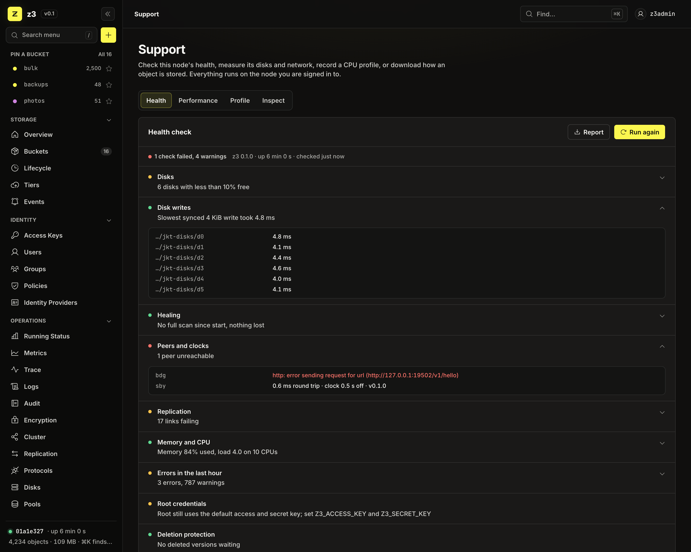

The **Support** page gathers the tools to find out why a node is slow or unwell, without logging
in to the server. Everything runs on the node you are signed in to, from the console, the
[admin API](/api/admin-operations#support) or [`zee3 admin support`](/cli/support).

| Tool | What it does | Right |
| --- | --- | --- |
| Health | Runs a set of checks and grades each one | `admin:ServerInfo` |
| Performance | Measures disk throughput, or the network to each replication peer | `admin:Profiling` |
| Profile | Records a CPU profile while the node keeps serving | `admin:Profiling` |
| Inspect | Downloads how one object is stored on disk | `admin:InspectData` |

The built-in `diagnostics` policy has `admin:ServerInfo` and `admin:Profiling`, but **not**
`admin:InspectData`, because inspect hands out raw object data. The console shows only the tabs your
rights allow.

## Health

<Frame>
  
</Frame>

Each check is `ok`, `warn` or `fail`; the report takes the worst level.

| Check | Looks at | Warn / fail when |
| --- | --- | --- |
| Disks | Each disk's state, the erasure layout, free space | **Fail**: more disks offline than the parity allows. **Warn**: a disk offline, or under 10% free |
| Disk writes | Writes, syncs, reads back and deletes a 4 KiB file on every disk | **Fail**: a disk cannot write. **Warn**: slower than 500 ms |
| Healing | Chunks checked, shards repaired, chunks lost, [geo shards rebuilt from other sites](/replication/geo-erasure-coding#healing-across-sites) | **Fail**: a chunk was lost and is not repaired yet (`lost_now`). **Warn**: some geo chunks can't be rebuilt from the other sites yet (too few sites answered) |
| Peers and clocks | A hello to each replication peer: round trip, version, clock difference (from its `Date` header), and whether it is reached over TLS (`tls`) | **Fail**: a peer is unreachable; TLS errors are explained (expired certificate, unknown CA, host name mismatch, client certificate required). **Warn**: a clock more than 5 s off, or another Zee3 version |
| Peer TLS | [Mutual TLS between nodes](/deploy/peer-tls#check-it): mode, this node's certificate (subject, names, validity), CA, reloads, refused handshakes and plain requests | **Fail**: this node's certificate has expired or is not valid yet. **Warn**: it expires in less than 14 days, a reload failed, the mode is `mixed`, or a peer endpoint is still `http://` |
| Replication | The state of each replication link | **Warn**: a link failing, or more than 5 minutes behind |
| Memory and CPU | Host and process memory, load average | **Warn**: memory over 90%, or load over 1.5 × the number of CPUs |
| Errors in the last hour | Errors and warnings in the log, the last five errors | **Warn**: any error |
| Log history | The [log history on disk](/audit/trace-and-logs#log-history-on-disk): size, files, lines dropped | **Warn**: the history can't be written (disk full or unwritable), lines were dropped since the start, or it could not be opened |
| Root credentials | Whether root still uses the default keys | **Warn** |
| Key store | The [external KMS](/security/external-kms#health) and any retired key stores: reachable, error, latency | **Fail**: the active KMS is down, so encrypted writes fail. **Warn**: a [retired key store](/security/external-kms#retired-key-stores) is down, so objects it sealed can't be read |
| Cluster redundancy | Only on [cluster](/deploy/cluster#erasure-coding-across-members) members with erasure coding across members, or with erasure-coded chunks still to convert back: erasure-coded chunks, chunks as copies, and chunks missing shards, as the leader's last placement sweep found them | **Fail**: a chunk has fewer than `data` shards available, so it can't be read until members come back. **Warn**: a chunk has fewer than `data + 1` shards available, so one more loss makes it unreadable. Chunks missing one shard with more left stay `ok`: the placement sweep rebuilds them |

In the console, open a check to see its details. **Report** downloads the whole report as JSON, to
attach when asking for help.

```bash
zee3 admin support health
```

```
zee3 0.1.0 on node 01a1e9a0-be79-7462-83e2-8685ea015598: warn
  ok    Disks                    6 disks online
  ok    Disk writes              Slowest synced 4 KiB write took 5.6 ms
  ok    Healing                  No full scan since start, nothing lost
  ok    Peers and clocks         2 peers reachable, clocks agree
  ok    Peer TLS                 Mutual TLS: TLS only, client certificates required
  ok    Replication              24 links streaming
  ok    Memory and CPU           Memory 62% used, load 2.9 on 16 CPUs
  ok    Errors in the last hour  No errors, 1 warning
  ok    Log history              12.4 MiB of 64 MiB in 3 files
  WARN  Root credentials         Root still uses the default access and secret key; set ZEE3_ACCESS_KEY and ZEE3_SECRET_KEY
  ok    Key store                AWS KMS reachable (38 ms)
```

The command exits with status 1 when a check fails, so it fits in a monitoring script.

## Performance

<Frame>
  
</Frame>

Pick **drive** or **network** and a size (1 to 1024 MB, 64 MB by default):

- **Drive** writes a test file on every disk at once in 4 MiB blocks, syncs it, reads it back and
  deletes it. The result is MiB/s per disk and in total. Reads may come from the operating
  system's cache, so the write figure is the more honest one.
- **Network** downloads test data from each replication peer, one peer at a time, over the same
  connection replication uses (`GET /v1/speedtest` on the peer API). The result is the round trip
  and MiB/s per peer.

## Profile

A profile samples the stack of every thread 99 times a second for the chosen time (1 to 120
seconds, 15 by default) while the node keeps serving, then downloads a zip:

| File | Contents |
| --- | --- |
| `flamegraph.svg` | Open it in a browser: the widest stacks are where the time goes. Missing when the node was idle |
| `cpu.pb` | pprof format, for `go tool pprof -http=:8080 cpu.pb` or another pprof viewer |
| `runtime.json` | Host, traffic, and async runtime figures (workers, live tasks, queues) |
| `README.txt` | What the files are |

Only one speed test or profile runs on a node at a time; a second one gets `409`. Profiles need a
Unix host (Linux, macOS).

## Inspect

Inspect downloads a zip that shows how one object version is stored on this node:

| File | Contents |
| --- | --- |
| `object.json` | The raw version record: size, ETag, chunk list, encryption and tier. Stored [object headers](/api/s3-compatibility#object-headers) (`Cache-Control` and friends) show as `zee3-sys-*` keys in its `user_metadata` |
| `layout.json` | User metadata and object headers as S3 clients see them (`user_metadata`, `headers`); for each chunk, the files that hold it on this node's disks (position, disk, path, size), and whether the chunk reads back intact |
| `chunks/` | The files as they are on disk: `<chunk number>-<hash>/<position>-disk<index>` |
| `README.txt` | What the files are |

Chunk files can be LZ4-compressed (starting with `zee3c1`), encrypted (SSE data stays encrypted in the
zip), or erasure-coded shards with a header. On a node with one data directory, a file is the
whole chunk.

Leave the raw files out (**without data**, `data=false`, `--no-data`) to get only the record and the
layout. With data, the files may total at most 1 GiB; a larger object answers `413` and must be
inspected without data.

```bash
zee3 admin support inspect photos 2026/a.jpg --no-data -o a.zip
```
