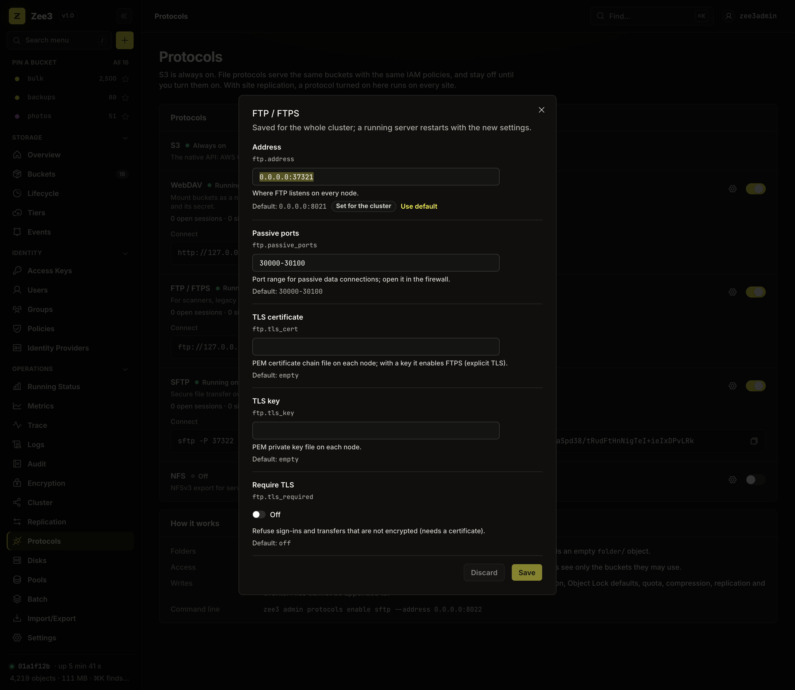

FTP is for devices and software that only speak FTP, such as document scanners and older
applications. With a certificate, Zee3 also serves **FTPS** (explicit TLS, `AUTH TLS`). Read the
[overview](/protocols/overview) first for how buckets look as files and how permissions work.

<Frame>
  
</Frame>

## Settings

| Key | Default | Meaning |
| --- | --- | --- |
| `ftp.enabled` | `false` | Serve buckets over FTP |
| `ftp.address` | `0.0.0.0:8021` | Where FTP listens on every node |
| `ftp.passive_ports` | `30000-30100` | Port range for passive data connections. Open it in the firewall. |
| `ftp.tls_cert` | empty | PEM certificate chain file on each node. With a key, it turns on FTPS (explicit TLS). |
| `ftp.tls_key` | empty | PEM private key file on each node |
| `ftp.tls_required` | `false` | Refuse sign-ins and transfers that aren't encrypted (needs a certificate) |

The certificate and key are file paths, so the files must exist at that path **on every node**.
Use an X.509 v3 certificate.

## Turn it on

<Tabs>
  <Tab title="Console">

    Open **Protocols**, click the gear icon next to **FTP / FTPS**, set the address, passive ports
    and, for FTPS, the certificate and key paths. Then turn on the switch. The **Connect** line
    shows `ftp://host:8021`, or `ftpes://host:8021` with a certificate.

  </Tab>
  <Tab title="zee3 admin">

    ```bash
    zee3 admin protocols enable ftp --set passive_ports=30000-30100

    # FTPS, and refuse plain FTP
    zee3 admin settings set ftp tls_cert=/etc/zee3/ftp.pem tls_key=/etc/zee3/ftp.key tls_required=true
    zee3 admin settings get ftp
    ```

  </Tab>
</Tabs>

## Sign in

The user name is an access key (or an IAM user name) and the password is its secret key.

<Warning>
  Plain FTP sends the secret key and the data unencrypted. Outside a trusted network, configure a
  certificate and set `ftp.tls_required` to `true`, or use [SFTP](/protocols/sftp) instead.
</Warning>

## Connect a client

<Tabs>
  <Tab title="lftp">

    ```bash
    # FTPS
    lftp -u AKEXAMPLE -e "set ftp:ssl-force true" -p 8021 zee3.example.com
    lftp AKEXAMPLE@zee3.example.com:/> ls
    lftp AKEXAMPLE@zee3.example.com:/> cd scans
    lftp AKEXAMPLE@zee3.example.com:/scans> put 2026-11-17-001.pdf
    ```

  </Tab>
  <Tab title="curl">

    ```bash
    # list the buckets, upload, download (FTPS)
    curl --ssl-reqd -u AKEXAMPLE:SECRETEXAMPLE ftp://zee3.example.com:8021/
    curl --ssl-reqd -u AKEXAMPLE:SECRETEXAMPLE -T scan.pdf ftp://zee3.example.com:8021/scans/
    curl --ssl-reqd -u AKEXAMPLE:SECRETEXAMPLE -O ftp://zee3.example.com:8021/scans/scan.pdf
    ```

    Leave out `--ssl-reqd` for plain FTP.

  </Tab>
  <Tab title="FileZilla">

    Create a site with **Protocol** FTP, **Host** `zee3.example.com`, **Port** `8021`,
    **Encryption** "Require explicit FTP over TLS" (or "Only use plain FTP" without a
    certificate), **Logon type** Normal, and the access key and secret key as user and password.

  </Tab>
  <Tab title="Scanners">

    Most network scanners have a "scan to FTP" destination. Enter the Zee3 host, port `8021`, the
    target folder as `/<bucket>/<folder>`, and a dedicated access key restricted to that bucket
    with `s3:PutObject` (and `s3:ListBucket` if the scanner checks the folder first).

  </Tab>
</Tabs>

## How it behaves

- Passive mode uses `ftp.passive_ports`. Open that range on every node's firewall.
- Downloads can resume (`REST`). Uploads always store a whole file.
- Files can't be appended to.
- Idle sessions are closed after 10 minutes.
- [Conditions](/access/conditions) see `aws:SecureTransport` = `true` for FTPS sessions and
  `aws:UserAgent` = `zee3-ftp`, so a policy can refuse plain FTP for a key.

## Not supported yet

- Implicit FTPS (port 990). Use explicit TLS (`AUTH TLS`), which every current client supports.
