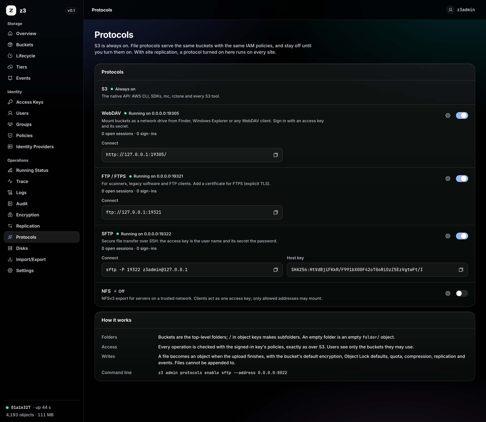

S3 is Zee3's native protocol and is always on. For tools that can't speak S3, such as scanners,
legacy software, network drives and servers that expect a mount, Zee3 can serve the **same
buckets** over four file protocols. Each one is **off by default** and checks every operation
with the same [IAM policies](/access/policies) as S3.

| Protocol | For | Sign in with | Default address |
| --- | --- | --- | --- |
| [WebDAV](/protocols/webdav) | Network drives in Finder and Windows Explorer, WebDAV clients, rclone | HTTP Basic: access key and secret key | `0.0.0.0:9005` |
| [FTP / FTPS](/protocols/ftp) | Scanners, legacy software, FTP clients; FTPS (explicit TLS) with a certificate | User = access key, password = secret key | `0.0.0.0:8021` |
| [SFTP](/protocols/sftp) | Secure transfers over SSH: sftp, WinSCP, FileZilla, rclone | User = access key, password = secret key | `0.0.0.0:8022` |
| [NFS](/protocols/nfs) | Servers on a trusted network (NFSv3) | No password: every allowed client acts as one access key | `0.0.0.0:2049` |

<Frame>
  
</Frame>

## Turn a protocol on

<Tabs>
  <Tab title="Console">

    Open **Protocols**. Each protocol has a switch to turn it on or off, and a gear icon that opens
    its settings (address and options). Settings are saved for the whole cluster, and a running
    server restarts with the new settings.

    Each protocol shows its state live: **Off**, **Starting**, **Running on** its address, or
    **Failed** with the reason. A running protocol also shows open sessions, sign-ins and refused
    sign-ins, plus a **Connect** (or **Mount**) line you can copy, and for SFTP the **Host key**
    fingerprint.

  </Tab>
  <Tab title="zee3 admin">

    Run on the server (it signs in with `ZEE3_ACCESS_KEY`/`ZEE3_SECRET_KEY`, or `--access-key` and
    `--secret-key`):

    ```bash
    zee3 admin protocols                                   # state of every protocol
    zee3 admin protocols enable sftp --address 0.0.0.0:8022
    zee3 admin protocols enable ftp --set passive_ports=30000-30100
    zee3 admin protocols enable nfs --set access_key=nfs-client --set allowed_clients=10.0.0.0/24
    zee3 admin protocols disable webdav
    zee3 admin settings get ftp
    zee3 admin settings set ftp tls_cert=/etc/zee3/ftp.pem tls_key=/etc/zee3/ftp.key tls_required=true
    ```

    `--url` (or `ZEE3_ADMIN_URL`, default `http://127.0.0.1:9001`) points at the node's admin API.
    See [CLI: protocols](/cli/protocols).

  </Tab>
  <Tab title="Admin API">

    ```bash
    curl -X PUT http://127.0.0.1:9001/api/settings/sftp \
      -H "Authorization: Bearer $TOKEN" -H 'content-type: application/json' \
      -d '{"enabled": true, "address": "0.0.0.0:8022"}'

    curl -H "Authorization: Bearer $TOKEN" http://127.0.0.1:9001/api/protocols
    ```

    `GET /api/protocols` returns each protocol's state on this node: state, address, error,
    sessions, sign-ins and the SFTP host key fingerprint.

  </Tab>
</Tabs>

Changing protocol settings needs `admin:ConfigUpdate`; viewing their state needs
`admin:ServerInfo`.

Protocol settings are part of the [cluster settings](/operations/settings) (subsystems `webdav`,
`ftp`, `sftp` and `nfs`). They apply without a restart and follow
[site replication](/replication/site-replication): a protocol turned on runs on **every site, at
the same address**. If a node can't use the address (the port is taken, a certificate file is
missing), the protocol shows **Failed** there with the reason.

<Note>
  Open the protocol's port in your firewall. For FTP, open the passive port range too.
</Note>

## Sign in

Use an [access key](/access/users-groups-keys#access-keys) (or a user name) and its secret key.
Create a dedicated key per device or application, restricted with a policy to the buckets it
needs. Root credentials work too, but avoid them.

Federated sign-in (OIDC, LDAP) and SSH public keys aren't supported over file protocols.

## How buckets look as files

- **Buckets are the top-level folders**, and `/` in keys makes subfolders. An empty folder is an
  empty object named `folder/`, as the S3 console does it.
- **Permissions**: every operation is checked with the signed-in key's policies, with the same
  actions as S3: `s3:ListBucket`, `s3:GetObject`, `s3:PutObject`, `s3:DeleteObject`,
  `s3:CreateBucket` and `s3:DeleteBucket`. Users see only the buckets they may use. Write access is
  checked when a file is opened for writing, before any data is sent.
- **Buckets from folders**: making a folder at the top level creates a bucket; deleting an empty
  top-level folder deletes the bucket.
- **Writes**: a file becomes an object when the upload finishes, through the same path as an S3
  write: the bucket's default encryption, Object Lock default retention, quota,
  [compression](/storage/compression), replication and [bucket events](/events/bucket-events)
  (`s3:ObjectCreated:Put`, `s3:ObjectRemoved:Delete`, with a user agent such as `zee3-sftp` or
  `zee3-ftp`).
- **Reads** support offsets (ranges), including SSE-S3 and SSE-KMS objects and objects on a
  [tier](/storage/tiers). SSE-C objects can't be read over file protocols: their key only exists
  at the S3 client.
- **Renames**: renaming a file copies and then deletes it. Renaming a folder moves everything in
  it, up to 10,000 files. Buckets can't be renamed.
- **No appends.** Changing part of a file (SFTP, NFS) works by rewriting the whole object when the
  file is closed.

Policy [conditions](/access/conditions) apply too: `aws:SourceIp` (not for NFS),
`aws:SecureTransport` (`true` for FTPS and SFTP) and `aws:UserAgent` (`zee3-ftp`, `zee3-sftp`,
`zee3-nfs`; WebDAV passes on the client's user agent, or `zee3-webdav` when there is none). For
example, a policy can allow a key only over SFTP:

```json
{"Effect": "Allow", "Action": "s3:*", "Resource": ["arn:aws:s3:::scans", "arn:aws:s3:::scans/*"],
 "Condition": {"StringEquals": {"aws:UserAgent": "zee3-sftp"}}}
```

## Not supported yet

- SSH public key sign-in, and LDAP or OIDC sign-in over file protocols. Use access keys.
- TLS directly on WebDAV (use a reverse proxy), implicit FTPS (port 990), NFSv4, and NFS locking
  (mount with `nolock`).
- Appends, symlinks, hard links and per-file permissions.
