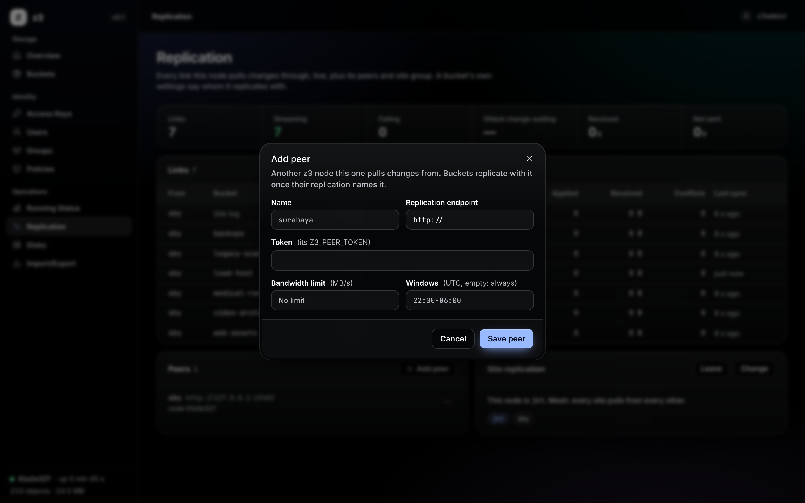
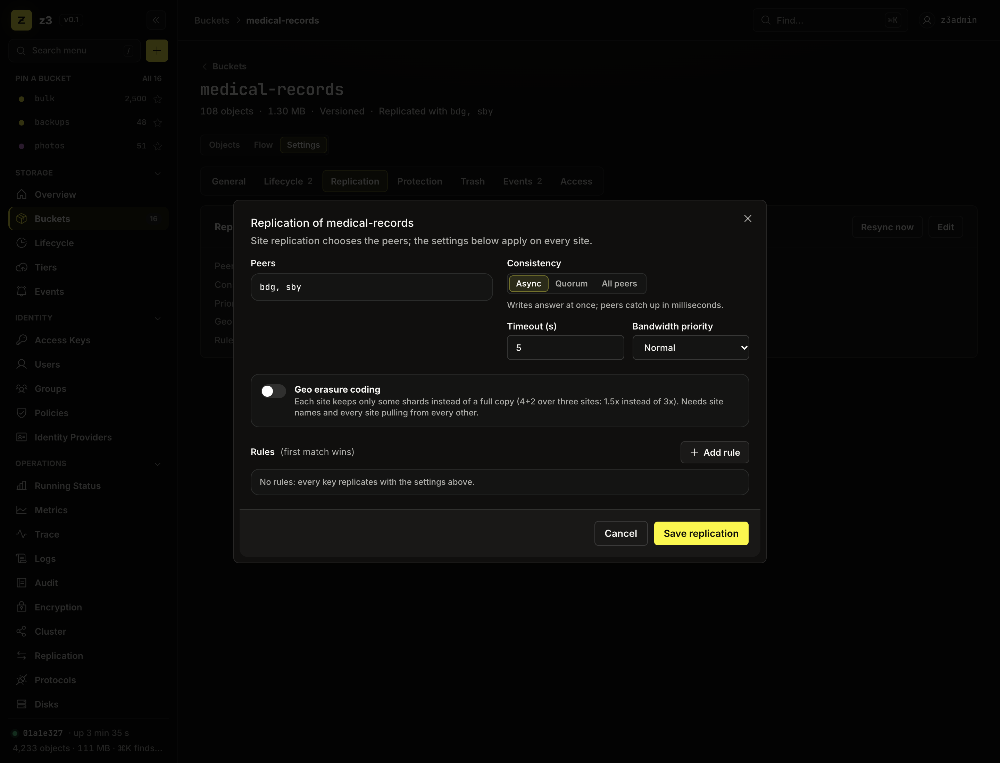

Bucket replication links individual buckets to peers. Each node pulls the bucket's changes from the
peers you list, so set it up **on every node** of the bucket, each pointing at the others. To
replicate every bucket at once, use [site replication](/replication/site-replication) instead.

Either side can be a [cluster](/deploy/cluster#replication-with-other-zee3-nodes): configure it
through any member, and give the other side the cluster's members as one endpoint (below).

All the steps below can be done in the console (peers on the **Replication** page, the bucket's
peers and rules under the bucket's **Settings → Replication** tab) or with the admin API. Changing
replication needs the `admin:ConfigUpdate` right.

## Set up two nodes

This example connects node A (`dc1`, 10.0.0.1) and node B (`dc2`, 10.0.0.2) and replicates the
bucket `data`.

<Steps>
  <Step title="Give each node a peer token">
    The token is what **other** nodes must present to pull from this node. Choose a different one per
    node and start both with it:

    ```bash
    # node A
    ZEE3_PEER_TOKEN=token-of-a ZEE3_PEER_ADDR=0.0.0.0:9002 zee3
    # node B
    ZEE3_PEER_TOKEN=token-of-b ZEE3_PEER_ADDR=0.0.0.0:9002 zee3
    ```

    Port 9002 must be reachable from the other node. To encrypt it, see
    [Mutual TLS between nodes](/deploy/peer-tls), then use `https://` endpoints below.
  </Step>
  <Step title="Create the bucket on both nodes">
    With any S3 client, with the same versioning state on both (enable versioning on both if you
    want older versions kept).
  </Step>
  <Step title="On node A: add B as a peer and replicate the bucket to it">
    <Tabs>
      <Tab title="Console">
        **Replication → Add peer**: name `dc2`, endpoint `http://10.0.0.2:9002`, token `token-of-b`.
        Then open the bucket, **Settings → Replication**, and add `dc2` as a peer.

        <Frame>
          
        </Frame>
      </Tab>
      <Tab title="Admin API">
        ```bash
        TOKEN=$(curl -s -X POST http://127.0.0.1:9001/api/auth/login \
          -H 'content-type: application/json' \
          -d '{"access_key": "admin", "secret_key": "change-me-please"}' | jq -r .token)

        curl -X PUT http://127.0.0.1:9001/api/peers/dc2 \
          -H "Authorization: Bearer $TOKEN" -H 'content-type: application/json' \
          -d '{"endpoint": "http://10.0.0.2:9002", "token": "token-of-b"}'

        curl -X PUT http://127.0.0.1:9001/api/buckets/data/replication \
          -H "Authorization: Bearer $TOKEN" -H 'content-type: application/json' \
          -d '{"peers": ["dc2"]}'
        ```
      </Tab>
    </Tabs>
  </Step>
  <Step title="On node B: the same in the other direction">
    ```bash
    curl -X PUT http://127.0.0.1:9001/api/peers/dc1 \
      -H "Authorization: Bearer $TOKEN" -H 'content-type: application/json' \
      -d '{"endpoint": "http://10.0.0.1:9002", "token": "token-of-a"}'

    curl -X PUT http://127.0.0.1:9001/api/buckets/data/replication \
      -H "Authorization: Bearer $TOKEN" -H 'content-type: application/json' \
      -d '{"peers": ["dc1"]}'
    ```
  </Step>
  <Step title="Check it">
    The **Replication** page shows both links as streaming. Upload on one node and read on the
    other. Objects already in the bucket replicate too, since the change log is read from the start.
  </Step>
</Steps>

<Note>
  When you edit a peer in the console and leave the token empty, the existing token is kept.
</Note>

## Several URLs for one peer

A peer's `endpoint` may list several URLs separated by commas, for example every member of a
[cluster](/deploy/cluster#how-peers-reach-the-cluster):

```json
{"endpoint": "http://10.0.0.11:9002,http://10.0.0.12:9002,http://10.0.0.13:9002", "token": "cluster-secret"}
```

The node uses the URL that last answered, and moves to the next one on a connection error or a
**503** (a member that left its cluster answers 503). A VIP or load balancer in front of the members,
or a single member's URL, works too. Older nodes don't understand comma lists: give them one URL or
a VIP.

## Bucket configuration

`PUT /api/buckets/{bucket}/replication` takes:

| Field | Default | Meaning |
| --- | --- | --- |
| `peers` | required | Peer names to pull this bucket from (and that count for `quorum` and `all`) |
| `mode` | `"async"` | `"async"`, `{"quorum": N}` or `"all"`; see below |
| `timeout_ms` | `5000` | How long a `quorum` or `all` write, or a session-token read, waits before `503` |
| `rules` | none | Prefix and tag rules, checked in order; see below |
| `priority` | `"normal"` | `"high"`, `"normal"` or `"low"`: who goes first when a peer link is throttled |
| `geo` | none | `{"data": D, "parity": P}` for [geo erasure coding](/replication/geo-erasure-coding) |

`GET` returns the current configuration. Use the same rules and mode on every node of the bucket;
site replication keeps them in sync for you.

<Frame>
  
</Frame>

## Consistency modes

| `mode` | A PUT or DELETE is answered after |
| --- | --- |
| `"async"` (default) | The local commit; peers catch up in the background |
| `{"quorum": N}` | N peers have applied the change |
| `"all"` | Every peer of the bucket has applied the change |

A peer counts as having applied a change when it asks for the next log entry, which it does only
after its apply transaction is durably committed. If not enough peers get there within `timeout_ms`,
the client gets **503**. The write is still stored on this node and replicates later; AWS SDKs retry
it as a new version.

```bash
curl -X PUT http://127.0.0.1:9001/api/buckets/data/replication \
  -H "Authorization: Bearer $TOKEN" -H 'content-type: application/json' \
  -d '{"peers": ["dc2", "dc3"], "mode": {"quorum": 1}, "timeout_ms": 2000}'
```

## Rules: prefix and tags

Rules are checked in order; the first one that matches a key decides.

```json
{
  "peers": ["dc2"],
  "rules": [
    {"prefix": "tmp/", "replicate": false},
    {"tags": {"classification": "local"}, "replicate": false},
    {"prefix": "invoices/", "mode": "all"}
  ]
}
```

| Rule field | Meaning |
| --- | --- |
| `prefix` | Keys starting with this prefix (empty: every key) |
| `tags` | Objects carrying all of these tags. Never matches delete markers or version deletes, which have no tags |
| `replicate` | `false` keeps matching objects on this node only; they don't show as `PENDING` |
| `mode` | Overrides the bucket's consistency mode for matching keys |
| `sites` | Data residency: only these sites may hold matching objects (below) |

The node serving the log filters the entries, and peers move their cursor past filtered entries. The
Merkle tree only covers replicated objects, so anti-entropy doesn't chase local ones, and it is
rebuilt when rules change. Changing an object's tags can move it into or out of replication;
anti-entropy sends objects that come in.

## Data residency

A rule with `sites` limits where matching objects may live:

```json
{"rules": [{"prefix": "id-cards/", "sites": ["dc1", "dc2"]}]}
```

- A write at any other site is refused with **403 AccessDenied** before the body is uploaded.
- The log never sends those entries to other sites. The serving node knows who asks, and other sites
  refuse to store such entries if one arrives anyway.
- Each group of sites has its own Merkle tree, and anti-entropy only compares the trees of groups
  that contain both sites, so objects can't leak through a resync.
- `COMPLETED` and `quorum` / `all` only count the allowed sites.

Site names come from site replication, or from `ZEE3_SITE_NAME`. Without site replication, `sites`
refers to peer names. Objects under residency only travel over direct links between allowed sites, so
in a hub-and-spoke topology the hub must be in the `sites` list too.

## Bandwidth limits and time windows

Each peer can be throttled and limited to time windows (UTC):

```bash
curl -X PUT http://127.0.0.1:9001/api/peers/dc3 \
  -H "Authorization: Bearer $TOKEN" -H 'content-type: application/json' \
  -d '{"endpoint": "http://10.0.0.3:9002", "token": "token-of-c",
       "max_bytes_per_sec": 10000000, "windows": ["22:00-06:00"]}'
```

| Field | Meaning |
| --- | --- |
| `max_bytes_per_sec` | Chunk transfers from this peer are limited to this rate, shared by all buckets. When bandwidth runs out, buckets with priority `high` go before `normal`, and `normal` before `low` |
| `windows` | Replication from this peer runs only inside these UTC windows (`"HH:MM-HH:MM"`, may cross midnight). Outside them the link is `paused`, and `quorum` / `all` writes time out |

The metrics `zee3_replication_throttled_seconds_total` and `zee3_replication_paused` show the effect.
With site replication, the same fields go on each site member.

## Read your writes with session tokens

Every write answers with an `x-zee3-session` header holding the node, bucket and log position. Send it
back on a GET, HEAD or List at another node, and that node waits until it has applied the write (at
most the bucket's `timeout_ms`) before it answers, or answers **503** if it can't.

This helps behind GeoDNS or a load balancer, where the next read may land at another site. In tests
with three nodes, a read right after a write at another site missed the write 20 times out of 20
without the token and 0 out of 20 with it.

A node can only verify tokens from nodes it pulls from directly for that bucket. For other tokens
(between spokes of a hub-and-spoke topology, for example) it answers at once with
`x-zee3-session-consistent: unverified`.

## Admin API

| Endpoint | What |
| --- | --- |
| `GET /api/peers` | Peers of this node |
| `PUT /api/peers/{name}`, `DELETE /api/peers/{name}` | Add, change or remove a peer |
| `GET /api/buckets/{bucket}/replication`, `PUT ...` | A bucket's replication configuration |
| `POST /api/buckets/{bucket}/replication/resync` | Run anti-entropy for the bucket now (in a cluster, on the leader) |
| `GET /api/buckets/{bucket}/conflicts` | Recent concurrent writes and their winners |
| `GET /api/replication` | Status of every link |

Peers and bucket replication are part of the [configuration export](/operations/config-export), so
you can set up another node the same way. See [Admin API: replication](/api/admin-replication).
