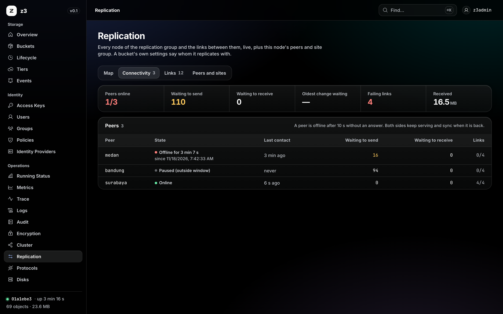

A z3 node at a branch office keeps serving reads and writes while its link to headquarters is
down, then syncs itself when the link comes back. There is nothing to do by hand: no resync, no
restart, and no lost writes.

This builds on regular [active-active replication](/replication/overview). Every node pulls its
peers' change logs and stores its position (cursor) durably. When a link drops, the node simply
stops pulling; when it comes back, it continues from the last cursor. On top of that, z3 adds:

1. **Offline status per peer**: when the peer last answered, and since when it is offline.
2. **Backlogs**: how many changes are waiting to be sent to each peer, and how many are waiting
   to be received from it.
3. **`on_offline`**: `quorum`/`all` writes can answer at once while the peers they need are
   offline, instead of waiting for the timeout and failing with 503.

## Set up headquarters and branches

Use [site replication](/replication/site-replication) with the **hub-spoke** topology:
headquarters is the hub, every branch is a spoke. Each branch has one link, to the hub, and
changes from one branch reach the others through the hub (relayed with their original origin
and HLC).

```bash
curl -X PUT localhost:9001/api/site -H 'content-type: application/json' -d '{
  "name": "hq",
  "sites": {
    "hq":       {"endpoint": "https://hq.example.com:9002",       "token": "secret-hq"},
    "branch-1": {"endpoint": "https://branch-1.example.com:9002", "token": "secret-branch-1"},
    "branch-2": {"endpoint": "https://branch-2.example.com:9002", "token": "secret-branch-2"}
  },
  "topology": {"hub_spoke": {"hub": "hq"}}
}'
```

One call on the hub is enough: it sends the configuration to every branch. A branch that is
offline at that moment can be configured later with the same call, or with `PUT /api/site` on
the branch itself. In the console: **Replication** page, **Set up**, topology **Hub and spoke**.

On slow branch links, cap transfers with `max_bytes_per_sec` or replication `windows` per site
(see [QoS](/replication/site-replication)). Outside its windows a link is `paused`, not offline.

## What keeps working offline

On both sides, while the link is down:

| Operation | While offline | Once reconnected |
|---|---|---|
| PUT, overwrite, DELETE, multipart upload | Works, recorded in the change log | Sent to the peer, only chunks it lacks |
| GET, HEAD, List | Works from local data | The peer's changes appear once applied |
| Create/delete buckets, versioning, replication rules | Works, recorded in the site log | Spread through the site log |
| Users, groups, policies, access keys (IAM) | Works, recorded in the site log | Spread through the site log |
| Restarting the node | Safe: logs, cursors and acknowledgements are on disk | Continues from the last cursor |
| `async` mode | Answers at once | No change |
| `quorum` / `all` mode | See [`on_offline`](#on_offline) | Waits for peers again |

What does **not** work offline: reading geo erasure coded objects that need shards from another
site, and session tokens (`x-z3-session`) for writes from another site that have not been
applied yet (503 after the timeout). OIDC/LDAP sign-in and external KMS depend on where those
servers run: if they are at headquarters, the branch cannot use them while offline.

## Conflicts

When the same key is written at headquarters and at a branch while they are disconnected, the
two writes **conflict** (neither saw the other, detected exactly with version vectors). Once
reconnected:

- Both versions are kept on both nodes. No data is lost.
- The version with the highest HLC wins, and every node picks the same winner.
- The conflict is listed in `GET /api/buckets/{bucket}/conflicts` on both nodes.
- The losing version stays readable by `versionId`, and shows in ListObjectVersions on
  versioned buckets.

Causal writes (a branch overwriting an object it already received from headquarters) are not
conflicts. Tags follow the highest HLC, and so do delete markers, so a delete on one side and a
rewrite on the other resolve the same way everywhere.

A bucket created with the same name on both sides becomes one bucket. IAM changes to the same
name resolve by HLC (last writer wins).

## on_offline

`quorum` and `all` writes normally wait for peers up to `timeout_ms`, then answer 503 (the write
stays stored locally). For branches that are often offline, choose what happens while the peers
a write needs are offline:

| `on_offline` | While the needed peers are offline |
|---|---|
| `"wait"` (default) | As before: wait up to `timeout_ms`, then 503 |
| `"local"` | Answer right after the local commit, with `x-amz-replication-status: PENDING` |

```bash
curl -X PUT localhost:9001/api/buckets/invoices/replication -H 'content-type: application/json' \
  -d '{"peers": ["hq"], "mode": {"quorum": 1}, "timeout_ms": 3000, "on_offline": "local"}'
```

- Offline peers do not count. With `quorum: 2` and three peers of which one is offline, the
  write still waits for the two online peers. With fewer online peers than required, it waits
  for all online peers; with none online, it answers at once. Every such degraded answer is
  `PENDING`.
- A peer counts as offline after **10 seconds** without an answer. During the first 10 seconds
  after the link drops, writes still wait as with `wait`.
- An online peer that is slow still makes the write wait up to `timeout_ms`, then 503.
- The object shows `PENDING` on HEAD/GET until the peer pulls it, then `COMPLETED`.
- `on_offline` travels through site replication like `mode` and `timeout_ms`, and is part of
  configuration export and import. Stored configurations without it mean `"wait"`.
- In the console: the bucket replication dialog, **When those peers are offline**
  (**Wait** / **Answer locally**). It shows when the bucket mode or a rule uses `quorum`/`all`.

## Monitoring

<Frame>
  
</Frame>

The [replication map](/replication/map) shows the same state for the whole group on one canvas.

A link is **offline** after failing to reach its peer for 10 seconds without a single answer in
between; a peer is offline when no link to it got an answer for 10 seconds. Only network failures
count (connection refused or reset, timeouts, 502/503/504 from a gateway in front of the peer);
a peer that answers with any other error is online.

### Per peer

`GET /api/replication?view=peers`:

```json
[{
  "peer": "branch-1", "state": "offline", "offline": true,
  "offline_since_ms": 1794957616918, "offline_ms": 312000,
  "last_contact_ms": 1794957616100,
  "links": 5, "links_streaming": 0,
  "outgoing_entries": 42, "incoming_entries": 0, "incoming_lag_ms": 0,
  "last_error": "http: error sending request ..."
}]
```

| Field | Meaning |
|---|---|
| `state` | `connecting`, `online`, `unreachable` (failing, not yet 10 s), `offline`, or `paused` (every link outside its QoS windows) |
| `offline_since_ms`, `offline_ms` | When it stopped answering and for how long, while offline |
| `last_contact_ms` | Last answer from the peer on any link |
| `outgoing_entries` | Entries of this node's change logs (bucket logs and site log) the peer has not acknowledged: **waiting to send**. Drops to 0 after reconnecting |
| `incoming_entries`, `incoming_lag_ms` | Changes on the peer not applied here yet, as of the last successful request: **waiting to receive** |

### Per link

`GET /api/replication` is still an array of links, with the extra fields `last_contact_ms`,
`unreachable_since_ms`, `offline`, `offline_since_ms` and `outgoing_entries`.

### Prometheus

| Metric | Labels | Value |
|---|---|---|
| `z3_replication_offline` | `peer` | 1 while the peer is offline |
| `z3_replication_offline_seconds` | `peer` | How long it has been offline (0 when online) |
| `z3_replication_outgoing_entries` | `peer`, `bucket` | Entries the peer has not acknowledged (`<site>` for the site log) |
| `z3_replication_lag_entries` | `peer`, `bucket` | Peer entries not applied here yet |

Example alert: `z3_replication_offline_seconds > 3600` (a branch offline for more than an hour).

### Console

**Replication** page, **Connectivity** tab: each peer with its state (Online, or Offline with
how long and since when), last contact, waiting to send and waiting to receive, with totals in
the readouts above. The **Links** tab has the per-link details.

The node log records the transitions too: `peer is offline; this node keeps serving and will sync
when it is back`, then `peer is back online; catching up`.

## After reconnecting

1. Links retry with a backoff of up to 10 seconds, so syncing starts at most about 10 seconds
   after the network is back.
2. Every link continues from its cursor; only chunks the other side lacks are sent (zstd,
   BLAKE3-verified).
3. The site log brings new buckets, rule changes and IAM; bucket logs bring the objects.
4. Periodic Merkle anti-entropy makes sure the contents end up identical.

In end-to-end tests on localhost, the offline state shows about 10 seconds after the cut, and two
nodes converge 5 to 10 seconds after the restore: identical version lists, buckets and users
from both sides on both, and the conflict recorded on both.

## Limitations

- The offline state and the counters in `/api/replication` live in memory and reset on restart.
  After a restart, a peer that is still unreachable counts as offline again after 10 seconds.
  The outgoing backlog is computed from data on disk, so it stays correct across restarts.
- The 10-second offline threshold is not configurable yet.
- Offline status comes from the links this node pulls. A peer that can still pull from this node
  but cannot be pulled from counts as offline.
- `outgoing_entries` also counts entries that replication rules filter out for that peer, and
  entries relayed back to where they came from; the peer skips them quickly once reconnected.
- Change logs, tombstones and internal delete markers are not pruned yet.
- Conflicts resolve automatically (highest HLC wins); there is no manual or rule-based
  resolution yet.
- Replication is not available in cluster mode (Raft). A branch node is a single node, optionally
  with several disks.
