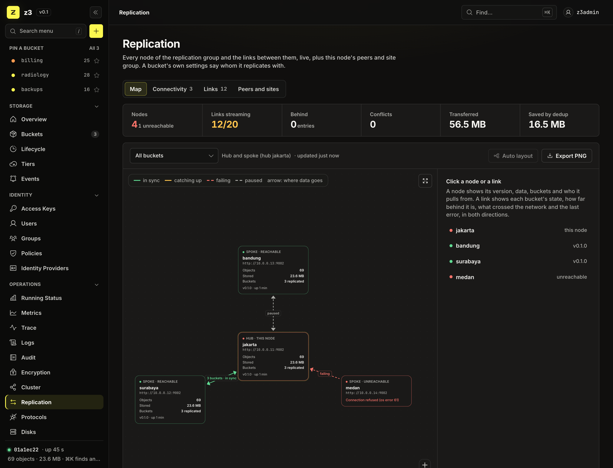
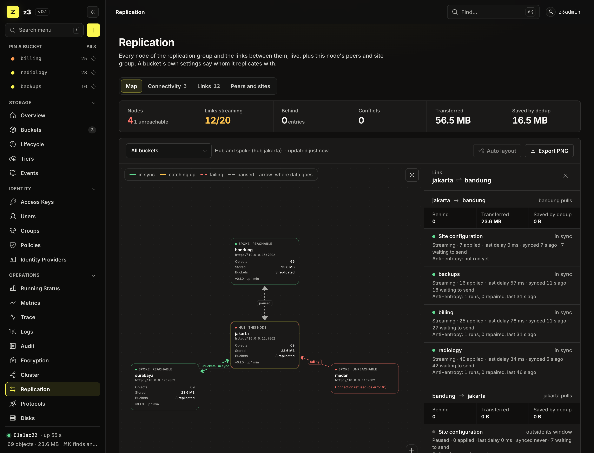

The **Map** tab of the **Replication** page draws the whole replication group on one canvas: every
site or peer as a card, and every link between two nodes as a line. It refreshes every five seconds.

<Frame>
  
</Frame>

The node you are signed in to asks every node it knows (site members and peers) to describe its own
replication, so the map also shows links between two other nodes, for example two spokes that both
pull from the hub. A node that does not answer still appears, marked unreachable with the error.

A [cluster](/deploy/cluster#replication-with-other-zee3-nodes) is one card, and its links appear once
whichever member you are signed in to. A peer listed with several URLs is asked at the first one
that answers.

## Reading the map

- **Cards** show the node's role (hub, spoke, site or peer), whether it answered, its peer address,
  objects, stored bytes, replicated buckets, version and uptime. The node you are on has a ring.
- **Lines** join two nodes that replicate. The arrowhead points to where data goes: a node that
  pulls from another gets the arrow. Most links run both ways, with an arrow at each end.
- **Colours**: green is in sync, amber is catching up (changes waiting), dashed red is failing or
  offline, dashed grey is paused outside a bandwidth window. A line moves while changes flow.
- The chip on each line says how far behind it is, or how many buckets are in sync.

Above the map, readouts total the whole group: nodes and how many are unreachable, links streaming,
changes waiting and the age of the oldest, conflicts, bytes transferred and bytes saved by
deduplication. The layout follows the site topology: the hub in the middle for hub and spoke, a row
for a chain, a circle for a mesh or plain peers.

## Details

Click a card or a line to open its details beside the map.

- **A node**: node id, version, uptime, objects and bytes, topology, the members of a cluster and
  the member running its links, the nodes it pulls from and
  the nodes that pull from it, every replicated bucket with its mode, peers, priority, rules, geo
  erasure coding and offline behaviour, and the bandwidth limits and windows it pulls with.
- **A link**, in both directions: for each bucket (and the site configuration log), its state,
  how many changes are behind and for how long, changes applied, conflicts, the last delay, the last
  sync, anti-entropy runs and repairs, time throttled, changes waiting to send while the peer is
  offline, the last error, and on a cluster the member running the link. **Compare now** runs Merkle
  anti-entropy for a bucket this node pulls.

<Frame>
  
</Frame>

## Tools

- **Bucket filter**: only the links of one bucket; nodes that don't replicate it fade.
- **Drag** cards to arrange them; the positions are kept in this browser. **Auto layout** puts them
  back.
- **Full screen**, zoom controls, and a minimap for large groups.
- **Export PNG** saves the whole map as an image.
- On a phone the map opens at a readable size on this node; drag to see the rest, or pick a node
  from the list below the map.

The **Connectivity**, **Links** and **Peers and sites** tabs keep the tables of peers, links, peers
and site group of this node.

## API

`GET /api/replication/topology` (`admin:ServerInfo`) answers this node's description and every other
node's, as asked over the peer API (`GET /v1/replication/topology` with the peer token):

```json
{
  "generated_ms": 1794951880000,
  "nodes": [
    { "name": "", "local": true, "reachable": true, "node": {
        "node_id": "01a1ebd4-...", "name": "jakarta", "version": "0.1.0", "uptime_secs": 3600,
        "stats": { "buckets": 3, "objects": 75, "logical_bytes": 23600000, "physical_bytes": 23600000, "chunks": 120 },
        "site": { "name": "jakarta", "topology": { "hub_spoke": { "hub": "jakarta" } }, "members": [ { "name": "bandung", "endpoint": "http://10.0.0.3:9002", "max_bytes_per_sec": null, "windows": [] } ] },
        "peers": [],
        "buckets": [ { "bucket": "radiology", "peers": ["bandung", "medan", "surabaya"], "mode": "async", "managed": true } ],
        "links": [ { "peer": "bandung", "bucket": "radiology", "state": "streaming", "lag_entries": 0 } ]
    } },
    { "name": "medan", "endpoint": "http://10.0.0.4:9002", "local": false, "reachable": false, "error": "Connection refused" }
  ]
}
```

Links have the fields of [`GET /api/replication`](/api/admin-replication#link-status), including
`worker` on a cluster. A cluster's description also has `cluster`: its members and the member
running the links.

```json
"cluster": {
  "members": [
    { "id": "2200471768134479368", "name": "zee3-1", "addr": "http://10.0.0.11:9002", "leader": true },
    { "id": "5168186497781187492", "name": "zee3-2", "addr": "http://10.0.0.12:9002", "leader": false }
  ],
  "replication_worker": "zee3-1"
}
```

Tokens are never included. Each node is asked with a four-second timeout.
