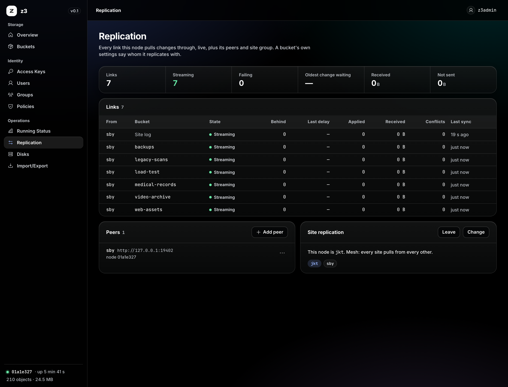

z3 replicates buckets between nodes **active-active**: every node accepts reads and writes for a
replicated bucket, and all nodes converge to the same contents. You can replicate:

<CardGroup cols={3}>
  <Card title="Per bucket" icon="bucket" href="/replication/bucket-replication">
    Choose peers, consistency mode and rules for each bucket.
  </Card>
  <Card title="Whole sites" icon="sitemap" href="/replication/site-replication">
    Every bucket of every site, plus bucket settings and IAM.
  </Card>
  <Card title="Geo erasure coding" icon="earth-asia" href="/replication/geo-erasure-coding">
    Shards spread across sites instead of a full copy at each.
  </Card>
</CardGroup>

## How it works

Every node keeps a **change log** per bucket (see [Concepts](/get-started/concepts#change-log-and-clock)).
Replication is that log, pulled by the other nodes:

1. **Pull with long-polling.** Each node asks each of its peers for new log entries of a bucket.
   The request is held open until there is something new (up to 20 seconds), so changes arrive within
   milliseconds without constant polling.
2. **Only missing chunks travel.** An entry for a new version lists its chunks. The receiving node
   asks only for chunks it doesn't have yet. They come compressed with zstd (or raw when that
   doesn't help) and are checked against their BLAKE3 hash before they're stored. Copies and
   versions that changed a little cost almost nothing to replicate.
3. **Atomic, idempotent apply.** Each entry is applied in one transaction together with the
   position (cursor) in the peer's log. After a crash, replication continues from the cursor with no
   duplicates and no gaps.
4. **Anti-entropy.** Each bucket keeps a Merkle tree of its versions, updated in the same transaction
   as every write. Periodically, nodes compare trees and pull only what differs.

Existing data replicates too: a new peer reads the change log from the start.

Nodes talk over the replication API on port 9002 with a bearer token: each node's `Z3_PEER_TOKEN`,
which its peers present when they pull. A node without a token can still pull from others, but no
one can pull from it.

## Who wins

- **Every version is kept on every node.** The current version of a key is the one with the
  highest [hybrid logical clock](/get-started/concepts#change-log-and-clock) (HLC) timestamp. Every
  node picks the same winner, so they converge.
- A write made **after** a node has seen another write always wins, even if that server's clock is
  behind: nodes move their clock past every timestamp they receive.
- **Conflicts are detected exactly.** Each version carries a version vector: what its writer had
  already seen of that key. Two versions conflict only when neither writer had seen the other, for
  example during a network split. Overwriting a version you have already received is not a
  conflict, even from another node.
- **Conflicts lose no data.** Both versions are stored. The winner becomes current everywhere, the
  other stays readable by `versionId`, and the conflict is recorded at
  `GET /api/buckets/{bucket}/conflicts` (and under the bucket's replication settings in the console).
- **Tags** follow the same rule: the change with the highest timestamp wins.
- **Permanent deletes leave tombstones**, so a late copy arriving over another path doesn't bring a
  deleted version back.
- **No echoes.** Applied entries keep their origin and original timestamp. A node ignores its own
  entries coming back, and entries can be relayed to a third node (hub-and-spoke and chain
  topologies).

<Note>
  MinIO picks the winner by modification time, so a server whose clock is behind can lose a newer
  write, and it doesn't tell real conflicts from ordinary overwrites. Its resync also scans object
  listings and resends whole objects, where z3 compares Merkle trees and sends only missing chunks.
</Note>

## Buckets without versioning

Buckets without versioning (or with versioning suspended) can replicate too. Their writes replace a
"null" version, and the null version with the highest timestamp wins. On a replicated bucket, a
DELETE leaves an internal null delete marker instead of removing the version outright, so deletes
follow the same "highest timestamp wins" rule and an old PUT arriving late can't bring a deleted
object back. These markers don't show in ListObjectVersions.

Keep the versioning state the same on every node of a bucket; site replication does that for you.

## Consistency modes

Each bucket (or rule) chooses when a write is answered:

| Mode | A PUT or DELETE is answered after |
| --- | --- |
| `async` (default) | The local commit. Peers catch up in the background |
| `quorum` with N | N peers have applied the change |
| `all` | Every peer of the bucket has applied the change |

If not enough peers apply the write within the bucket's `timeout_ms` (5000 by default), the client
gets **503**. The write stays stored on this node and replicates later, like a write timeout in
Cassandra. See [Consistency modes](/replication/bucket-replication#consistency-modes).

## Anti-entropy

Each bucket keeps 4,096 Merkle leaves (an XOR of the hashes of the live versions in each leaf).
Every `Z3_ANTI_ENTROPY_INTERVAL` seconds (300 by default) on each link, or when you ask for a
resync, the nodes compare leaves and fetch the contents of only the leaves that differ. The cost
follows the number of differences, not the number of objects.

Run it now with **Resync** in the bucket's replication settings, or:

```bash
curl -X POST -H "Authorization: Bearer $TOKEN" \
  http://127.0.0.1:9001/api/buckets/photos/replication/resync
```

## Monitoring

<Frame>
  
</Frame>

| Where | What |
| --- | --- |
| **Replication** page | Each link live: state, lag, delay, bytes, conflicts and the last error |
| `GET /api/replication` | Each link: `streaming` or `error`, cursor, lag in entries and seconds, last delay, bytes on the wire, raw and saved by deduplication, conflicts, last error, last anti-entropy result. The site log's link shows as bucket `<site>` |
| `GET /api/buckets/{bucket}/conflicts` | Concurrent writes and their winners |
| `GET /metrics` | `z3_replication_up`, `z3_replication_lag_seconds`, `z3_replication_lag_entries`, `z3_replication_conflicts_total`, `z3_replication_bytes_*_total`, `z3_replication_throttled_seconds_total`, `z3_replication_paused`, `z3_replication_geo_chunks_total` |
| **Support** page | The **Replication** check warns on a link in error or more than 5 minutes behind; **Peers and clocks** checks each peer's reachability, version and clock difference |

The counters in `/api/replication` reset when the node restarts.

On objects, GET and HEAD return `x-amz-replication-status`:

| Value | Meaning |
| --- | --- |
| `PENDING` | Not yet pulled by every peer |
| `COMPLETED` | Every peer has it |
| `REPLICA` | This copy came from another node |

Objects that a rule keeps local have no such header.

## Current limits

- No mutual TLS between nodes. Use a private network or VPN, or put a TLS proxy in front of the
  replication API (peer endpoints accept `https://`). See
  [TLS and reverse proxies](/deploy/tls-and-proxies#the-replication-api).
- The change log, tombstones and internal delete markers aren't trimmed yet.
- A `quorum` or `all` write that times out stays stored locally; it isn't rolled back.
- Session tokens can only be verified by a node that pulls directly from the writing node.
- All nodes of a replication group should run the same z3 version. See
  [Upgrading](/deploy/upgrading#replication-groups).
