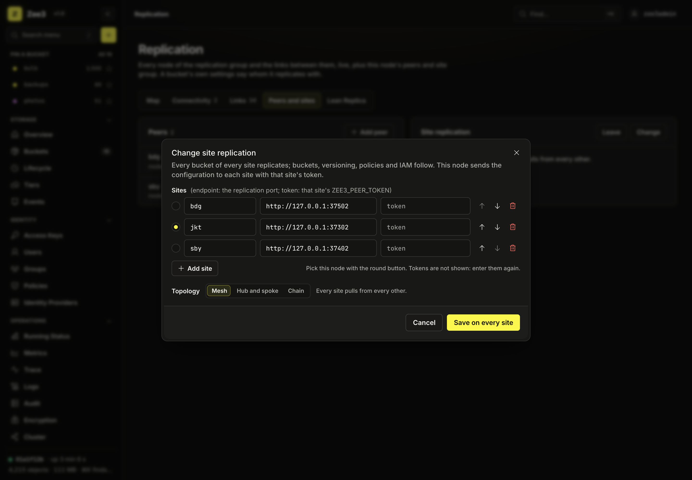

Site replication joins several nodes (sites) into one group. Instead of configuring each bucket,
**every bucket of every site** replicates to every site, now and in the future, and the
configuration around them follows.

## What follows

| What | How |
| --- | --- |
| Object data of every bucket | Replicated active-active, as in [bucket replication](/replication/bucket-replication) |
| Bucket creation and deletion | Through the site log. A deleted bucket leaves a tombstone, so a late `Create` doesn't bring it back. A bucket that still holds objects at a site isn't deleted there |
| Versioning state, replication mode and rules | Through the site log; conflicting changes are resolved by HLC |
| IAM: users, groups, policies, access keys, bucket policies | Replicated; secrets are re-sealed with a key derived from the tokens of all sites, so every site can open them even with different root secrets |
| Lifecycle rules, event rules and destinations, audit targets | Replicated |
| Object Lock configuration, bucket tags and quotas | Replicated |
| KMS keys and default bucket encryption | Replicated, so SSE-S3 and SSE-KMS objects are readable at every site |
| Tiers, identity providers, file protocol settings | Replicated |
| Cluster settings (region, API limits, CORS, compression, scanner, logging) | Replicated |

The **site log** is a special change log, pulled between sites like a bucket log, that carries the
bucket-level and configuration changes.

## Set it up

Every site needs a name, a reachable replication API and its own `ZEE3_PEER_TOKEN`:

```bash
# on each site, with its own token
ZEE3_PEER_TOKEN=token-of-dc1 zee3
```

Then one call to **one** node configures the whole group. That node stores the configuration and
sends it to every other site, using each site's token:

<Tabs>
  <Tab title="Console">
    **Replication → Site replication → Set up**: this site's name, then each site's name, replication
    endpoint and token, and the topology.

    <Frame>
      
    </Frame>
  </Tab>
  <Tab title="Admin API">
    ```bash
    curl -X PUT http://127.0.0.1:9001/api/site \
      -H "Authorization: Bearer $TOKEN" -H 'content-type: application/json' \
      -d '{
        "name": "dc1",
        "sites": {
          "dc1": {"endpoint": "http://10.0.0.1:9002", "token": "token-of-dc1"},
          "dc2": {"endpoint": "http://10.0.0.2:9002", "token": "token-of-dc2"},
          "dc3": {"endpoint": "http://10.0.0.3:9002", "token": "token-of-dc3"}
        },
        "topology": "mesh"
      }'
    ```

    The answer lists the result per site (`ok` and `error`).
  </Tab>
</Tabs>

| Field | Meaning |
| --- | --- |
| `name` | This node's own site; must be one of `sites` |
| `sites` | At least two sites, by name. Each has `endpoint` (`http://` or `https://`, the site's replication API; several URLs separated by commas for the members of a cluster) and `token` (that site's `ZEE3_PEER_TOKEN`) |
| `sites.*.max_bytes_per_sec`, `sites.*.windows` | Optional bandwidth limit and UTC time windows for pulling from that site; see [Bandwidth limits](/replication/bucket-replication#bandwidth-limits-and-time-windows) |
| `topology` | Who pulls from whom (below); `"mesh"` by default |

Setting it up needs the `admin:ConfigUpdate` right.

## A cluster as a site

A site can be a [cluster](/deploy/cluster#replication-with-other-zee3-nodes). Set up or change site
replication through any of its members; the configuration is stored in the cluster's metadata, so
every member has it.

- Give the site's `endpoint` as every member separated by commas
  (`http://10.0.0.11:9002,http://10.0.0.12:9002,http://10.0.0.13:9002`), a VIP or load balancer in
  front of them, or one member's URL. With several URLs, the URL that last answered is used, and the
  next one is tried on a connection error or a 503. The same goes for every call between sites: geo
  shards, geo repair, the replication map and health checks.
- Older single-node sites don't understand comma lists: give them one URL or a VIP.
- The cluster's leader pulls from the other sites; any member serves them, including the call that
  joins the cluster to the group.
- Every member needs the same `ZEE3_SITE_NAME`, or none.

## Mutual TLS between sites

Sites can talk over [mutual TLS](/deploy/peer-tls) instead of plain HTTP: start every site with
`ZEE3_PEER_TLS_CERT`, `ZEE3_PEER_TLS_KEY` and `ZEE3_PEER_TLS_CA` (certificates from one CA), and use
`https://` endpoints in `sites`. The site configuration is sent to the other sites over the same
connection, so it is protected too.

To switch a running group, set the certificates with `ZEE3_PEER_TLS_MODE=mixed` on every site, run
`PUT /api/site` once more with `https://` endpoints (or edit the group in the console), then remove
the mode variable. See [Turn it on in a running group](/deploy/peer-tls#turn-it-on-in-a-running-group).

## Topologies

| `topology` | Each site pulls from |
| --- | --- |
| `"mesh"` | Every other site |
| `{"hub_spoke": {"hub": "dc1"}}` | Spokes pull from the hub; the hub pulls from every spoke |
| `{"chain": {"order": ["dc1", "dc2", "dc3"]}}` | Its neighbours in the order |

Bucket log and site log entries are relayed with their original origin and timestamp, so every change
reaches every site in any topology. Hub-and-spoke and chain need fewer links, for example branch
offices that only connect to headquarters. Two features need direct links:
[geo erasure coding](/replication/geo-erasure-coding) needs a mesh, and objects under a
[residency rule](/replication/bucket-replication#data-residency) only travel between allowed sites
that pull from each other directly.

## Per-bucket settings in a group

For buckets managed by site replication, `PUT /api/buckets/{bucket}/replication` changes only
`mode`, `timeout_ms`, `rules` (and `priority` and `geo`); the peers always follow the topology. The
change spreads to every site through the site log.

## Leave the group

**Replication → Site replication → Leave**, or:

```bash
curl -X DELETE -H "Authorization: Bearer $TOKEN" http://127.0.0.1:9001/api/site
```

This node stops following the group. Its buckets keep replicating with the same peers, as plain
bucket configuration. Other sites aren't changed.

## Good to know

- Every site must reach the replication API of the sites it pulls from. Event destinations, audit
  targets, tiers and external KMS servers must be reachable from every site, since their
  configuration is shared.
- Each node sends bucket events only for requests it served itself, so a change produces exactly one
  event even though every site has the same rules.
- `api.requests_max` is a shared setting but limits each node on its own.
- The site configuration is part of the [configuration export](/operations/config-export) but isn't
  applied by an import; set it up again on the new node.
- Run the same Zee3 version on every site. See [Upgrading](/deploy/upgrading#replication-groups).
