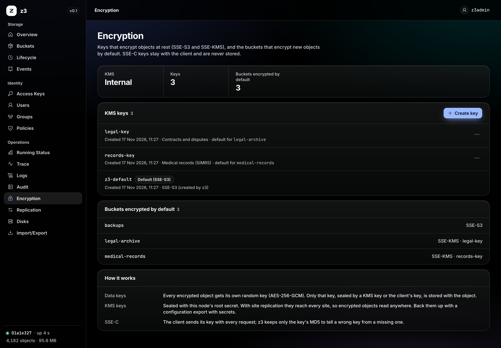
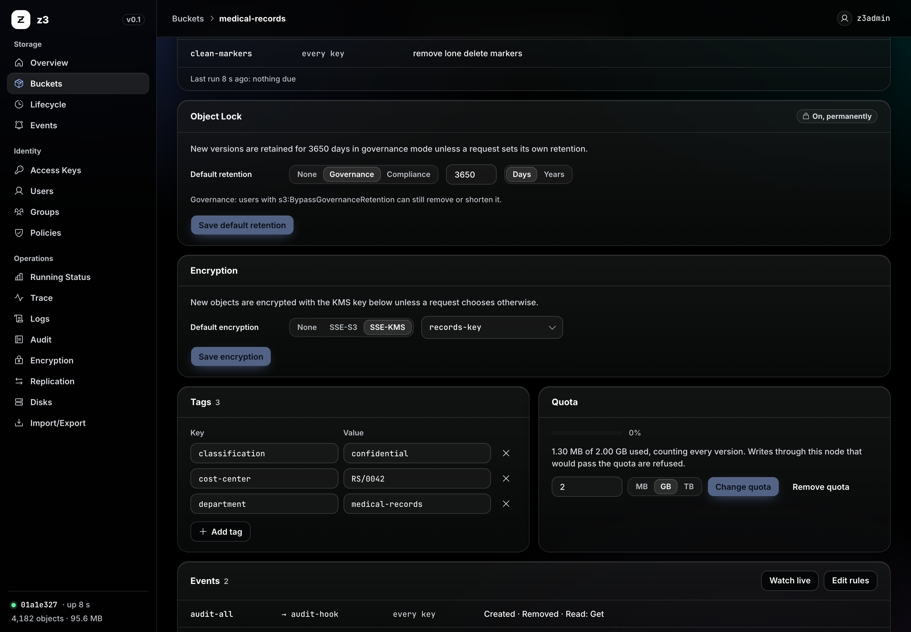
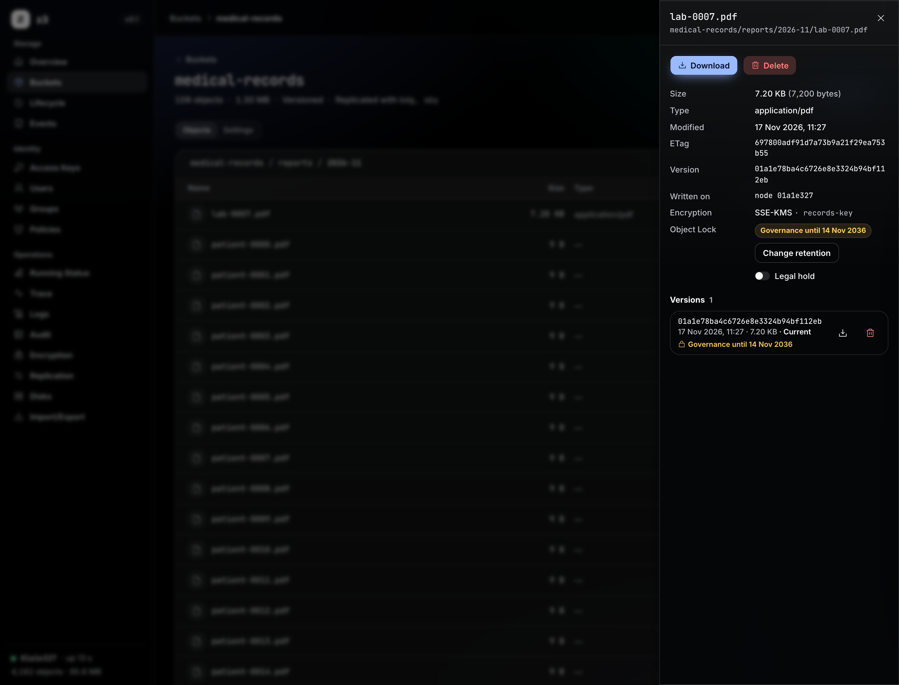

z3 can store object data encrypted on disk (**server-side encryption**), in the same three modes
as Amazon S3:

| Mode | The data key is sealed with | Ask for it with |
| --- | --- | --- |
| **SSE-S3** | The server's default key, `z3-default` | `x-amz-server-side-encryption: AES256` |
| **SSE-KMS** | A named KMS key | `x-amz-server-side-encryption: aws:kms` and `x-amz-server-side-encryption-aws-kms-key-id` |
| **SSE-C** | A 256-bit key the client sends with every request | `x-amz-server-side-encryption-customer-algorithm`, `-customer-key` and `-customer-key-MD5` |

Keys live in z3's **internal KMS** unless you connect an
[external KMS](/security/external-kms) (HashiCorp Vault or MinIO KES).

<Frame>
  
</Frame>

## How it works

- Every encrypted object gets its own random **data key**. Each chunk is encrypted with
  AES-256-GCM (a random nonce per chunk), then stored and replicated as ciphertext. The version's
  metadata holds only the **sealed** data key (sealed by the KMS key or the client's key), the
  mode and the key id.
- Range reads still work: z3 reads and decrypts only the chunks it needs.
- Encrypted objects aren't deduplicated with other objects (every object's ciphertext differs),
  and they're never [compressed](/storage/compression).
- The ETag is still the MD5 of the original content.
- Internal KMS keys are sealed with the node's root secret. The default key is created the first
  time it's needed (not at startup), so two sites never create different default keys.
- **SSE-C**: z3 never stores the client's key, only its MD5, to tell a wrong key (`AccessDenied`)
  from a missing one (`InvalidRequest`). GET, HEAD, UploadPart and CopyObject (as the source) must
  send the same key.

## Encrypt objects

```bash
# SSE-S3
aws --endpoint-url http://localhost:9000 s3 cp report.pdf s3://records/ --sse AES256

# SSE-KMS with a named key
aws --endpoint-url http://localhost:9000 s3 cp lab-result.pdf s3://records/ \
  --sse aws:kms --sse-kms-key-id records-key

# SSE-C with your own 32-byte key
aws --endpoint-url http://localhost:9000 s3 cp secret.zip s3://archive/ \
  --sse-c AES256 --sse-c-key fileb://key.bin
aws --endpoint-url http://localhost:9000 s3 cp s3://archive/secret.zip . \
  --sse-c AES256 --sse-c-key fileb://key.bin
```

Multipart uploads, copies and range reads all work encrypted. To require encryption, add a
[condition](/access/conditions) on `s3:x-amz-server-side-encryption`, or set a bucket default.

## KMS keys

Named keys are for SSE-KMS. Names are 1 to 64 characters: letters, digits, `-`, `_` and `.`.

<Tabs>
  <Tab title="Console">

    Open **Encryption** and click **Create key**. Enter a **Name** and an optional
    **Description**. The list shows each key, the default SSE-S3 key, and the buckets that encrypt
    by default with it.

  </Tab>
  <Tab title="Admin API">

    ```bash
    curl -X POST http://127.0.0.1:9001/api/kms/keys \
      -H "Authorization: Bearer $TOKEN" -H 'content-type: application/json' \
      -d '{"name": "records-key", "description": "Medical records"}'

    curl -H "Authorization: Bearer $TOKEN" http://127.0.0.1:9001/api/kms
    ```

  </Tab>
</Tabs>

Managing KMS keys needs `admin:ConfigUpdate`.

<Warning>
  Deleting a key makes every object encrypted with it **unreadable**, on every site. A key that is
  still a bucket's default, and the `z3-default` key, can't be deleted. Rotate objects to another
  key first (see [Key rotation](#key-rotation)).
</Warning>

Back up internal keys with a [configuration export](/operations/config-export) **with secrets**:
the key material is included.

## Bucket default encryption

A bucket can encrypt new objects by default. Objects written without encryption headers follow the
default; a request that asks for something else wins. Existing objects don't change. Uploads from
the console and through the [file protocols](/protocols/overview) follow the default too.

<Tabs>
  <Tab title="Console">

    Open the bucket, **Settings → Protection → Encryption**. Pick **None**, **SSE-S3** or
    **SSE-KMS** (and choose the key), then click **Save encryption**.

    <Frame>
      
    </Frame>

  </Tab>
  <Tab title="AWS CLI">

    ```bash
    aws --endpoint-url http://localhost:9000 s3api put-bucket-encryption --bucket records \
      --server-side-encryption-configuration '{"Rules": [{"ApplyServerSideEncryptionByDefault":
        {"SSEAlgorithm": "aws:kms", "KMSMasterKeyID": "records-key"}}]}'

    aws --endpoint-url http://localhost:9000 s3api get-bucket-encryption --bucket records
    aws --endpoint-url http://localhost:9000 s3api delete-bucket-encryption --bucket records
    ```

    These need `s3:GetEncryptionConfiguration` and `s3:PutEncryptionConfiguration`.

  </Tab>
  <Tab title="Admin API">

    ```bash
    curl -X PUT http://127.0.0.1:9001/api/buckets/records/encryption \
      -H "Authorization: Bearer $TOKEN" -H 'content-type: application/json' \
      -d '{"algorithm": "sse-kms", "key_id": "records-key"}'
    ```

    `{"algorithm": "sse-s3"}` for SSE-S3; `DELETE` removes the default.

  </Tab>
</Tabs>

## In the console

The object details show how an object is encrypted (SSE-S3, SSE-KMS with its key, or SSE-C) and
which KMS sealed it. Console downloads decrypt SSE-S3 and SSE-KMS objects. SSE-C objects can only
be downloaded over S3 with their key.

<Frame>
  
</Frame>

## Copying

`CopyObject` takes the target's encryption from the request headers, or from the target bucket's
default:

- **Same protection as the source** (SSE-S3 to SSE-S3, unencrypted to unencrypted): only metadata
  is copied, and the ciphertext is reused.
- **Different protection** (a new SSE-C key, SSE-C to SSE-S3, encrypting an old object,
  decrypting): the data is read, decrypted and encrypted again into the new version.

So `CopyObject` with encryption headers is how you encrypt an existing unencrypted object or change
an SSE-C key. A copy that keeps the same mode but finds the source sealed by another KMS (for
example the internal one after Vault was connected) seals the data key again with the active KMS.

## Key rotation

To move SSE-S3 and SSE-KMS objects to another key, run a **rotate** [batch job](/storage/batch).
Each version's data key is sealed again in place, without rewriting the data, older versions
included:

```json
{ "type": "rotate", "source": { "bucket": "records" }, "key_id": "records-key-2027" }
```

```bash
z3 admin batch start rotate.json --wait
```

An empty `key_id` moves objects to the default SSE-S3 key. Start with `"dry_run": true` to see what
would change. SSE-C objects are skipped, since their key is only at the client. After a rotation,
the old key is no longer needed for the objects that moved.

Rotation also moves objects from the internal KMS to an
[external KMS](/security/external-kms#move-objects-to-the-external-kms).

## With replication

Chunks are replicated as ciphertext, and the metadata carries the sealed data key. With
[site replication](/replication/site-replication), KMS keys and bucket default encryption reach
every site (keys are resealed with the site group's key), so SSE-S3 and SSE-KMS objects are
readable on any site. SSE-C objects are readable on any site with the client's key.

For plain [bucket replication](/replication/bucket-replication), the other node needs the same KMS
keys: move them with a [configuration export](/operations/config-export) **with secrets** and an
import. The key material comes along and objects stay readable.

## Admin API

| Endpoint | What it does |
| --- | --- |
| `GET /api/kms` | Keys (without material), the default key, every bucket's default encryption |
| `POST /api/kms/keys` | `{"name": "records-key", "description": "..."}` |
| `DELETE /api/kms/keys/{name}` | Delete an internal key (objects using it become unreadable) |
| `GET/PUT/DELETE /api/buckets/{b}/encryption` | Bucket default encryption |

The external KMS endpoints are on [External KMS](/security/external-kms#admin-api).

## Not supported yet

- Scheduled (automatic) key rotation. Rotate by hand with a batch job.
- `x-amz-server-side-encryption-context` and bucket keys (`BucketKeyEnabled`) are ignored.
