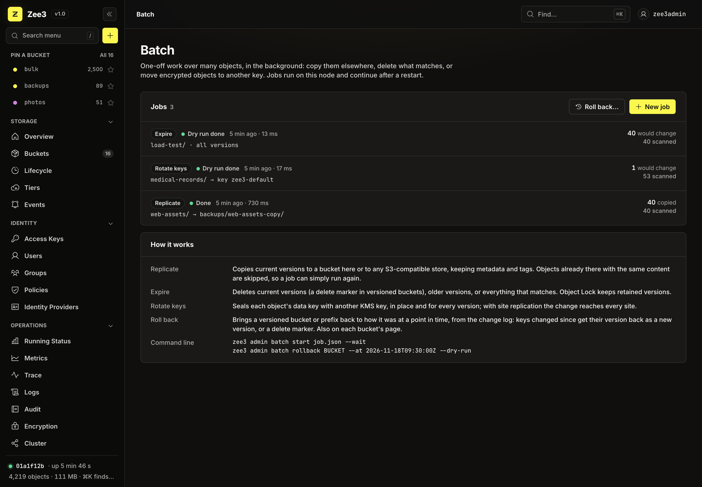
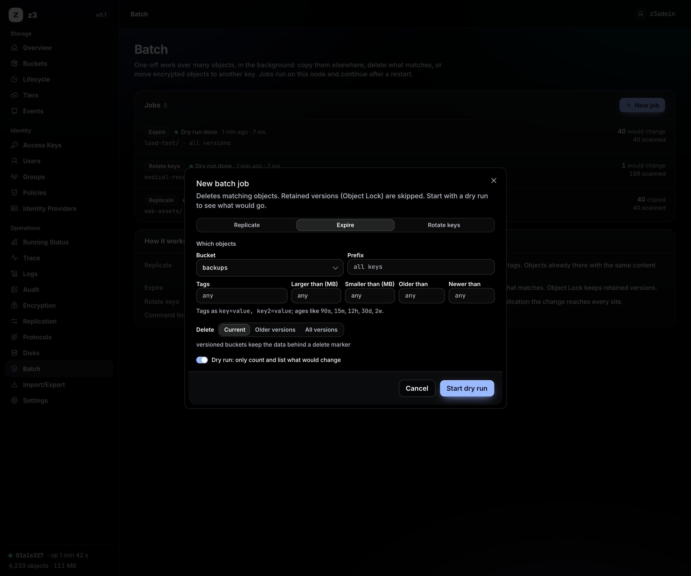
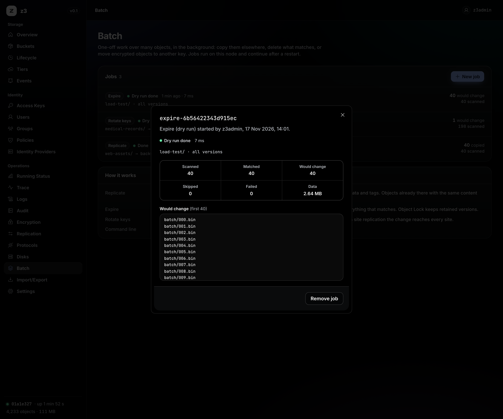

A **batch job** is one-off work over many objects that runs in the background on the node where
you start it.

| Job | What it does |
| --- | --- |
| **replicate** | Copies matching objects (current versions) to another bucket in this cluster or to any S3-compatible store (AWS S3, MinIO, another z3). Metadata, content type and tags come along. Objects already in the target with the same content are skipped, so you can run the job again at any time. |
| **expire** | Deletes matching objects: current versions (a delete marker in a versioned bucket), older versions, or all versions including delete markers. Versions held by [Object Lock](/storage/object-lock) are skipped. |
| **rotate** | Moves SSE-S3 and SSE-KMS objects to another KMS key. Each version's data key is sealed again **in place**, without rewriting data, older versions included. SSE-C objects are skipped: their key only exists at the client. |
| **rollback** | Brings a versioned bucket, a prefix or one key back to how it looked at a point in time, by adding versions and delete markers. See [Point-in-time rollback](/storage/point-in-time). |

Expire and rotate have a **dry run**; a rollback has a **preview** instead, that only counts the objects the job would touch and lists up
to 100 of them.

<Frame>
  
</Frame>

## Filters

Every field you fill in must match:

| Field | Meaning |
| --- | --- |
| `source.bucket`, `source.prefix` | The bucket and prefix to go through |
| `filter.tags` | Objects that carry all of these tags |
| `filter.size_gt`, `filter.size_lt` | Size in bytes: larger than, smaller than |
| `filter.older_than`, `filter.newer_than` | Age since the version was written: `90s`, `15m`, `12h`, `30d`, `2w` |

## Start a job

<Tabs>
  <Tab title="Console">

    1. Open **Batch** and click **New job**.
    2. Pick **Replicate**, **Expire** or **Rotate keys**.
    3. Choose the source **Bucket** and, as needed, **Prefix**, **Tags**, **Larger than (MB)**,
       **Smaller than (MB)**, **Older than** and **Newer than**.
    4. Fill in the part for the job type:
       - **Replicate**: the target is **This cluster** or **Another S3 store** (**Endpoint**,
         **Region**, **Access key**, **Secret key**), plus the target **Bucket** and **Prefix**.
         **Copy again even when the target already has the object** turns on `overwrite`.
       - **Expire**: which versions to delete: **Current**, **Older versions** or **All versions**.
       - **Rotate keys**: the key to **Move to**, such as `z3-default (SSE-S3)` or a named key.
    5. For expire and rotate, leave **Dry run: only count and list what would change** on the first
       time, and click **Start dry run**. Check the list, then start the real job.

    <Frame>
      
    </Frame>

  </Tab>
  <Tab title="z3 admin">

    Write the job as JSON and start it:

    ```bash
    z3 admin batch start job.json --wait   # start, then show progress until it finishes
    z3 admin batch start - < job.json      # read the definition from stdin
    ```

    See [CLI: batch](/cli/batch).

  </Tab>
  <Tab title="Admin API">

    ```bash
    curl -X POST http://127.0.0.1:9001/api/batch \
      -H "Authorization: Bearer $TOKEN" -H 'content-type: application/json' \
      -d @job.json
    ```

  </Tab>
</Tabs>

Before a job starts, z3 checks it: the source bucket exists, a local target bucket exists and
doesn't overlap the source, a remote target answers, and the KMS key exists.

### Job definitions

Expire with a dry run:

```json
{ "type": "expire", "source": { "bucket": "logs", "prefix": "tmp/" },
  "filter": { "older_than": "30d" }, "versions": "all", "dry_run": true }
```

`versions` is `current` (the default), `noncurrent` or `all`.

Replicate to another S3 store:

```json
{ "type": "replicate", "source": { "bucket": "records" },
  "target": { "bucket": "archive", "prefix": "site-a/", "endpoint": "https://s3.dr-site.example",
              "region": "us-east-1", "access_key": "AKEXAMPLE", "secret_key": "SECRETEXAMPLE" } }
```

An empty `target.endpoint` means a bucket in this cluster. `"overwrite": true` copies again even
when the target already has the same object.

Rotate to another key:

```json
{ "type": "rotate", "source": { "bucket": "records" }, "key_id": "records-key-2027" }
```

An empty `key_id` means the default SSE-S3 key (`z3-default`). Rotation also moves objects
from the internal KMS to an [external KMS](/security/external-kms) once one is connected.

## Follow, cancel and remove jobs

<Tabs>
  <Tab title="Console">

    The **Batch** page lists jobs, newest first, with state and counts. Click a job for its
    details: scanned, matched, done, skipped, failed, data copied, the last errors and the dry run
    list. **Cancel job** stops a running job; **Remove job** forgets a finished one (only its
    record goes; what it copied, deleted or rotated stays).

    <Frame>
      
    </Frame>

  </Tab>
  <Tab title="z3 admin">

    ```bash
    z3 admin batch list
    z3 admin batch status expire-1a2b3c4d5e6f7a8b   # progress, errors, dry-run list
    z3 admin batch cancel replicate-0f1e2d3c4b5a6978
    z3 admin batch remove rotate-8a7b6c5d4e3f2a1b
    ```

  </Tab>
</Tabs>

A job is `running`, `done`, `failed` or `cancelled`. Job ids start with the job type.

## How jobs run

- A job runs on the node where it was started, four objects at a time. Its definition and progress
  are saved on that node every few seconds. If the node restarts mid-job, the job continues from
  the last key it finished.
- **Replicate** into this cluster uses the normal write path: the target bucket's default
  encryption, compression, replication and bucket events all apply. To a remote store, large
  objects go as multipart (64 MiB parts), and the source ETag is stored in the metadata
  `z3-source-etag` to recognise objects already copied. The target secret key is stored sealed and
  never shown again.
- **Expire** triggers `s3:ObjectRemoved:Delete` or `s3:ObjectRemoved:DeleteMarkerCreated`
  [events](/events/bucket-events). Objects on a [tier](/storage/tiers) are deleted from the tier too.
- **Rotate** writes a `Rewrap` record to the change log, so with bucket or site replication the
  key change reaches the other nodes. After a rotation, the old key is no longer needed for the
  objects that moved.

## Permissions

Viewing jobs needs `admin:ServerInfo`. Starting, cancelling and removing them needs
`admin:ConfigUpdate`.

| Endpoint | What it does |
| --- | --- |
| `GET /api/batch` | Every job, newest first |
| `POST /api/batch` | Start a job |
| `GET /api/batch/{id}` | One job |
| `POST /api/batch/{id}/cancel` | Stop a running job |
| `DELETE /api/batch/{id}` | Forget a finished job |

## Not supported yet

- Replicating every version (only current versions are copied), and copying from a remote S3 store
  into z3. Use [migration from MinIO or S3](/deploy/migrate-from-minio) for that.
- Scheduled, repeating jobs. Run `z3 admin batch start` from cron instead.
- Encrypting unencrypted objects with rotate. Use CopyObject with encryption headers.
