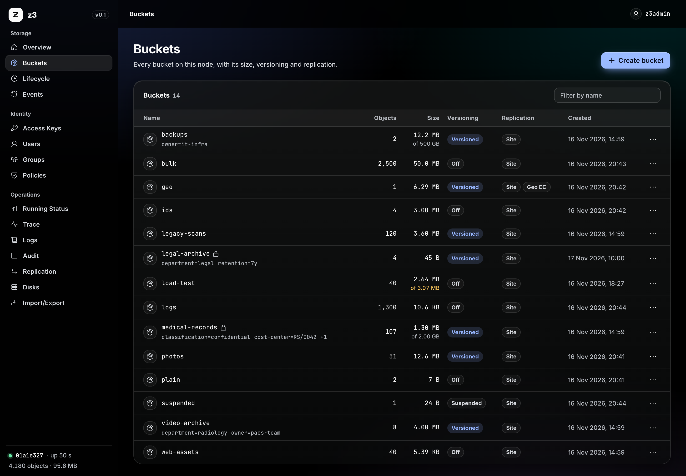
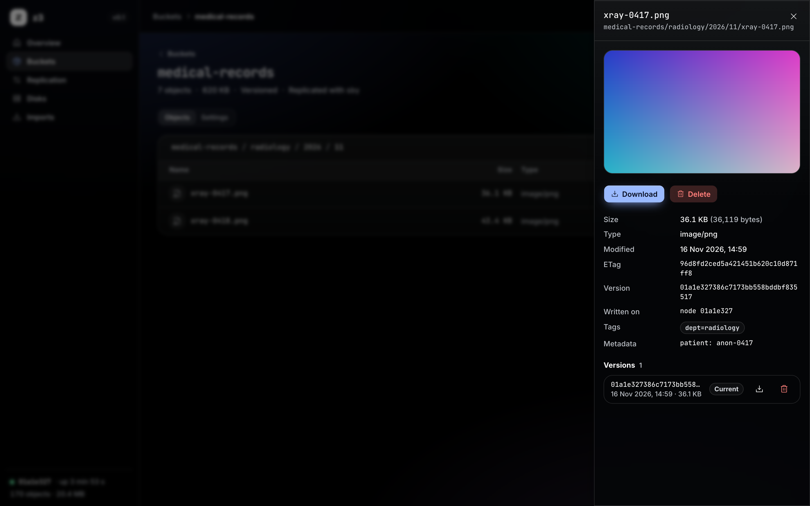
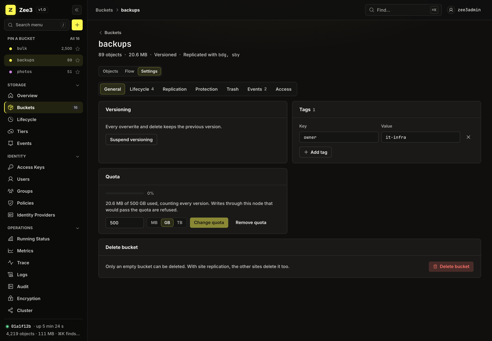

A **bucket** is a named container of objects. You create buckets in the console, with any S3
client, or over the [admin API](/api/admin-buckets). Who may create, list or delete a bucket is
decided by [policies](/access/policies) (`s3:CreateBucket`, `s3:ListBucket`, `s3:DeleteBucket`).

## Bucket names

Names follow the DNS-compatible S3 rules:

- 3 to 63 characters,
- lowercase letters, digits, dots (`.`) and hyphens (`-`),
- starting and ending with a letter or digit, with no two dots in a row.

Creating a bucket that already exists fails with `BucketAlreadyOwnedByYou`.

## Create a bucket

<Tabs>
  <Tab title="Console">

    1. Open **Buckets** and click **Create bucket**.
    2. Enter a **Name**.
    3. Leave **Keep every version** on to turn on [versioning](/storage/versioning) (the
       default), or turn it off for a bucket where overwrites replace the object.
    4. Turn on **Object Lock** only if versions must be protected from deletion. It can't be
       turned off later and keeps versioning on. See [Object Lock](/storage/object-lock).
    5. Click **Create bucket**. The console opens the new bucket.

  </Tab>
  <Tab title="AWS CLI">

    ```bash
    aws --endpoint-url http://localhost:9000 s3 mb s3://photos

    # versioning on
    aws --endpoint-url http://localhost:9000 s3api put-bucket-versioning \
      --bucket photos --versioning-configuration Status=Enabled

    # with Object Lock (turns versioning on too)
    aws --endpoint-url http://localhost:9000 s3api create-bucket \
      --bucket records --object-lock-enabled-for-bucket
    ```

    A bucket created over S3 starts without versioning, as on Amazon S3.

  </Tab>
  <Tab title="Admin API">

    ```bash
    curl -X POST http://127.0.0.1:9001/api/buckets \
      -H "Authorization: Bearer $TOKEN" -H 'content-type: application/json' \
      -d '{"name": "photos", "versioning": true, "object_lock": false}'
    ```

    See [Admin API: buckets](/api/admin-buckets).

  </Tab>
</Tabs>

With [site replication](/replication/site-replication), a bucket created on one site is created
on every site.

## The bucket list

**Buckets** shows every bucket you may use, with its size and object count, versioning,
replication peers, the first two [tags](/storage/tags-and-quota), the
[quota](/storage/tags-and-quota) if one is set (for example "of 2.00 GB" under the size) and a lock
icon for buckets with Object Lock. The filter box narrows the list by name.

The size counts every stored version, while the object count only counts current objects. When part
of the size is not in the listing, a line under it says where it is, for example "2.40 MB in old
versions · 3.1 MB in trash": [older versions](/storage/versioning#older-versions-and-space) (also
objects hidden by a delete marker) and deleted versions waiting in the
[trash](/storage/deletion-protection). So a versioned bucket can show 0 objects and still have a size.
The bucket page shows the same split next to its size.

<Frame>
  
</Frame>

Users without admin rights see only the buckets their policies let them use. `ListBuckets` over
S3 works the same way: it returns only buckets the caller has some access to.

## Browse objects

Click a bucket to open its **Objects** tab:

- Folders come from `/` in keys. Click one to go into it.
- **Search** asks the server, so it also finds objects past the first page. **Contains** (the
  default) finds objects in the current folder and its subfolders whose path has what you type in
  it, in any case, and marks the match. It reads up to 20,000 objects at a time; **Search further**
  goes on. **Starts with** lists folders and objects in the current folder whose name starts with
  it (case-sensitive), the way S3 prefixes work.
- **Sort** by name, size, modified time or type, either way, from the sort button or by clicking a
  column header. Folders stay on top. The server lists keys in name order a page at a time, so
  sorting by anything else orders the objects loaded so far; **Load more** brings in the rest.
- **List** or **Gallery** view: the gallery shows a card per folder and object, with a thumbnail for
  images up to 10 MiB (not for SSE-C objects, which need your key). The sort and the view are kept
  in the browser.
- **Upload** (or drag and drop files onto the page) uploads into the current folder, with progress.
- Click an object to see its details: size, content type, ETag, metadata,
  [object headers](/api/s3-compatibility#object-headers) (shown apart from metadata), tags, encryption,
  [tier](/storage/tiers), retention and its versions. From there you can download it, preview
  images, video, audio, PDF and text, and delete it. **Preview** opens a large view; the arrow
  buttons (or the arrow keys) step through the folder's other previewable files. Files stored
  as `application/octet-stream` are previewed by their extension.

### Delete many objects

- **Pick them:** tick the checkbox of each object (the header checkbox ticks the whole page), then
  **Delete** in the bar above the list. Each key is checked against your rights; keys you may not
  delete, or that Object Lock keeps, are reported and stay ticked.
- **By condition:** **Delete by condition…** (needs `admin:ConfigUpdate`) deletes what matches a
  prefix, a name pattern such as `pegawai_*` (`*` any run of characters, `?` one character) and a
  modified date range. With no condition it deletes everything under the prefix, after you type the
  bucket name. **Count matches** shows how many objects match and the first keys; the delete then
  runs as a [batch job](/storage/batch) with its progress in the dialog. In a versioned bucket you
  choose between a delete marker per object and removing every version for good.

<Frame>
  
</Frame>

<Note>
  Previews are served with `Content-Security-Policy: sandbox` and `nosniff`. HTML, SVG and
  JavaScript are shown as text, so a file in a bucket can never run as part of the console.
  PDFs are the exception, since browsers refuse to show a PDF in a sandboxed document: they rely
  on the browser's own PDF viewer and can only be embedded by the console (`frame-ancestors 'self'`).
</Note>

## Bucket settings

Open a bucket and click **Settings**. The settings are grouped in tabs; a direct link uses
`?tab=settings&section=<name>`.

| Tab | What's there |
| --- | --- |
| **General** | [Versioning](/storage/versioning), [tags](/storage/tags-and-quota), [quota](/storage/tags-and-quota), delete the bucket |
| **Lifecycle** | [Lifecycle rules](/storage/lifecycle): expiration, older versions, transitions to [tiers](/storage/tiers), run now |
| **Replication** | [Bucket replication](/replication/bucket-replication): peers, consistency, rules, resync |
| **Protection** | [Object Lock](/storage/object-lock) and [default encryption](/security/encryption) |
| **Events** | [Event rules](/events/bucket-events) and the live watch |
| **Access** | The [bucket policy](/access/bucket-policies): Private, Public read or Custom |

A tab you have no right to read is hidden.

<Frame>
  
</Frame>

## Delete a bucket

Only an **empty** bucket can be deleted: no objects, no older versions or delete markers.
Otherwise the request fails with `BucketNotEmpty`. Unfinished multipart uploads don't keep a bucket
busy: they are aborted with it, as on S3.

<Tabs>
  <Tab title="Console">

    Open the bucket, **Settings → General → Delete bucket**, and confirm. The bucket list's
    **⋯** menu has **Delete** as well.

  </Tab>
  <Tab title="AWS CLI">

    ```bash
    aws --endpoint-url http://localhost:9000 s3 rb s3://photos
    ```

  </Tab>
</Tabs>

A deleted bucket takes its lifecycle rules, bucket policy, tags and quota with it. A new bucket
with the same name starts without them. With site replication, the other sites delete the bucket
too.
