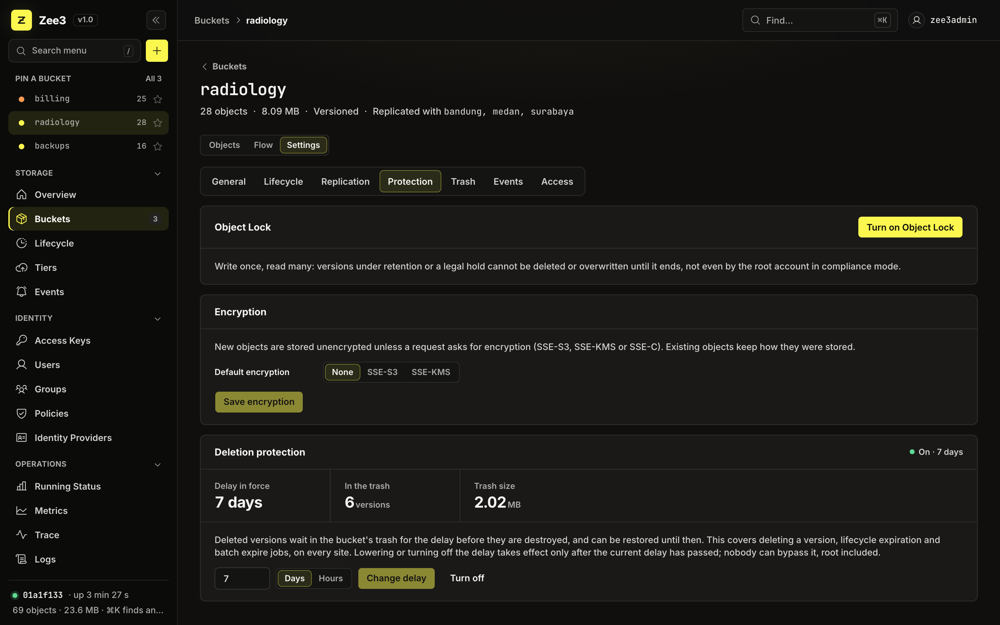
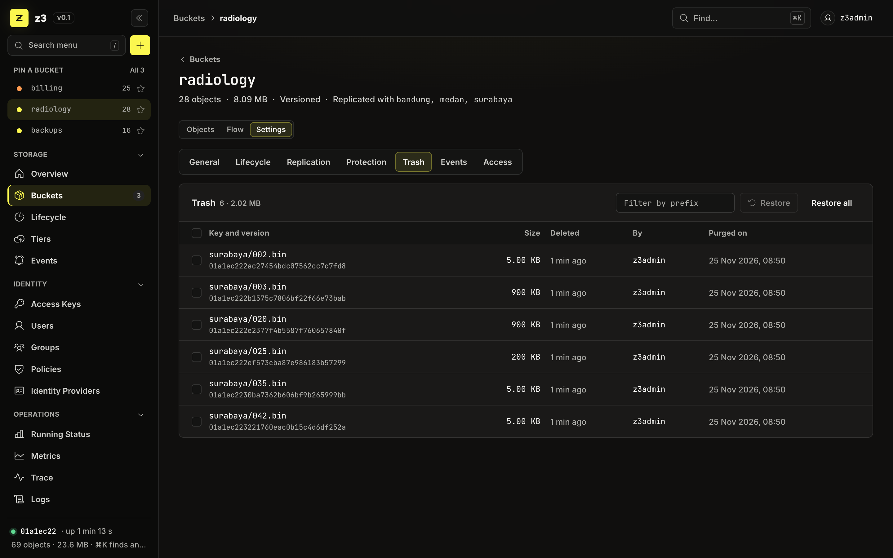

**Deletion protection** guards every version of a bucket against hasty or malicious permanent
deletion: a stolen access key, a script gone wrong, a lifecycle rule that expires too much.
[Object Lock](/storage/object-lock) protects the versions you lock; deletion protection covers
everything else.

While a bucket has a **deletion delay**, a version deleted for good isn't destroyed. It moves to
the bucket's **trash**, waits there for the delay, and can be restored with the same version id
until then.

## What goes to the trash

| Deletion | With a delay |
| --- | --- |
| `DeleteObject` with a `versionId`, `DeleteObjects` with version ids | Trash |
| Deleting a version in the console | Trash |
| Lifecycle `NoncurrentVersionExpiration` | Trash |
| Batch `expire` jobs | Trash |
| Version deletions replicated from another node | Trash, when the bucket has a delay on the receiving node |
| Deleting without a version id, lifecycle `Expiration` of current versions | Delete marker, as before |
| Deleting a delete marker (undelete) | Immediate, no trash |

For clients, a trashed version is gone exactly as if it had been deleted: it isn't listed by
`ListObjectVersions`, `GET` and `HEAD` with its version id answer `NoSuchVersion`, and the current
version is recomputed. Behind the scenes:

- Its data stays referenced, so garbage collection keeps it.
- Its bytes still count towards the bucket's usage and **its quota**.
- The bucket can't be deleted (`BucketNotEmpty`) until its trash is empty.
- `s3:ObjectRemoved:Delete` events are sent as usual.
- Each entry records when it was deleted, when it will be purged (deletion time plus the delay
  then in force), and who deleted it: an access key, `lifecycle`, `batch` or `replication`.

Once an entry's purge time has passed, it's destroyed: its data is released for garbage
collection and a tombstone keeps late replicas from bringing it back.

## Set the delay

<Frame>
  
</Frame>

<Note>
  The bucket needs versioning enabled. While a delay is set, versioning can't be suspended. The
  delay is between one hour and 365 days.
</Note>

<Warning>
  Lowering or turning off the delay only takes effect after the delay currently in force has
  passed. Nobody can bypass this, not even the root account: someone holding an admin key can't
  switch protection off and delete everything at once, and whatever they delete meanwhile can be
  restored.
</Warning>

- **Raising** the delay applies at once (and cancels a pending weaker change).
- **Lowering** it or turning it off is stored as a pending change with the date it takes effect.
- Versions already in the trash keep their purge date.

<Tabs>
  <Tab title="Console">

    Open the bucket, then **Settings → Protection**. The **Deletion protection** panel shows the
    delay in force, what the trash holds, and any pending change with its date.

  </Tab>
  <Tab title="CLI">

    ```bash
    zee3 admin trash delay medical-records 7d     # 7d, 48h or off
    zee3 admin trash delay medical-records        # show the delay, pending change and trash
    ```

  </Tab>
  <Tab title="Admin API">

    ```bash
    curl -X PUT http://127.0.0.1:9001/api/buckets/medical-records/deletion-protection \
      -H "authorization: Bearer $TOKEN" -H "content-type: application/json" \
      -d '{"days": 7}'
    ```

    `{"hours": 48}` works too; `DELETE` (or `0`) turns it off once the current delay has passed.

  </Tab>
</Tabs>

Reading the setting and the trash needs `admin:ServerInfo`; changing it and restoring needs
`admin:ConfigUpdate`.

## Restore

<Frame>
  
</Frame>

A restored version comes back with the same version id, data, metadata, tags and lock, and becomes
current again when it's the newest version of its key. Purged versions can't be restored.

To put a whole bucket or prefix back as it was before an attack, a
[point-in-time rollback](/storage/point-in-time) restores the versions it needs from the trash and
makes them current again, in one job.

<Tabs>
  <Tab title="Console">

    Open the bucket, then **Settings → Trash**. Filter by prefix, select versions and choose
    **Restore**, or **Restore all** to bring back everything that matches the filter.

  </Tab>
  <Tab title="CLI">

    ```bash
    zee3 admin trash list medical-records --prefix 2026/
    zee3 admin trash restore medical-records --version 2026/p-0042.pdf@01a1ebd2...
    zee3 admin trash restore medical-records --prefix 2026/
    zee3 admin trash restore medical-records --all
    ```

  </Tab>
  <Tab title="Admin API">

    ```bash
    curl -X POST http://127.0.0.1:9001/api/buckets/medical-records/trash/restore \
      -H "authorization: Bearer $TOKEN" -H "content-type: application/json" \
      -d '{"items": [{"key": "2026/p-0042.pdf", "version_id": "01a1ebd2..."}]}'
    ```

    Or `{"prefix": "2026/"}`; `{"prefix": ""}` restores everything.

  </Tab>
</Tabs>

## With replication

- The delay is a per-bucket setting, so site replication carries it (and a pending change) to
  every site.
- Version deletions replicate as usual and every site applies its own trash, so with site
  replication a deleted version waits in the trash on every site.
- Restores replicate too. A site whose trash holds the version restores it from there; a site
  that had destroyed it fetches its data from the peer.
- Each site purges its own trash by each entry's purge time.

## Monitoring

- Prometheus: `zee3_trash_versions{bucket}` and `zee3_trash_bytes{bucket}`.
- The **Deletion protection** health check (in **Support**) warns when more than 1,000 versions
  entered one bucket's trash within the last hour, which usually means a mass deletion.

## API reference

| Endpoint | Body or answer |
| --- | --- |
| `GET /api/buckets/{bucket}/deletion-protection` | `{delay_secs, pending: {delay_secs, effective_ms} \| null, effective_secs, versioning, trash_versions, trash_bytes}` |
| `PUT /api/buckets/{bucket}/deletion-protection` | `{"days": 7}` or `{"hours": 48}` |
| `DELETE /api/buckets/{bucket}/deletion-protection` | Turns it off after the current delay |
| `GET /api/buckets/{bucket}/trash?prefix=&after_key=&after_version=&limit=` | `{items: [{key, version_id, null, size, etag, last_modified_ms, deleted_ms, purge_ms, deleted_by}], next, versions, bytes}` |
| `POST /api/buckets/{bucket}/trash/restore` | `{"items": [{"key", "version_id"}], "prefix": "..."}`, answers `{restored, bytes}` |

## Upgrading

This release moves the metadata format from 6 to 7. Existing data is read as is, so nothing is
rewritten when you upgrade. Run the same Zee3 version on every node of a replication group.
