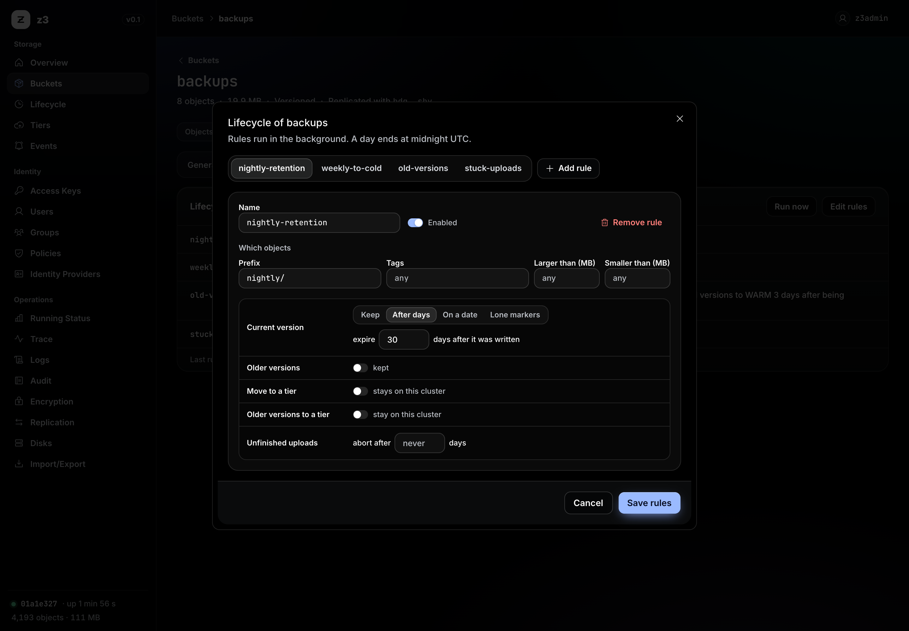
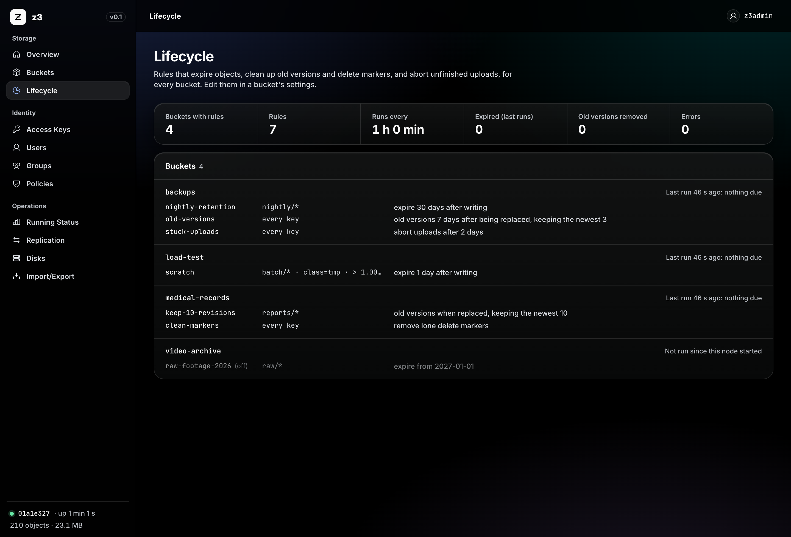

**Lifecycle rules** let z3 tidy a bucket in the background. Each bucket has its own rules, set in
the console or with `PutBucketLifecycleConfiguration` from any S3 client.

| Action | What it does |
| --- | --- |
| **Expiration (days)** | The current version expires N days after it was written |
| **Expiration (date)** | Current versions expire from that date on (midnight UTC) |
| **Lone delete markers** | A delete marker with no other versions left behind it is removed |
| **Older versions** | Versions that were replaced are removed N days after being replaced, and/or only the newest N older versions are kept |
| **Abort multipart** | Multipart uploads started N days ago and never completed are aborted |
| **Transition** | The current version (N days after it was written) or older versions (N days after being replaced) move to a [tier](/storage/tiers) |

## Which objects a rule applies to

Every rule picks objects with any mix of:

- a **prefix** (`tmp/`, `logs/2026/`), empty for the whole bucket,
- **tags**: the object must carry all of them,
- **size**: larger than and/or smaller than a number of bytes.

A rule can be disabled without deleting it. A bucket has at most 1000 rules, and rule ids (at most
255 characters) must be unique; an empty id becomes `rule-1`, `rule-2` and so on.

## How expiration behaves

Expiring the current version works like a `DeleteObject` without a version id, so it follows the
bucket's [versioning](/storage/versioning) state:

- **Versioned**: z3 adds a delete marker. The data stays as an older version until an
  older-versions rule removes it.
- **Not versioned**: the object is deleted for good.
- **Suspended**: a delete marker with the version id `null`.

Days are counted as on S3: an object written at time T under a "30 days" rule expires at the first
midnight UTC after T + 30 days.

<Note>
  Versions held by [Object Lock](/storage/object-lock) are skipped without counting as an error,
  and removed on a later run once the lock has ended.
</Note>

## Add rules

<Tabs>
  <Tab title="Console">

    1. Open the bucket, then **Settings → Lifecycle**, and click **Add rules** (or **Edit rules**).
    2. Each rule has its own tab. Give it a **Name** and leave it **Enabled**.
    3. Under **Which objects**, fill in **Prefix**, **Tags**, **Larger than (MB)** and **Smaller
       than (MB)** as needed. Empty fields match everything.
    4. Under **What happens**, choose what happens to the current version: **Keep**, **After
       days**, **On a date**, or **Lone markers** (remove delete markers with nothing behind them).
    5. Turn on the older-versions line to remove versions some days after they were replaced, keep
       only the newest few (1 to 100), or both.
    6. Optionally move the current version or older versions to a tier (see
       [Transitions](#transitions)), and abort unfinished uploads after some days.
    7. Click **Save rules**. Saving with no rules left removes the bucket's lifecycle configuration.

    <Frame>
      
    </Frame>

  </Tab>
  <Tab title="AWS CLI">

    ```bash
    aws --endpoint-url http://localhost:9000 s3api put-bucket-lifecycle-configuration \
      --bucket logs --lifecycle-configuration '{
        "Rules": [
          {"ID": "tmp", "Status": "Enabled", "Filter": {"Prefix": "tmp/"},
           "Expiration": {"Days": 7},
           "AbortIncompleteMultipartUpload": {"DaysAfterInitiation": 2}},
          {"ID": "history", "Status": "Enabled", "Filter": {"Prefix": ""},
           "NoncurrentVersionExpiration": {"NoncurrentDays": 30, "NewerNoncurrentVersions": 5}},
          {"ID": "markers", "Status": "Enabled", "Filter": {"Prefix": ""},
           "Expiration": {"ExpiredObjectDeleteMarker": true}}
        ]}'

    aws --endpoint-url http://localhost:9000 s3api get-bucket-lifecycle-configuration --bucket logs
    aws --endpoint-url http://localhost:9000 s3api delete-bucket-lifecycle --bucket logs
    ```

    Reading rules needs `s3:GetLifecycleConfiguration`; setting or deleting them needs
    `s3:PutLifecycleConfiguration`.

  </Tab>
  <Tab title="Admin API">

    ```bash
    curl -X PUT http://127.0.0.1:9001/api/buckets/logs/lifecycle \
      -H "Authorization: Bearer $TOKEN" -H 'content-type: application/json' \
      -d '{"rules": [{"id": "tmp", "enabled": true, "prefix": "tmp/",
            "tags": {"class": "tmp"}, "size_gt": 1000000, "size_lt": null,
            "expiration": {"days": 7, "date": null, "delete_marker": false},
            "noncurrent": {"days": 30, "keep": 5},
            "abort_uploads_days": 2}]}'
    ```

    | Endpoint | What it does |
    | --- | --- |
    | `GET /api/lifecycle` | Every bucket with rules, the last run of each, and the interval |
    | `GET/PUT/DELETE /api/buckets/{b}/lifecycle` | One bucket's rules (`PUT` with no rules removes them) |
    | `POST /api/buckets/{b}/lifecycle/run` | Run the rules now and return the result |

  </Tab>
</Tabs>

z3 checks rules when they're saved and refuses ones that can't work, with a message that says why:

- A rule must do something: an expiration, an older-versions action, a transition or an upload abort.
- An expiration has exactly one of days, a date (`YYYY-MM-DD`) or "delete marker". Days must be positive.
- A lone-delete-marker rule can't have a tag filter, because delete markers have no tags.
- Abort-multipart can only be filtered by prefix: uploads don't have tags or a size yet.
- "Larger than" must be smaller than "smaller than".

## Transitions

A transition moves the data of old versions to a [tier](/storage/tiers) (AWS S3, MinIO or another
z3, Google Cloud Storage, Azure Blob) to free up local disks. Objects stay readable through z3.

- **Move to a tier**: the current version moves N days after it was written.
- **Older versions to a tier**: older versions move N days after being replaced.

In the S3 API, the storage class is the tier's name:

```bash
aws --endpoint-url http://localhost:9000 s3api put-bucket-lifecycle-configuration --bucket backups \
  --lifecycle-configuration '{"Rules": [{"ID": "to-cold", "Status": "Enabled",
    "Filter": {"Prefix": "weekly/"},
    "Transitions": [{"Days": 30, "StorageClass": "COLD"}],
    "NoncurrentVersionTransitions": [{"NoncurrentDays": 7, "StorageClass": "COLD"}],
    "Expiration": {"Days": 365}}]}'
```

- One transition and one older-versions transition per rule. `Days: 0` means the first midnight
  UTC after the write.
- A transition must come before the expiration in the same rule.
- The tier must exist when the rule is saved (`InvalidArgument` otherwise).
- A transition by `Date` works over the S3 API; the console sets days only.

See [Tiered storage](/storage/tiers) for what gets moved and how reads work afterwards.

## When rules run

Rules run every hour by default. Change the interval without a restart with the
`scanner.lifecycle_interval_secs` [setting](/operations/settings) (default from
`Z3_LIFECYCLE_INTERVAL`; `0` runs rules only on demand). To run one bucket's rules right away,
click **Run now** in its **Lifecycle** panel, or call `POST /api/buckets/{b}/lifecycle/run`.

The **Lifecycle** page lists every bucket with rules, a summary of the rules and the result of
the last run: objects scanned, expired, older versions and markers removed, uploads aborted,
versions transitioned, and errors.

<Frame>
  
</Frame>

Expiring and transitioning trigger [bucket events](/events/bucket-events)
(`s3:LifecycleExpiration:Delete`, `s3:LifecycleExpiration:DeleteMarkerCreated`,
`s3:ObjectTransition:Complete`, `s3:ObjectTransition:Failed`) if the bucket has event rules for
them.

## With replication

Lifecycle rules are stored per bucket. With [site replication](/replication/site-replication)
they reach every site, and deleting them on one site deletes them everywhere. With plain
[bucket replication](/replication/bucket-replication), set the rules on each node.

- A current version is expired only by the node it was written on. Its delete marker is made once
  and replicated, so there are no duplicate markers even though every site runs its rules.
- Removing a specific version (older versions, delete markers) gives the same result on every
  node, so any node may do it.
- As a result, an object written on a site that is down expires once that site is back.

## Not supported yet

- Transitions between tiers, and date-based transitions in the console.
- MinIO's `DelMarkerExpiration` and `ExpiredObjectAllVersions`.
- Tag and size filters for aborting multipart uploads (S3 doesn't support them either).
