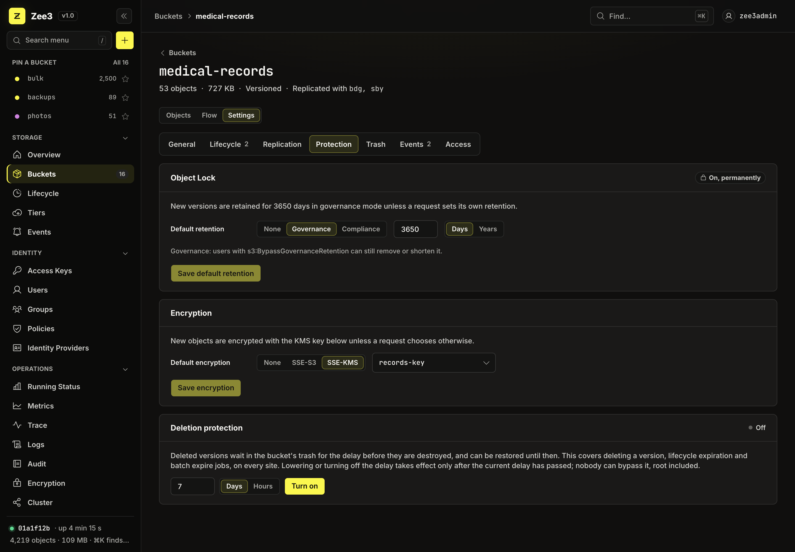
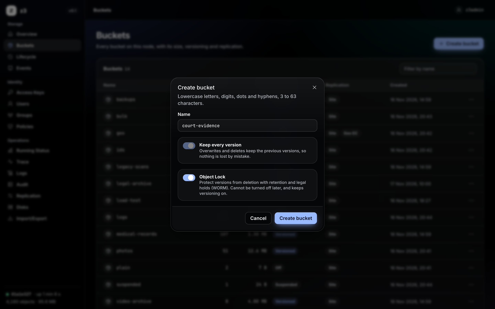
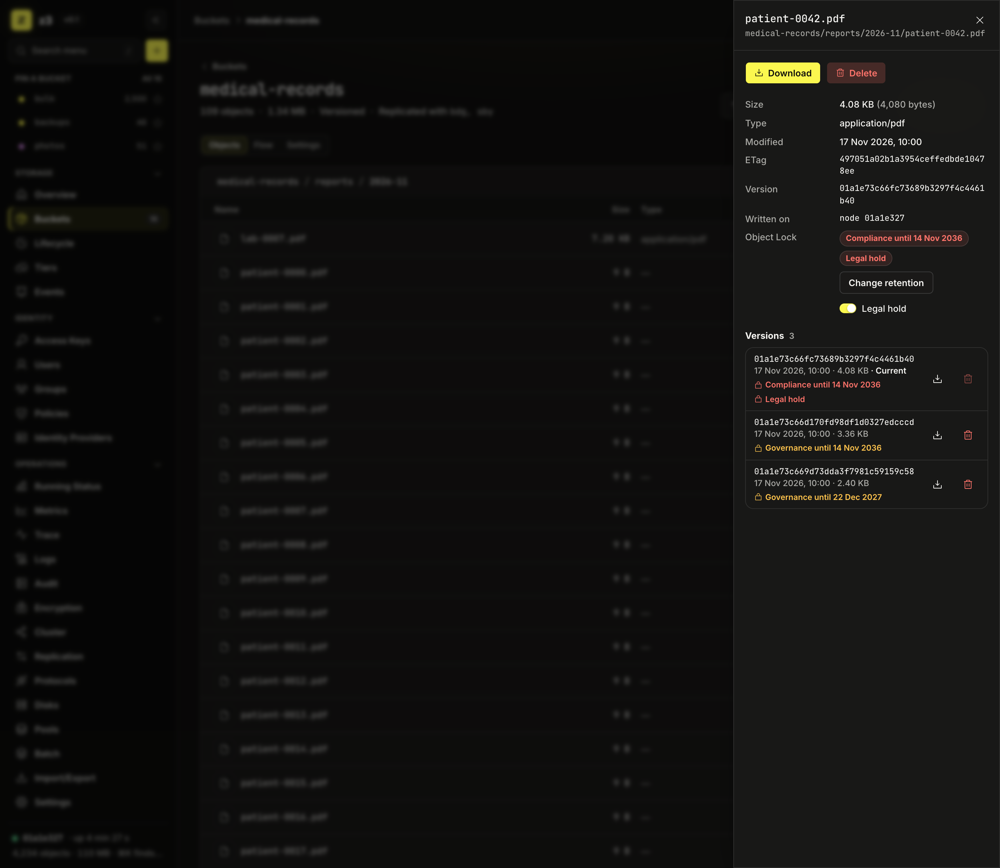

**Object Lock** makes object versions *write once, read many* (WORM). While a version is under
retention or a legal hold, nobody can delete it. Use it for medical and legal records, backups
that must survive ransomware, and archive retention rules.

| Protection | What it means |
| --- | --- |
| **Governance** | The version can't be deleted and its retention can't be shortened, except by a user with `s3:BypassGovernanceRetention` who sends the bypass header |
| **Compliance** | Nobody can delete the version or shorten its retention until the date has passed, not even the root account. Retention can only be extended. |
| **Legal hold** | The version can't be deleted while the hold is on. It has no end date and can be placed or released at any time by a user with `s3:PutObjectLegalHold`. |

<Frame>
  
</Frame>

## Turn on Object Lock

<Warning>
  Object Lock can't be turned off, and the bucket's versioning can no longer be suspended.
</Warning>

<Tabs>
  <Tab title="Console">

    - **New bucket**: in **Buckets → Create bucket**, turn on **Object Lock**. Versioning comes
      on with it.
    - **Existing bucket**: [versioning](/storage/versioning) must be on. Open the bucket,
      **Settings → Protection**, and click **Turn on Object Lock**.

    <Frame>
      
    </Frame>

  </Tab>
  <Tab title="AWS CLI">

    ```bash
    # new bucket
    aws --endpoint-url http://localhost:9000 s3api create-bucket \
      --bucket records --object-lock-enabled-for-bucket

    # existing bucket with versioning on
    aws --endpoint-url http://localhost:9000 s3api put-object-lock-configuration \
      --bucket records --object-lock-configuration '{"ObjectLockEnabled": "Enabled"}'
    ```

  </Tab>
</Tabs>

## Default retention

A bucket can have a default retention: governance or compliance, in days (1 to 36500) or years
(1 to 100; a year is 365 days). Every new version written without its own retention gets it,
counted from the time of the write. Changing the default doesn't change versions that already
exist.

<Tabs>
  <Tab title="Console">

    In **Settings → Protection → Object Lock**, pick the mode under **Default retention**
    (none, governance or compliance), enter the period, choose days or years, and click **Save
    default retention**.

  </Tab>
  <Tab title="AWS CLI">

    ```bash
    aws --endpoint-url http://localhost:9000 s3api put-object-lock-configuration --bucket records \
      --object-lock-configuration '{"ObjectLockEnabled": "Enabled",
        "Rule": {"DefaultRetention": {"Mode": "GOVERNANCE", "Days": 3650}}}'

    aws --endpoint-url http://localhost:9000 s3api get-object-lock-configuration --bucket records
    ```

  </Tab>
</Tabs>

## Retention and legal hold per object

Set them when writing, with the `x-amz-object-lock-*` headers on `PutObject`, `CopyObject` and
`CreateMultipartUpload`, or afterwards.

<Tabs>
  <Tab title="Console">

    Open the object. In its details, click **Set retention** (or **Change retention**) to pick the
    **Mode** and **Retain until** date, and use the **Legal hold** switch. The version list shows
    the lock of every version.

    <Frame>
      
    </Frame>

  </Tab>
  <Tab title="AWS CLI">

    ```bash
    # retention when writing
    aws --endpoint-url http://localhost:9000 s3api put-object --bucket records \
      --key 2026/p-0042.pdf --body p-0042.pdf \
      --object-lock-mode COMPLIANCE --object-lock-retain-until-date 2036-11-17T00:00:00Z

    # retention afterwards
    aws --endpoint-url http://localhost:9000 s3api put-object-retention --bucket records \
      --key 2026/p-0042.pdf \
      --retention '{"Mode": "GOVERNANCE", "RetainUntilDate": "2030-01-01T00:00:00Z"}'

    # legal hold
    aws --endpoint-url http://localhost:9000 s3api put-object-legal-hold --bucket records \
      --key 2026/p-0042.pdf --legal-hold Status=ON

    aws --endpoint-url http://localhost:9000 s3api get-object-retention --bucket records --key 2026/p-0042.pdf
    aws --endpoint-url http://localhost:9000 s3api get-object-legal-hold --bucket records --key 2026/p-0042.pdf
    ```

    `GetObject` and `HeadObject` return the lock in `x-amz-object-lock-*` headers. Add
    `--version-id` to act on a specific version.

  </Tab>
</Tabs>

### The rules

- A retention date must be in the future.
- **Compliance**: the date can only move later (be extended), and the mode can't change to
  governance.
- **Governance**: extending it is always allowed. Shortening it, removing it, or changing it to
  compliance needs `s3:BypassGovernanceRetention` **and** the header
  `x-amz-bypass-governance-retention: true`, as on S3. In the console, tick **Bypass governance
  retention**.
- A default retention with an unknown mode, or with both `Days` and `Years`, is refused with
  `MalformedXML`; a period of zero or less with `InvalidRetentionPeriod`.
- A retention date that has passed protects nothing anymore; the version can be deleted as usual.

## Deleting locked objects

- Deleting an object **without** a version id always works: it only adds a delete marker, and the
  locked version stays.
- Deleting a specific version (`DeleteObject` with `versionId`, or `DeleteObjects`) fails with
  `AccessDenied` while it is locked.
- A version under **governance** retention can be deleted by a user with
  `s3:BypassGovernanceRetention` who sends the bypass header:

  ```bash
  aws --endpoint-url http://localhost:9000 s3api delete-object --bucket records \
    --key 2026/p-0042.pdf --version-id <version-id> --bypass-governance-retention
  ```

  In the console, deleting such a version asks for confirmation (**Bypass and delete**). The
  delete button of a version under compliance retention or a legal hold is disabled.
- [Lifecycle](/storage/lifecycle) skips locked versions without counting an error and removes
  them on a later run once the lock has ended. A [batch expire](/storage/batch) job skips them.

## Permissions

| Action | Allows |
| --- | --- |
| `s3:PutObjectRetention` / `s3:GetObjectRetention` | Set / read a version's retention |
| `s3:PutObjectLegalHold` / `s3:GetObjectLegalHold` | Place or release / read a legal hold |
| `s3:BypassGovernanceRetention` | Shorten, remove, change to compliance or delete through governance retention (with the header) |
| `s3:PutBucketObjectLockConfiguration` / `s3:GetBucketObjectLockConfiguration` | Turn Object Lock on and set / read the default retention |

## With replication

- The bucket's configuration (on, default retention) is stored per bucket. It reaches every site
  with [site replication](/replication/site-replication), and travels with a
  [configuration export](/operations/config-export).
- Retention and legal hold are kept on each version and carried by the change log, so a change
  on one site reaches the others, and every site refuses the same deletes.
- If two sites change the lock of the same version at the same time, the newer change wins,
  **except** that compliance retention is never weakened by the merge. Of two compliance
  retentions, the later date is kept.

## Admin API

| Endpoint | What it does |
| --- | --- |
| `GET /api/buckets/{b}/object-lock` | `{enabled, default, versioning}` |
| `PUT /api/buckets/{b}/object-lock` | `{"enabled": true, "default": {"mode": "governance", "days": 30, "years": null}}`; `"default": null` removes the default |
| `PUT /api/buckets/{b}/objects/lock?key=&version=` | `{"retention": {"mode": "compliance", "until_ms": ...}` or `null`, `"legal_hold": true, "bypass_governance": false}` |
| `DELETE /api/buckets/{b}/objects?key=&version=&bypass_governance=true` | Delete a governance version with the bypass |

## Not supported yet

- `ObjectLockToken` in `PutObjectLockConfiguration` is ignored, and z3 doesn't require
  `Content-MD5` on Object Lock requests as AWS does.
- Imports from MinIO or another S3 store don't bring retention along: imported versions have no lock.
