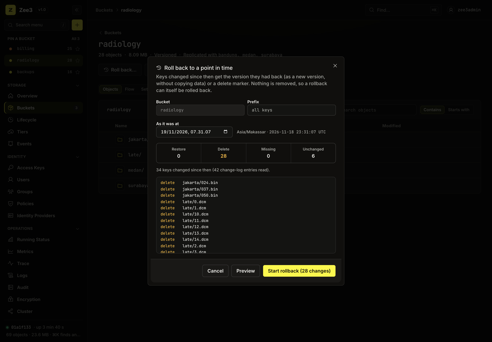

A **rollback** brings a bucket, a prefix or one key back to how it looked at a time you choose.
Keys that changed since then get the version they had back, or a delete marker if they did not
exist yet.

A rollback only **adds** versions and delete markers. It copies the old version as a new version
(no data is copied: the new version shares the old one's chunks) and never removes anything. So
you can roll back a rollback, and [replication](/replication/overview) carries it to other sites
like any other write.

<Note>
  The bucket needs [versioning](/storage/versioning) turned on. A bucket that never had versioning
  has no history to roll back to, and z3 refuses it. A bucket with versioning suspended is refused
  too until you enable versioning again.
</Note>


<Frame>
  
</Frame>

## How z3 decides

z3 does not scan every object. It reads the bucket's change log from the point where the log
passes your time, and collects the keys written or deleted after it. For each of those keys:

| At that time | Now | What the rollback does |
| --- | --- | --- |
| Absent | Absent | Nothing |
| Absent | An object | Adds a delete marker |
| Version V | V, or an object with the same content and metadata | Nothing |
| Version V | Something else, or a delete marker | Copies V as a new current version |

The version current at a time is the newest version written at or before it; a delete marker means
the key was absent.

If the version from then was deleted for good since, but the bucket has
[deletion protection](/storage/deletion-protection), the version is still in the bucket's trash: the
rollback brings it back from there (with its own version id) and makes it current again. The preview
counts these as restores and marks them "from the trash". Without deletion protection such keys are
reported as **missing** and left alone.

## Preview and run

<Tabs>
  <Tab title="Console">

    1. Open the bucket and click **Roll back…** (or open **Batch** and click **Roll back…**).
    2. Pick the time under **As it was at**. It is in your local time zone; the UTC time is shown
       next to it. Narrow it down with **Prefix** if needed.
    3. Click **Preview**: you see how many keys would be restored, deleted, missing or unchanged,
       and the first planned changes.
    4. Click **Start rollback**, then **View job** to follow it on the Batch page.

  </Tab>
  <Tab title="z3 admin">

    ```bash
    # What would change, without changing anything
    z3 admin batch rollback records --at 2026-11-18T09:30:00Z --prefix patients/ --dry-run

    # Run it and follow its progress
    z3 admin batch rollback records --at 2026-11-18T09:30:00Z --prefix patients/ --wait

    # One key only
    z3 admin batch rollback records --at 2026-11-18T09:30:00Z --key patients/001.json
    ```

    `--at` takes any RFC 3339 time, such as `2026-11-18T17:30:00+08:00`.

  </Tab>
  <Tab title="Admin API">

    ```bash
    curl -X POST "$Z3_ADMIN_URL/api/batch/rollback/preview" -H "Authorization: Bearer $TOKEN" \
      -d '{"source": {"bucket": "records", "prefix": "patients/"}, "at": "2026-11-18T09:30:00Z", "limit": 20}'

    curl -X POST "$Z3_ADMIN_URL/api/batch" -H "Authorization: Bearer $TOKEN" \
      -d '{"type": "rollback", "source": {"bucket": "records", "prefix": "patients/"}, "at": "2026-11-18T09:30:00Z"}'
    ```

    Both need `admin:ConfigUpdate`.

  </Tab>
</Tabs>

The rollback runs as a [batch job](/storage/batch) of type `rollback`: you can follow, cancel and
remove it like any other job, and it continues where it stopped if the node restarts.

## Good to know

- Restored versions get the bucket's default [Object Lock](/storage/object-lock) retention and
  send `s3:ObjectCreated:Copy` [events](/events/bucket-events); delete markers send
  `s3:ObjectRemoved:DeleteMarkerCreated`.
- Changes made in place, without a new version, are not rolled back: object tags, retention and
  legal hold, tier transitions and key rotation.
- Times are version times (Last-Modified). Objects imported from another store
  keep their source's time.
- A delete marker that was permanently removed since is also reported as missing.
- Bucket quotas are not checked for restored versions.
- A rollback can only go back as far as the change log that is left. Entries older than
  `Z3_LOG_RETENTION_DAYS` (30 days by default) are [pruned](/replication/overview#change-log-pruning)
  once every peer has applied them; earlier times are refused. Set it to `0` to keep the whole log.
