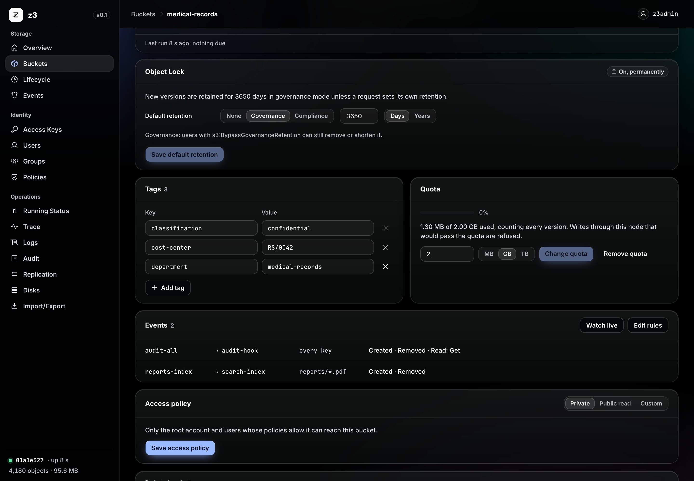
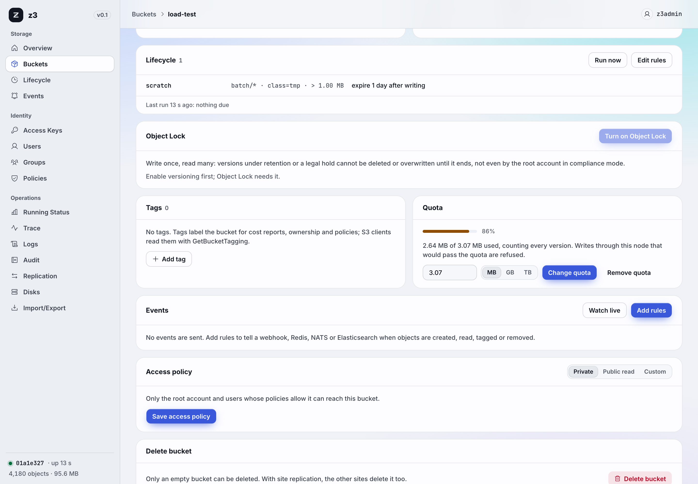

<Frame>
  
</Frame>

## Bucket tags

Tags are key/value pairs on a bucket, such as `department=radiology` or `cost-center=RS/0042`, for
cost reports, ownership, and tools that read S3 bucket tags.

- At most 50 tags per bucket.
- Keys are 1 to 128 characters, values at most 256. Letters, digits, spaces and `+ - = . _ : / @`.
- Keys starting with `aws:` are reserved.

<Tabs>
  <Tab title="Console">

    Open the bucket, **Settings → General → Tags**. Click **Add tag**, fill in **Key** and
    **Value**, and click **Save tags**. **Discard** throws away unsaved changes. The bucket list
    shows the first two tags of each bucket.

  </Tab>
  <Tab title="AWS CLI">

    ```bash
    aws --endpoint-url http://localhost:9000 s3api put-bucket-tagging --bucket scans \
      --tagging 'TagSet=[{Key=department,Value=radiology},{Key=cost-center,Value=RS/0042}]'

    aws --endpoint-url http://localhost:9000 s3api get-bucket-tagging --bucket scans
    aws --endpoint-url http://localhost:9000 s3api delete-bucket-tagging --bucket scans
    ```

    `GetBucketTagging` on a bucket without tags answers `NoSuchTagSet`.

  </Tab>
  <Tab title="Admin API">

    ```bash
    curl -X PUT http://127.0.0.1:9001/api/buckets/scans/tags \
      -H "Authorization: Bearer $TOKEN" -H 'content-type: application/json' \
      -d '{"tags": {"department": "radiology", "cost-center": "RS/0042"}}'
    ```

    `GET`, `PUT` and `DELETE /api/buckets/{b}/tags`.

  </Tab>
</Tabs>

Reading tags needs `s3:GetBucketTagging`; setting or deleting them needs `s3:PutBucketTagging`.

<Note>
  The built-in `readonly` policy doesn't grant `s3:GetBucketTagging`, the same as on MinIO.
</Note>

## Quota

A quota is a hard limit on the bytes a bucket may store, like MinIO's hard quota
(`mc quota set`). Usage counts **every version**: older versions count, delete markers don't.

A write that would go past the quota fails with `XMinioAdminBucketQuotaExceeded` (HTTP 400), the
same code MinIO uses:

| Operation | Checked against |
| --- | --- |
| `PutObject`, console upload, [file protocols](/protocols/overview) | The body size (`Content-Length` or `x-amz-decoded-content-length`) |
| `CopyObject` | The size of the source object |
| `UploadPart` | The part size |
| `CompleteMultipartUpload` | The total of the parts used |
| `CreateMultipartUpload` | Refused when the bucket is already full |

When the body size isn't known up front, a write is refused only once the bucket has reached its
quota. Deleting objects or older versions frees space.

<Tabs>
  <Tab title="Console">

    Open the bucket, **Settings → General → Quota**. Enter a size, pick the unit, and click **Set
    quota** (or **Change quota**). **Remove quota** takes the limit away.

    The panel shows a usage bar that turns yellow above 80% and red above 95%. The bucket list
    shows the quota under the size, for example "of 2.00 GB".

    <Frame>
      
    </Frame>

  </Tab>
  <Tab title="Admin API">

    ```bash
    curl -X PUT http://127.0.0.1:9001/api/buckets/scans/quota \
      -H "Authorization: Bearer $TOKEN" -H 'content-type: application/json' \
      -d '{"max_bytes": 2000000000}'

    curl -H "Authorization: Bearer $TOKEN" http://127.0.0.1:9001/api/buckets/scans/quota
    # {"quota": {"max_bytes": 2000000000}, "used_bytes": 1300000}

    curl -X DELETE -H "Authorization: Bearer $TOKEN" http://127.0.0.1:9001/api/buckets/scans/quota
    ```

  </Tab>
</Tabs>

A quota is an admin setting: reading it needs `admin:ServerInfo` and changing it needs
`admin:ConfigUpdate` (see [Policies](/access/policies)).

`GET /api/buckets` includes each bucket's `tags`, `quota_bytes` and `object_lock`.

## With replication

Tags and quota are stored per bucket, like lifecycle rules. They reach every site with
[site replication](/replication/site-replication), travel with a
[configuration export](/operations/config-export), and go away with a deleted bucket (a new bucket
with the same name starts without them).

Each site enforces the quota for the writes it serves itself. Replicated writes are never refused,
because refusing them would make the sites differ. So if several sites write at once while the
bucket is nearly full, usage can end up slightly over the quota.

## Not supported yet

- A quota on the number of objects (MinIO also has only a size quota).
- Policy conditions on bucket tags (`s3:ResourceTag`).
