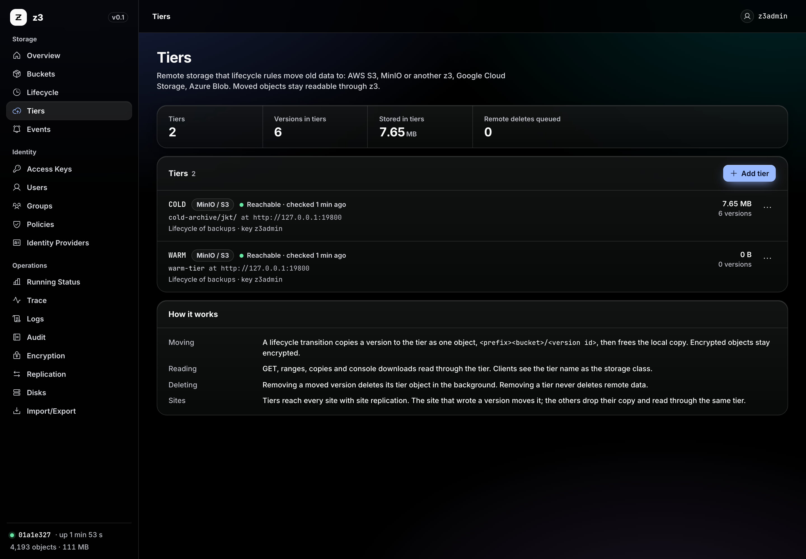
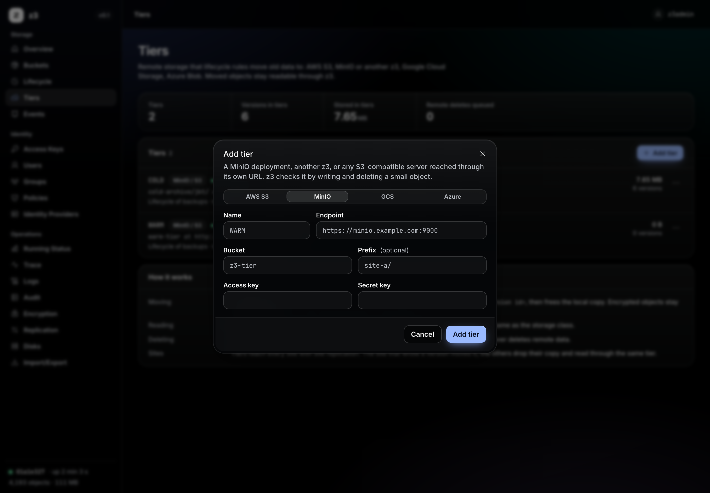
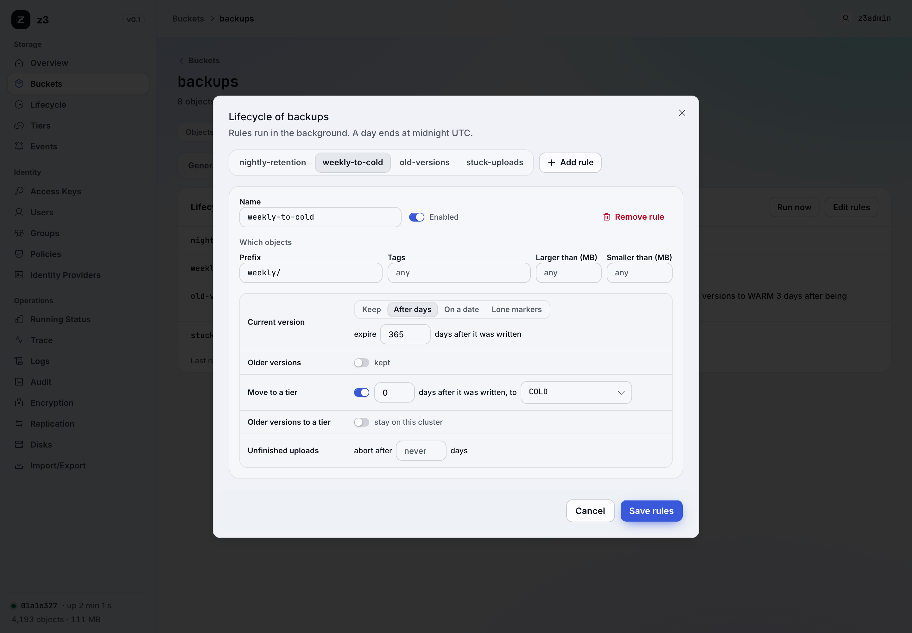
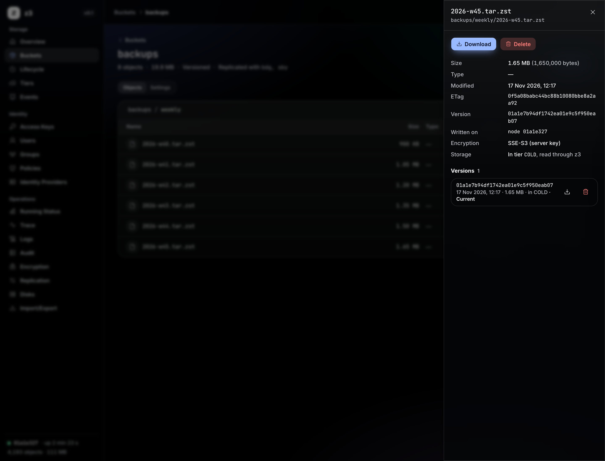

A **tier** is another storage service that [lifecycle rules](/storage/lifecycle) move old data to,
so z3's own disks stay free for data that's in use. Objects that moved are still read through z3
as before; clients don't need to know where the data is. The tier's name shows up as the object's
storage class.

| Type | For | Credentials |
| --- | --- | --- |
| **AWS S3** | Amazon S3. Empty endpoint: `https://s3.<region>.amazonaws.com` | Access key and secret key |
| **MinIO** | MinIO, another z3, Ceph, or any S3-compatible server, by its URL | Access key and secret key |
| **GCS** | Google Cloud Storage through its S3-compatible API. Empty endpoint: `https://storage.googleapis.com` | An HMAC key from **Interoperability** |
| **Azure** | Azure Blob Storage. Empty endpoint: `https://<account>.blob.core.windows.net` | Storage account name and account key |

<Frame>
  
</Frame>

## Add a tier

The bucket (for Azure, the container) must already exist on the other side.

<Tabs>
  <Tab title="Console">

    1. Open **Tiers** and click **Add tier**.
    2. Pick the type: **AWS S3**, **MinIO**, **GCS** or **Azure**.
    3. Fill in the fields:

       | Field | Meaning |
       | --- | --- |
       | **Name** | 2 to 63 characters: uppercase letters, digits, `-` and `_`, starting with a letter or digit, for example `WARM` or `COLD-ARCHIVE`. `STANDARD` and `REDUCED_REDUNDANCY` are taken. |
       | **Endpoint** | Required for MinIO; optional for the others (the defaults above) |
       | **Bucket** / **Container** | Where the data goes |
       | **Prefix** | Optional. Useful when several clusters share one bucket. |
       | **Region** | AWS S3 only |
       | **Access key** / **Account name** | |
       | **Secret key** / **Account key** | Stored sealed |

    4. Save. Before saving, z3 writes and deletes a small object named
       `<prefix>.z3-tier-check`. If that fails (wrong credentials, missing bucket, unreachable),
       the tier isn't saved and the reason is shown.

    <Frame>
      
    </Frame>

  </Tab>
  <Tab title="Admin API">

    ```bash
    curl -X POST http://127.0.0.1:9001/api/tiers \
      -H "Authorization: Bearer $TOKEN" -H 'content-type: application/json' \
      -d '{"name": "COLD", "kind": "minio", "endpoint": "https://minio.example.com:9000",
           "bucket": "z3-cold", "prefix": "site-a/", "region": "",
           "access_key": "AKEXAMPLE", "secret_key": "SECRETEXAMPLE"}'
    ```

    `kind` is `s3`, `minio`, `gcs` or `azure`.

  </Tab>
</Tabs>

Once a tier exists, its location (type, endpoint, bucket, prefix) can't change, because data is
already there. Only the credentials can: **Change credentials** (tested the same way before they
are saved), or `PUT /api/tiers/{name}` with `{"access_key", "secret_key"}`.

z3 checks each tier's health every two minutes with a read-only request. **Check now** (or
`POST /api/tiers/{name}/check`) checks it right away.

Viewing tiers needs `admin:ServerInfo`; adding, changing or removing them needs
`admin:ConfigUpdate`.

## Move data with a lifecycle rule

In the bucket's lifecycle editor, two lines move data to a tier:

- **Move to a tier**: the current version, N days after it was written.
- **Older versions to a tier**: older versions, N days after being replaced.

<Frame>
  
</Frame>

Over the S3 API the storage class is the tier's name:

```bash
aws --endpoint-url http://localhost:9000 s3api put-bucket-lifecycle-configuration --bucket backups \
  --lifecycle-configuration '{"Rules": [{"ID": "to-cold", "Status": "Enabled",
    "Filter": {"Prefix": "weekly/"},
    "Transitions": [{"Days": 30, "StorageClass": "COLD"}],
    "NoncurrentVersionTransitions": [{"NoncurrentDays": 7, "StorageClass": "COLD"}],
    "Expiration": {"Days": 365}}]}'
```

The rules for transitions are on the [Lifecycle](/storage/lifecycle#transitions) page. These
are never moved: delete markers, empty objects, versions already on a tier, versions in a
[geo erasure coded](/replication/geo-erasure-coding) bucket, and versions that the same run deletes
or expires.

Each transition triggers `s3:ObjectTransition:Complete` (or `s3:ObjectTransition:Failed`), which
you can pick in the bucket's [event rules](/events/bucket-events).

## How a transition works

1. z3 reads the version's chunks exactly as stored (ciphertext for encrypted objects) and sends
   them to the tier as **one object** named `<prefix><bucket>/<version id>`. Large versions go
   as multipart (S3 types) or in blocks (Azure), 64 MiB per part (`Z3_TIER_PART_SIZE`, in bytes).
2. The version now points at that object (tier name, object name, length of each chunk), and the
   local chunks are released to garbage collection. If the version changed or was deleted during
   the upload, the object on the tier is deleted again.
3. The version's size, ETag, metadata, tags, retention and encryption don't change.

## Reading data on a tier

- GET (including ranges), CopyObject and console downloads read from the tier. For an encrypted
  object, z3 fetches only the chunks the range needs and decrypts them. Data on the tier is never
  plaintext.
- HEAD, GET, ListObjects and ListObjectVersions show the tier name as `StorageClass`.
- A copy (CopyObject) of an object on a tier becomes a normal local object.
- The object details in the console show the tier.

<Frame>
  
</Frame>

There is no `RestoreObject`: GET reads straight from the tier, so there's nothing to restore first.

## Deleting

- When a version that moved is deleted for good (DeleteObject with a version id, expiration of an
  older version, a [batch expire](/storage/batch)), its object on the tier is deleted in the
  background, with retries while the tier can't be reached. The queue shows as **Remote deletes
  queued** on the Tiers page.
- A tier can't be removed while a lifecycle rule uses it, while it still holds versions, or while
  it has queued deletes. Removing a tier doesn't delete the data on it.

## With replication

- Tier settings travel with [site replication](/replication/site-replication) (secrets resealed
  for the site group), so every site knows the same tiers.
- Only the node a version was written on moves it. Other nodes receive the transition through the
  change log, release their local chunks and read from the same tier. Data is sent and stored on
  the tier once.
- The object on the tier is deleted only by the node that moved it, when the version is deleted
  there (deletes on other sites arrive through replication).
- For plain [bucket replication](/replication/bucket-replication), create the same tier on every
  node, for example with a [configuration export](/operations/config-export) **with secrets**.
  Without it, the other nodes can't read versions that moved.

A configuration export includes tiers; secret keys only in an export with secrets, and a tier
without a secret isn't imported.

## Admin API

| Endpoint | What it does |
| --- | --- |
| `GET /api/tiers` | Tiers (no secrets), versions and bytes on each tier from this node, health, the buckets that use them, queued deletes |
| `POST /api/tiers` | Add a tier |
| `PUT /api/tiers/{name}` | New credentials |
| `DELETE /api/tiers/{name}` | Remove an unused tier |
| `POST /api/tiers/{name}/check` | Check now |

## Not supported yet

- Transitions between tiers, and date-based transitions in the console (the S3 API takes `Date`).
- Transitions of geo erasure coded buckets.
- Azure support is tested against a stand-in that checks Shared Key signatures, not yet against
  Azure itself.
