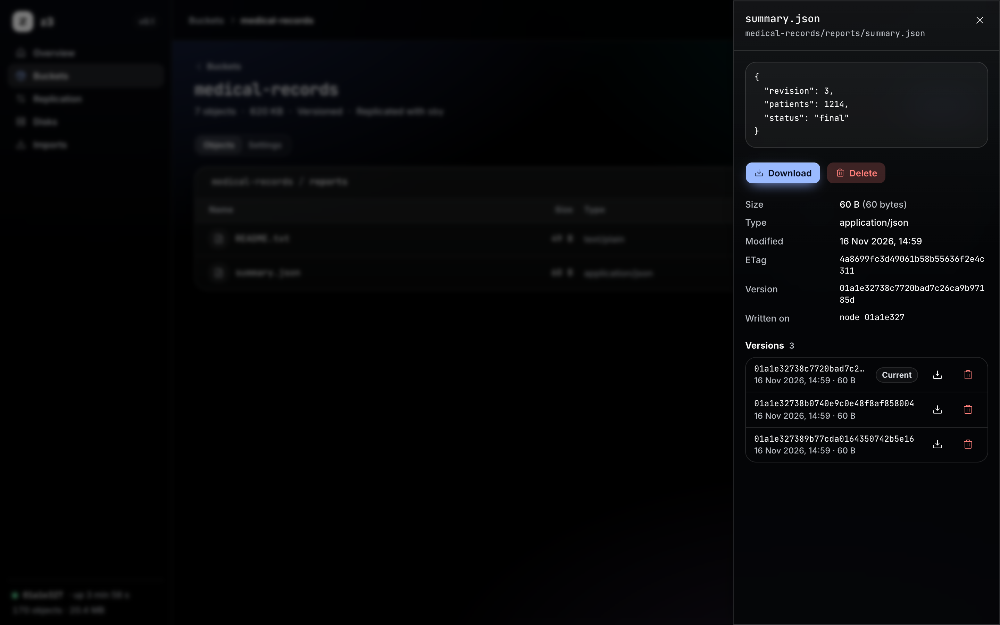

With **versioning** on, every overwrite and every delete keeps the previous version of the
object, so nothing is lost by mistake. Older versions stay readable with their `versionId` until
you delete them or a [lifecycle rule](/storage/lifecycle) cleans them up.

A bucket is in one of three states:

| State | Writes | Deletes without a version id |
| --- | --- | --- |
| **Not versioned** | Each key holds one object; an overwrite replaces it | Remove the object for good |
| **Versioned** (`Enabled`) | Every write adds a new version with a unique id | Add a **delete marker**; the data stays as an older version |
| **Suspended** | New writes replace the "null" version; versions kept so far stay | Add a delete marker with the version id `null` |

Version ids are globally unique (UUIDv7), so versions written on different nodes never collide.

## Turn versioning on or off

<Tabs>
  <Tab title="Console">

    New buckets have **Keep every version** on by default. For an existing bucket, open it and go
    to **Settings → General → Versioning**, then click **Enable versioning** or **Suspend
    versioning**.

  </Tab>
  <Tab title="AWS CLI">

    ```bash
    aws --endpoint-url http://localhost:9000 s3api put-bucket-versioning \
      --bucket photos --versioning-configuration Status=Enabled

    aws --endpoint-url http://localhost:9000 s3api put-bucket-versioning \
      --bucket photos --versioning-configuration Status=Suspended

    aws --endpoint-url http://localhost:9000 s3api get-bucket-versioning --bucket photos
    ```

  </Tab>
</Tabs>

Changing versioning needs `s3:PutBucketVersioning`; reading it needs `s3:GetBucketVersioning`.

Once versioning has been on, a bucket can be suspended but not set back to "not versioned", as on
Amazon S3. A bucket with [Object Lock](/storage/object-lock) can't be suspended at all
(`InvalidBucketState`).

## List and read versions

<Tabs>
  <Tab title="Console">

    Click an object. Its details panel lists every version, newest first, with its id, size, time,
    and lock state. Each version has a download button and a delete button.

    <Frame>
      
    </Frame>

  </Tab>
  <Tab title="AWS CLI">

    ```bash
    aws --endpoint-url http://localhost:9000 s3api list-object-versions \
      --bucket photos --prefix 2026/report.pdf

    aws --endpoint-url http://localhost:9000 s3api get-object \
      --bucket photos --key 2026/report.pdf \
      --version-id 0192f3c4-9a7b-7d10-8e2f-5b6c7d8e9f01 report-old.pdf
    ```

  </Tab>
</Tabs>

Reading a specific version needs `s3:GetObjectVersion` instead of `s3:GetObject`. Listing versions
needs `s3:ListBucketVersions`.

## Restore an older version

Copy the older version over the current one. The copy becomes the new current version, and every
version in between stays:

```bash
aws --endpoint-url http://localhost:9000 s3api copy-object \
  --bucket photos --key 2026/report.pdf \
  --copy-source "photos/2026/report.pdf?versionId=0192f3c4-9a7b-7d10-8e2f-5b6c7d8e9f01"
```

The copy shares the chunks of the old version, so no data is written twice. To undo a delete,
remove the delete marker instead (next section).

## Delete markers

Deleting an object in a versioned bucket without a version id only adds a **delete marker**: the
object disappears from listings and GET answers `NoSuchKey`, but its versions are still there.

- **Undo a delete**: delete the delete marker by its version id. The previous version becomes
  current again.
- **Delete for good**: delete a specific version by its version id. This needs
  `s3:DeleteObjectVersion` and cannot be undone.

```bash
# remove the delete marker (undelete)
aws --endpoint-url http://localhost:9000 s3api delete-object \
  --bucket photos --key 2026/report.pdf --version-id <delete-marker-id>
```

In the console, deleting an object in a versioned bucket says the object can be restored from its
versions; deleting a single version says it cannot be recovered.

<Warning>
  Versions under [Object Lock](/storage/object-lock) retention or a legal hold can't be deleted by
  version id until the lock ends. Deleting without a version id still works: it only adds a
  delete marker.
</Warning>

## Older versions and space

Older versions count toward the bucket's size and its [quota](/storage/tags-and-quota). To keep
them in check, add a [lifecycle rule](/storage/lifecycle) that removes older versions some days
after they were replaced, keeps only the newest few, or moves them to a [tier](/storage/tiers).
Unchanged chunks are shared between versions (see [Concepts](/get-started/concepts)), so a
small edit to a large file costs little extra space.

## With replication

Versioned and unversioned buckets can both be replicated. Keep the versioning state the same on
every node; [site replication](/replication/site-replication) does that for you. See
[Replication overview](/replication/overview).
